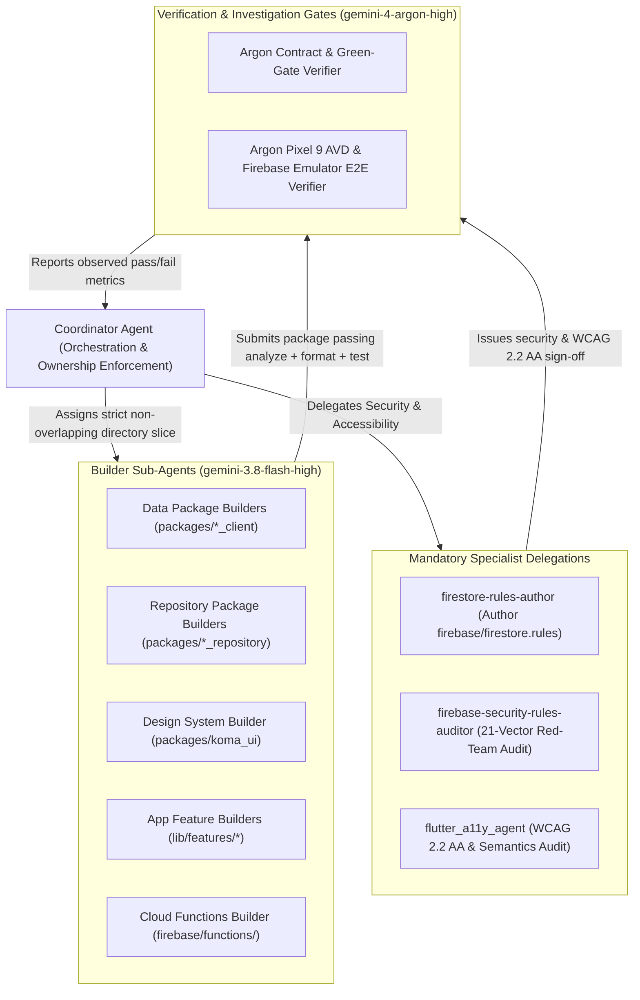
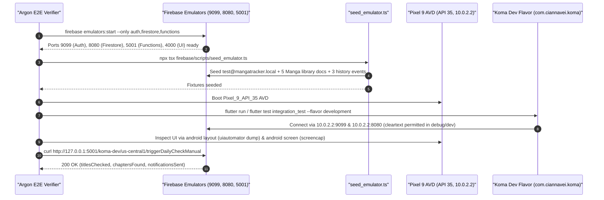

# AGENTS.md — Koma Multi-Agent Engineering Playbook

This document is the authoritative multi-agent orchestration manual for building, verifying, and shipping **Koma** (`com.ciannavei.koma`), an offline-first manga reading tracker built with **Flutter `3.47.9` / Dart `3.13.7`**, **Cloud Firestore**, **Cloud Functions v2 (Node.js 22)**, **Drift SQLite**, and the **MangaDex REST API v5**.

Every Coordinator, Builder Sub-Agent (`gemini-3.8-flash-high`), Verification Gate (`gemini-4-argon-high`), and Specialist Agent operating in this repository must follow the contracts and guardrails below.

---

## 1. Multi-Agent Topology & Model Division of Labor



### 1.1 When to Use `gemini-3.8-flash-high` vs `gemini-4-argon-high`

| Agent Tier | Pinned Model | Responsibilities | Strict Prohibitions |
| :--- | :--- | :--- | :--- |
| **Builder Sub-Agent** | `gemini-3.8-flash-high` | High-velocity implementation of isolated packages (`packages/*`), feature Blocs/views (`lib/features/*`), Cloud Functions (`firebase/functions/`), and unit/widget tests within an explicitly assigned directory slice. | **Never** edit files outside the assigned package/directory slice. **Never** modify another package's public barrel contract without Coordinator approval. |
| **Verification / Investigation Gate** | `gemini-4-argon-high` | Cross-package contract verification, live API edge-case investigation, Firestore scaling/cost modeling, multi-package `build_runner` resolution, and end-to-end Pixel 9 AVD integration verification. | **Never** silently rewrite a builder's production architecture without logging exact root-cause findings; **never** bypass failing tests or lower coverage gates. |
| **Security Rules Specialist** | `firestore-rules-author` + `firebase-security-rules-auditor` | Authoring `firebase/firestore.rules` and executing the 21-vector red-team security audit (`firebase_validate_security_rules` + `@firebase/rules-unit-testing`). | **Never** hand-roll production security rules in a general builder agent without running the `firestore-rules-author` -> `firebase-security-rules-auditor` pipeline. |
| **Accessibility Specialist** | `flutter_a11y_agent` | Auditing `packages/koma_ui` and `lib/features/*` against **WCAG 2.2 Level AA** on Android (TalkBack, 200% font scale, 48x48dp touch targets) and iOS (VoiceOver, Dynamic Type). | **Never** ship UI widgets with bare `GestureDetector`, unlabeled `IconButton`, fixed-height text containers, or `.withOpacity()` deprecations. |

---

## 2. Coordinator Rules & Zero-Collision File Ownership

1. **One Owner Per File / Package Slice**:
   Two agents editing the same file or running `build_runner` simultaneously in the same package is the primary multi-agent failure mode. Every `swarm{action: "add"}` brief must state:
   * **Owned Directory / Files**: Exact paths the worker may create or edit.
   * **Read-Only Dependencies**: Upstream barrel files and specification docs (`docs/01`–`docs/08`, `docs/investigations/argon-01`–`03`) the worker must consume without modifying.
   * **Definition of Done**: Exact quality gate commands (`analyze`, `format`, `test`, `coverage`) that must pass before posting completion.
2. **Use `workspace: "share"` for Concurrent Builders**:
   When spawning multiple `gemini-3.8-flash-high` builders that compile or run `flutter test` concurrently, pass `workspace: "share"` so each builder operates in an isolated working copy, then land/integrate its slice once verified.
3. **Doorbell Etiquette on the Swarm Board**:
   `@name` wakes an agent and costs a turn. Builders report back to `@coordinator` (or their designated `@verifier`) with observed test/coverage numbers—never post "acknowledged" or "starting work" noise.

### 2.1 Canonical Package Ownership Slices

| Slice ID | Owned Path | Layer | Allowed Local Dependencies | Test Runner |
| :--- | :--- | :--- | :--- | :--- |
| `slice-data-mangadex` | `packages/mangadex_api_client/` | Data (Pure Dart) | None (External only: `dio`, `retrofit`, `json_annotation`) | `dart test` |
| `slice-data-cache` | `packages/koma_cache_client/` | Data (Pure Dart) | None (External only: `drift`, `sqlite3`, `path`) | `dart test` |
| `slice-data-auth` | `packages/firebase_auth_client/` | Data (Flutter Plugin Wrapper) | None (`firebase_auth`, `google_sign_in`) | `flutter test` |
| `slice-data-firestore` | `packages/firestore_library_client/` | Data (Flutter Plugin Wrapper) | None (`cloud_firestore`) | `flutter test` |
| `slice-repo-auth` | `packages/auth_repository/` | Repository | `packages/firebase_auth_client` | `flutter test` |
| `slice-repo-manga` | `packages/manga_repository/` | Repository (Pure Dart) | `packages/mangadex_api_client`, `packages/koma_cache_client` | `dart test` |
| `slice-repo-library` | `packages/library_repository/` | Repository | `packages/firestore_library_client` | `flutter test` |
| `slice-repo-notif` | `packages/notifications_repository/` | Repository | `packages/firestore_library_client` (`+ firebase_messaging`) | `flutter test` |
| `slice-ui-design` | `packages/koma_ui/` | UI Design System | None (`flutter`, `cached_network_image`) | `flutter test` |
| `slice-feat-auth-search` | `lib/features/auth/`, `lib/features/search/` | Presentation & BLoC | `koma_ui`, `auth_repository`, `manga_repository` | `flutter test` |
| `slice-feat-lib-progress` | `lib/features/library/`, `lib/features/reader_progress/` | Presentation & BLoC | `koma_ui`, `library_repository`, `manga_repository` | `flutter test` |
| `slice-feat-hist-settings`| `lib/features/history/`, `lib/features/settings/` | Presentation & BLoC | `koma_ui`, `library_repository`, `auth_repository`, `notifications_repository` | `flutter test` |
| `slice-backend-firebase` | `firebase/` (`functions/`, `scripts/`, `firestore.*`) | Serverless Backend | Node.js 22 (`firebase-admin` v13, `firebase-functions` v6, `bottleneck`, `undici`) | `npm run build` |

---

## 3. Canonical Shared Contract (Non-Negotiable)

All agents must enforce this exact contract across Dart, TypeScript, and Security Rules:

* **App Name / Root Package / Bundle ID**: `Koma` / `koma` / `com.ciannavei.koma`
* **Product Boundary**: Pure Manga Progress Tracker (metadata search, volume/chapter progress, atomic "Mark Previous as Read", reading history timeline, daily chapter notifications, and external link to `https://mangadex.org/chapter/{chapterId}`). **Zero** in-app chapter image scraping or MangaDex@Home hosting.
* **Mandatory MangaDex `User-Agent`**:
  ```http
  User-Agent: Koma/0.1.0 (https://github.com/mattcianna/koma)
  ```
  Must be sent on **every** `api.mangadex.org` REST request (`Dio` interceptor + Cloud Functions `undici` client) AND **every** `uploads.mangadex.org` image request (`CachedNetworkImage.httpHeaders`).
* **Flutter / Dart SDK & Codegen Matrix**:
  * Flutter `3.47.9` / Dart `3.13.7` (`environment: sdk: ^3.13.0`, `flutter: ">=3.47.9"`)
  * Codegen versions **must** support Dart language version `3.13` (`analyzer >=13.0.0 <15.0.0`):
    * `build_runner: ^2.17.1`
    * `go_router: ^18.1.4` + `go_router_builder: ^4.5.3` (all `GoRouteData` classes **must** include `with $<ClassName>`)
    * `retrofit: ^4.10.0` + `retrofit_generator: ^10.3.3`
    * `json_annotation: ^4.12.0` + `json_serializable: ^6.15.2`
    * `drift: ^2.35.4` + `drift_dev: ^2.35.3` + `drift_flutter: ^0.3.1` + `sqlite3: ^3.9.1`
    * `very_good_analysis: ^11.0.0`
* **VGV 4-Layer Architecture Rules**:
  * Unidirectional flow: `Presentation -> Business Logic (Bloc/Cubit) -> Repository -> Data`.
  * **Zero inter-repository imports**: Repositories never import other repositories; cross-domain coordination happens exclusively in `Bloc`/`Cubit`.
  * **Barrel exports only**: Every package exports its public API via `lib/<package_name>.dart`. Direct imports of `package:*/src/*` outside the owning package are forbidden.
  * **Zero UI in Data/Repository layers**: `packages/*_client` and `packages/*_repository` never import `package:flutter/material.dart`, `cupertino.dart`, or `widgets.dart`.
  * **No `GoRouter` `extra` payloads**: Navigation uses only path parameters (`:id`) and query parameters (`?highlightChapter=...`).
* **Canonical Firestore Schema & `ReadingStatus` Enum**:
  * `ReadingStatus` Firestore strings: `'Reading'`, `'Plan to Read'`, `'Completed'`, `'On Hold'`, `'Dropped'` -> Dart `enum ReadingStatus { reading, planToRead, completed, onHold, dropped }`.
  * `users/{uid}`: `uid` (immutable), `email`, `displayName`, `photoUrl`, `uiLocale` (`'en' | 'it'`), `preferredLanguages` (`['en', 'it']`), `contentRatings` (`['safe', 'suggestive']`), `notificationsEnabled` (bool), `createdAt` (immutable), `updatedAt`.
  * `users/{uid}/devices/{deviceId}`: `token`, `platform` (`'android' | 'ios'`), `updatedAt`.
  * `users/{uid}/library/{mangaId}`: `mangaId` (immutable), `uid` (immutable), `title`, `coverFileName`, `status`, `preferredLanguages` (denormalized), `readChapters` (`List<String>`), `readVolumes` (`List<String>`), `lastReadChapter`, `lastReadChapterId`, `latestKnownChapterId`, `latestKnownChapterNumber`, `addedAt` (immutable), `updatedAt`.
  * `users/{uid}/reading_history/{eventId}`: `eventId` (immutable), `uid` (immutable), `mangaId` (immutable), `mangaTitle` (immutable), `coverFileName` (immutable), `actionType` (`'chapter_read' | 'volume_read' | 'bulk_previous_read'`, immutable), `chapterNumbers` (`List<String>`, immutable), `volumeNumber` (`String?`, immutable), `chaptersCount` (`int`, immutable), `timestamp` (immutable, indexed descending).
* **QA Test Account & Emulator Ports**:
  * `KOMA_TEST_EMAIL=test@mangatracker.local`
  * `KOMA_TEST_PASSWORD=KomaTest!2026#Dev`
  * `KOMA_TEST_UID=koma-test-uid-001`
  * Emulator Ports: Auth `9099`, Firestore `8080`, Functions `5001`, UI `4000` (`10.0.2.2` on Android AVD, `127.0.0.1` on iOS Simulator / macOS host).

---

## 4. Mandatory Specialist Delegations

### 4.1 Firestore Security Rules (`firestore-rules-author` + `firebase-security-rules-auditor`)

> [!IMPORTANT]
> Production `firebase/firestore.rules` **must never** be finalized by a general builder agent alone.
> 1. **Authoring**: Invoke the `firestore-rules-author` subagent (or follow its skill guidelines) using the canonical data model in `docs/03-firestore-schema-and-security-rules.md` and the scaling/security findings in `docs/investigations/argon-02-firestore-scaling-and-security.md`.
> 2. **Red-Team Verification**: Invoke the `firebase-security-rules-auditor` specialist skill to audit `firebase/firestore.rules` across all 21 attack vectors (authentication bypass, cross-user path traversal, `collectionGroup('library')` client leak, `update` bypassing `create` validators, immutable field tampering on `uid`/`mangaId`/`createdAt`/`addedAt`/`timestamp`, 1 MiB payload DoS, and unbounded list growth) and validate syntax via `firebase_validate_security_rules` + emulator unit tests (`@firebase/rules-unit-testing`).

### 4.2 Flutter UI Accessibility (`flutter_a11y_agent` / `accessibility` Skill)

> [!IMPORTANT]
> Every widget in `packages/koma_ui` and every feature screen in `lib/features/*` **must** undergo a **WCAG 2.2 Conformance Level AA** audit on **Android** and **iOS** via `flutter_a11y_agent` (and the `accessibility` skill):
> * **Target Size**: Minimum `48x48 dp` interactive hit targets (VGV standard exceeding WCAG 2.5.8 AA 24dp).
> * **Contrast**: Normal text >= `4.5:1`, large text & UI components >= `3.0:1` across both Light (*Warm Washi* `#FAF8F5`) and Dark (*Sumi Ink OLED* `#0D0D10`) themes.
> * **Semantics & TalkBack/VoiceOver**: Explicit `Semantics(button: true, label: ...)` on custom cards, `Tooltip` on every `IconButton`, `excludeFromSemantics: true` on decorative backdrops, and `Semantics(liveRegion: true)` on async progress updates.
> * **Text Scaling & RTL**: Clean layout reflow up to `200%` font scaling (`no fixed-height text containers`), and `EdgeInsetsDirectional` / `AlignmentDirectional` used throughout.
> * **Reduced Motion**: Gate transitions on `MediaQuery.disableAnimationsOf(context)`.

---

## 5. Autonomous Quality Gates (`green-gate` Standard)

Before any Builder Sub-Agent marks its slice complete—and during every Argon Verification Gate—the package must pass all four quality gates in a **single final iteration** with observed numbers:

### 5.1 Gate Execution Order (`analyze -> format -> test -> coverage`)

1. **Gate 1 — Analyze (`zero errors, zero warnings`)**:
   * Run `mcp__dart__analyze_files` on the package root (or `dart analyze --fatal-infos --fatal-warnings`).
   * Ensure `analysis_options.yaml` includes `package:very_good_analysis/analysis_options.yaml` and excludes `**/*.g.dart`, `**/*.drift.dart`, and `lib/l10n/gen/**`.
   * Never use `.withOpacity(...)` on Flutter `3.47.9`; always use `.withValues(alpha: ...)`.
2. **Gate 2 — Format (`zero unformatted files`)**:
   * Run `mcp__dart__dart_format` on the package root (or `dart format --output=none --set-exit-if-changed .`).
3. **Gate 3 — Unit & Widget Tests (`100% passing`)**:
   * Run `mcp__very-good-cli__test` with `directory: 'packages/<pkg_name>'`, `coverage: true`, `min_coverage: 100` (or `>= 90` per phase gate), `check_ignore: true`, `timeout_seconds: 120`, and `exclude_coverage: '**/*.{g,freezed,gen,drift}.dart'`.
   * Follow the `testing` skill: private `_Mock*` classes via `package:mocktail`, `setUp` inside `group`, `pumpApp` helper for widget tests, and `pump()` instead of unbounded `pumpAndSettle()` when animations or progress indicators are active.
4. **Gate 4 — Line Coverage Verification**:
   * Inspect `<package>/coverage/lcov.info` to confirm every hand-written source file meets the coverage threshold without `// coverage:ignore-file` workarounds on reachable logic.

---

## 6. Pixel 9 AVD E2E & Firebase Emulator Workflow

End-to-end verification runs hermetically against the **Firebase Local Emulator Suite** and the **Google Pixel 9 Android 15 (API 35) AVD**.



### 6.1 Step-by-Step E2E Execution Checklist

1. **Start the Firebase Local Emulator Suite**:
   ```bash
   cd firebase
   npm --prefix functions run build
   firebase emulators:start --only auth,firestore,functions
   ```
2. **Seed the Deterministic QA Account & Library Fixtures**:
   ```bash
   cd firebase
   npx tsx scripts/seed_emulator.ts
   ```
   Verifies that `test@mangatracker.local` (`UID: koma-test-uid-001`) is provisioned with *Chainsaw Man*, *Frieren*, *Dungeon Meshi*, *Berserk*, and *Oshi no Ko* across all reading statuses.
3. **Boot & Verify the Pixel 9 AVD**:
   ```bash
   # Launch Pixel 9 AVD (1080x2424, 422 dpi, API 35)
   emulator -avd Pixel_9_API_35 -no-snapshot-load -netdelay none -netspeed full &
   adb wait-for-device
   ```
4. **Ensure Debug Requirements Are Active**:
   * `android/app/src/debug/res/xml/network_security_config.xml` (and `src/development/res/xml/network_security_config.xml`) allows cleartext HTTP **only** to `10.0.2.2`, `127.0.0.1`, and `localhost`.
   * `lib/main_development.dart` calls `SemanticsBinding.instance.ensureSemantics()` in `kDebugMode` so the Android `AccessibilityNodeInfo` tree is immediately populated for `uiautomator dump`.
   * Notification channel `koma_manga_releases` (`IMPORTANCE_HIGH`) is created at startup and `POST_NOTIFICATIONS` permission is granted (`adb shell pm grant com.ciannavei.koma.dev android.permission.POST_NOTIFICATIONS`).
5. **Run Automated Integration Tests & Inspect Layout/Screen**:
   ```bash
   # Execute Flutter integration test suite on Pixel 9 AVD
   flutter test integration_test/library_flow_test.dart \
     --flavor development \
     --dart-define=USE_FIREBASE_EMULATOR=true \
     -d Pixel_9_API_35

   # Dump live semantics / layout hierarchy
   adb exec-out uiautomator dump /dev/tty

   # Capture visual verification screenshot
   adb exec-out screencap -p > /tmp/koma_pixel9_verified.png
   ```

---

## 7. Reference Documentation Index

| Document | Scope |
| :--- | :--- |
| [01 — System Architecture & Data Flow](./docs/01-system-architecture-and-data-flow.md) | C4 Context/Container diagrams, sequence flows, offline-first architecture |
| [02 — Flutter Monorepo Structure & Packages](./docs/02-flutter-monorepo-structure-and-packages.md) | 4-layer VGV package tree, `pubspec.yaml` specs, `GoRouter`, `l10n`, flavor bootstrap |
| [03 — Firestore Schema & Security Rules](./docs/03-firestore-schema-and-security-rules.md) | Document schemas, `firestore.indexes.json`, atomic `WriteBatch`, prototype `firestore.rules` |
| [04 — MangaDex API Integration Guide](./docs/04-mangadex-api-integration-guide.md) | Endpoints, `User-Agent`, `/aggregate` parser, natural chapter comparator, token-bucket rate limiter |
| [05 — Cloud Functions Notification Scheduler](./docs/05-cloud-functions-notification-scheduler.md) | Node.js 22 Cloud Functions v2 daily release poller, subscriber deduplication, FCM multicast & token pruning |
| [06 — Test Account, Emulator & Pixel 9 Setup](./docs/06-test-account-emulator-and-pixel9-setup.md) | `firebase.json`, `seed_emulator.ts`, `10.0.2.2` network security config, Pixel 9 AVD & QA bypass |
| [07 — Agentic Implementation Roadmap](./docs/07-agentic-implementation-roadmap.md) | 7-phase implementation plan pairing Flash Builder Sub-Agents with Argon Verification Gates |
| [08 — Design System & Starting Graphics](./docs/08-design-system-and-starting-graphics.md) | *"Manga Ink & Vermilion"* M3 color tokens, `ThemeExtension`s, 7 `koma_ui` widgets, starting graphics gallery |
| [Argon 01 — MangaDex Live Edge Cases](./docs/investigations/argon-01-mangadex-live-edge-cases.md) | Empirical live `curl` verification of MangaDex v5 payloads, PHP `[]` vs `{}` quirk, timestamp & CDN rules |
| [Argon 02 — Firestore Scaling & Security Audit](./docs/investigations/argon-02-firestore-scaling-and-security.md) | 1 MiB document math for 1,500+ chapter manga, 500-op `WriteBatch` math, scheduler capacity & 21-vector rules audit |
| [Argon 03 — Monorepo & Agentic Audit](./docs/investigations/argon-03-monorepo-and-agentic-audit.md) | Flutter `3.47.9` / Dart `3.13.7` compatibility matrix, Pixel 9 API 35/36 traps, cross-doc discrepancy register |
