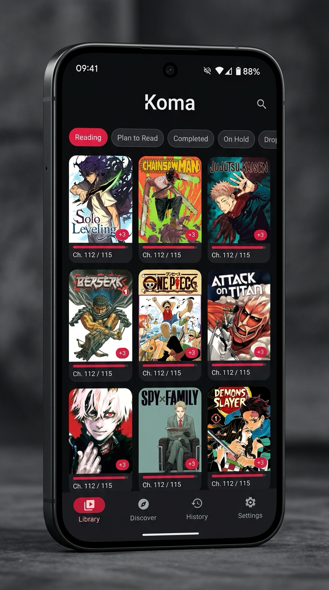
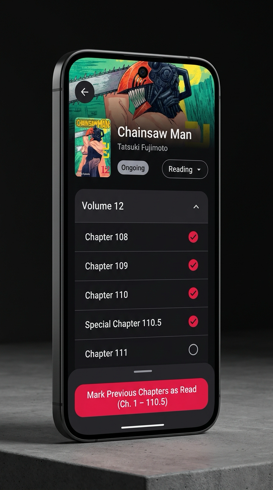
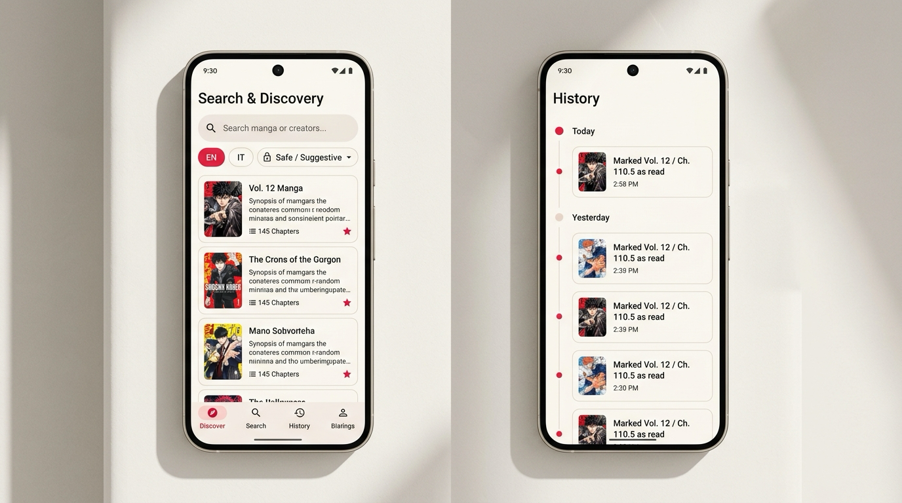
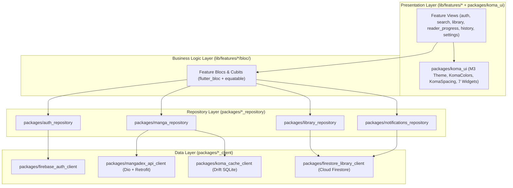

# Koma (コマ) — Manga Ink & Vermilion Reading Tracker


> **License**: MIT | **Bundle ID**: `com.ciannavei.koma` | **SDK**: Flutter `3.47.9` / Dart `3.13.7` (`sdk: ^3.13.0`) | **Architecture**: VGV 4-Layer Monorepo | **Backend**: Firebase Auth, Cloud Firestore, Cloud Functions v2 (Node.js 22), FCM & MangaDex API v5

**Koma** (コマ — the Japanese word for an individual manga panel) is an open-source, offline-first manga reading tracker for **Android** and **iOS**. Designed around the **"Manga Ink & Vermilion"** aesthetic (*Warm Washi Paper* `#FAF8F5` in daylight, *Sumi Ink OLED* `#0D0D10` at night, and *Vermilion Hanko Seal* focal accents), Koma lets readers discover series via MangaDex v5, track chapter and volume progress without ad clutter, receive automated release notifications, and jump cleanly into external licensed or community readers.

---

## Brand Identity & Starting UI Gallery

### App Icon (`1024x1024` Adaptive, Material You Monochrome & iOS Squircle)


### UI Concept Gallery (`1080x2424`)

| Library Grid (Sumi Ink OLED Dark) | Manga Detail & Progress Tracker | Search & Discover (Warm Washi Light) |
| :---: | :---: | :---: |
|  |  |  |

### Custom State Illustrations

| Empty Library State | Empty Search State |
| :---: | :---: |
|  |  |

---

## Core Product Capabilities

* **3-Section Actionable Home & 1-Tap Progress**: Organizes your library into **To Read**, **Caught Up**, and collapsible **On Hold / Finished**, with a 1-tap **`Read Ch. X`** button right on unread cards so weekly chapters can be marked read without opening the full chapter tree.
* **Fast Detail Navigation & Atomic Bulk Catch-Up**: Auto-expands the first volume containing unread chapters, offers a top **`Mark Ch. X as read`** action, and lets you long-press any chapter row (`KomaBulkReadSheet`) to atomically mark chapters `1..N` as read while appending an immutable event in `users/{uid}/reading_history/{eventId}` via a single Firestore `WriteBatch`.
* **Pure Tracker Etiquette (Zero Scraping)**: Queries MangaDex v5 metadata (`GET /manga`, `GET /manga/{id}/aggregate`, `GET /manga/{id}/feed`) with an honest `User-Agent: Koma/0.1.0 (https://github.com/mattcianna/koma)` and a client-side token-bucket rate limiter (`<= 4 req/s`). Links directly to `https://mangadex.org/chapter/{id}` (or external official publisher links) to read.
* **Official Publisher RSS/Atom Feed Discovery**: Supplements MangaDex feed polling with official publisher RSS/Atom release feeds (e.g., MangaPlus / Magazine Pocket / Young Jump) on both the mobile client and Cloud Functions backend so chapters ahead of fan scanlations still trigger unread badges and alerts.
* **Dual-Tier Offline-First Engine**:
  * **Cloud Firestore Native Offline Persistence**: Instant local reads and queued offline writes for library progress and reading history.
  * **Drift SQLite Local Cache (`packages/koma_cache_client`)**: Caches series metadata (24h TTL) and language-keyed `/aggregate` chapter hierarchies (30m TTL).
* **Scheduled Release Notifier**: Node.js 22 Cloud Functions v2 (`checkDailyMangaReleases`, `0 */2 * * *` UTC) deduplicates active `'Reading'` subscriptions across `(mangaId, preferredLanguages)`, checks for new chapters within rate limits, dispatches localized (`EN`/`IT`) FCM multicast notifications, and prunes stale device tokens.
* **Bilingual & WCAG 2.2 AA Accessible**: OS-driven `EN` / `IT` localization (`app_en.arb`, `app_it.arb`), TalkBack/VoiceOver semantics (`2.5.3` Label in Name), `>= 48x48dp` interactive targets, tested up to `200%`–`300%` font scaling, RTL-safe directional spacing, and Android adaptive + Material You monochrome launcher icons.

---

## VGV 4-Layer Monorepo Architecture

Koma enforces unidirectional dependencies (`Presentation -> Business Logic -> Repository -> Data`) across 9 modular packages under `packages/` and feature modules under `lib/features/`:



---

## Quick Start

Personal Firebase credentials are decoupled from Git. Pick either the zero-setup **Local Emulator** flow or connect **your own Firebase project**.

### Option 1: Local Firebase Emulator (Zero Cloud Setup)

Runs cleanly out of the box with the `demo-koma` emulator configuration—no Firebase Console project needed:

```bash
# 1. Start Firebase Local Emulators (Auth: 9099, Firestore: 8080, Functions: 5001, UI: 4000)
cd firebase
npm --prefix functions install && npm --prefix functions run build
npm --prefix scripts install
firebase emulators:start --only auth,firestore,functions --project demo-koma &

# 2. Seed deterministic QA test user (test@mangatracker.local) & sample library
npx tsx scripts/seed_emulator.ts
cd ..

# 3. Run Flutter dependencies, codegen/l10n, and launch Development flavor
flutter pub get
flutter gen-l10n
flutter run --flavor development -t lib/main_development.dart --dart-define=USE_FIREBASE_EMULATOR=true
```

> On Android emulators, `bootstrap.dart` maps host loopback automatically; on physical devices or custom setups pass `--dart-define=FIREBASE_EMULATOR_HOST=<LAN_IP>`.

### Option 2: Bring Your Own Firebase Project (Production / Staging)

1. Create a Firebase project and enable **Authentication** (Email/Password + Google Sign-In) and **Cloud Firestore**.
2. Copy the local config templates and populate your project values (all local overrides are `.gitignore`d):
   ```bash
   cp .env.firebase.json.example .env.firebase.json
   cp firebase/.firebaserc.example firebase/.firebaserc
   cp ios/Flutter/FirebaseLocal.xcconfig.example ios/Flutter/FirebaseLocal.xcconfig
   # Also download your real google-services.json -> android/app/google-services.json
   # and GoogleService-Info.plist -> ios/Runner/GoogleService-Info.plist
   ```
   *(You can also copy values generated by `flutterfire configure` into `.env.firebase.json`.)*
3. Deploy Firestore rules, indexes, and (optionally, requires Blaze plan) Cloud Functions:
   ```bash
   cd firebase
   firebase deploy --only firestore:rules,firestore:indexes
   npm --prefix functions run build && firebase deploy --only functions
   cd ..
   ```
4. Build or run with your local `.env.firebase.json`:
   ```bash
   flutter run --flavor production -t lib/main_production.dart --dart-define-from-file=.env.firebase.json
   # Or build a release APK:
   flutter build apk --flavor production -t lib/main_production.dart --dart-define-from-file=.env.firebase.json
   ```

---

## Running Tests & Quality Gates

```bash
# Formatting & static analysis
dart format --output=none --set-exit-if-changed packages/ lib/ test/
dart analyze --fatal-infos --fatal-warnings

# Design system package tests
(cd packages/koma_ui && dart analyze --fatal-infos --fatal-warnings && flutter test)

# Pure-Dart client/repository tests (example: MangaDex client)
(cd packages/mangadex_api_client && dart analyze --fatal-infos --fatal-warnings && dart test)

# App unit & widget test suite
flutter test

# Cloud Functions TypeScript build
npm --prefix firebase/functions run build
```

---

## Documentation & Investigation Index

### Engineering Playbook

| Document | Description |
| :--- | :--- |
| [**`AGENTS.md`**](./AGENTS.md) | Multi-agent playbook: ownership slices, canonical shared contract, specialist delegations (`firestore-rules-author`, `firebase-security-rules-auditor`, `flutter_a11y_agent`), quality gates, and E2E workflow. |

### Baseline Architecture & Implementation Specifications (`docs/01`–`docs/08`)

| # | Document | Summary |
| :---: | :--- | :--- |
| **01** | [**System Architecture & Data Flow**](./docs/01-system-architecture-and-data-flow.md) | C4 Context & Container diagrams, Firestore + Drift SQLite storage tiers, and end-to-end sequence flows. |
| **02** | [**Flutter Monorepo Structure & Packages**](./docs/02-flutter-monorepo-structure-and-packages.md) | Complete VGV 4-layer directory tree, dependency rules, `GoRouter` typed routes, EN/IT ARB bundles, and flavor bootstrap. |
| **03** | [**Firestore Schema & Security Rules**](./docs/03-firestore-schema-and-security-rules.md) | Schemas for `users/{uid}`, `devices`, `library`, and `reading_history`, composite indexes (`firestore.indexes.json`), and atomic `WriteBatch` operations. |
| **04** | [**MangaDex API Integration Guide**](./docs/04-mangadex-api-integration-guide.md) | REST v5 endpoints, `User-Agent`, CDN cover resolver, defensive `/aggregate` parser, natural decimal chapter comparator, and token-bucket rate limiter. |
| **05** | [**Cloud Functions Notification Scheduler**](./docs/05-cloud-functions-notification-scheduler.md) | TypeScript Node.js 22 Cloud Functions v2 release poller, subscriber deduplication, localized FCM multicast, and token pruning. |
| **06** | [**Test Account, Emulator & Pixel 9 Setup**](./docs/06-test-account-emulator-and-pixel9-setup.md) | `firebase.json` emulator suite (`9099`, `8080`, `5001`, `4000`), `seed_emulator.ts`, `10.0.2.2` debug `network_security_config.xml`, and `DevQuickLoginButton`. |
| **07** | [**Agentic Implementation Roadmap**](./docs/07-agentic-implementation-roadmap.md) | 7-phase implementation roadmap from repo init to E2E sign-off. |
| **08** | [**Design System & Starting Graphics**](./docs/08-design-system-and-starting-graphics.md) | *"Manga Ink & Vermilion"* color palettes, WCAG 2.2 AA contrast tables, `KomaColors` & `KomaSpacing` `ThemeExtension`s, and `packages/koma_ui` widget gallery. |

### Technical Audits & Empirical Investigations (`docs/investigations/`)

| ID | Investigation Report | Summary |
| :---: | :--- | :--- |
| **Argon-01** | [**MangaDex Live Edge Cases**](./docs/investigations/argon-01-mangadex-live-edge-cases.md) | Live `curl` verification against `api.mangadex.org` and `uploads.mangadex.org`, PHP `[]` vs `{}` quirk, timestamp validation, and CDN anti-hotlink behavior. |
| **Argon-02** | [**Firestore Scaling & Security Audit**](./docs/investigations/argon-02-firestore-scaling-and-security.md) | UTF-8 1 MiB document math for 1,500+ chapter manga, 500-op `WriteBatch` boundary verification, Cloud Function rate-limit capacity modeling, and 21-vector Security Rules red-team audit. |
| **Argon-03** | [**Monorepo, Pixel 9 AVD & Cross-Doc Audit**](./docs/investigations/argon-03-monorepo-and-agentic-audit.md) | Flutter `3.47.9` / Dart `3.13.7` compatibility audit, pure-Dart vs Flutter plugin test runner isolation, Pixel 9 API 35/36 traps, and cross-document discrepancy register. |

---

## License

Released under the [MIT License](./LICENSE).
