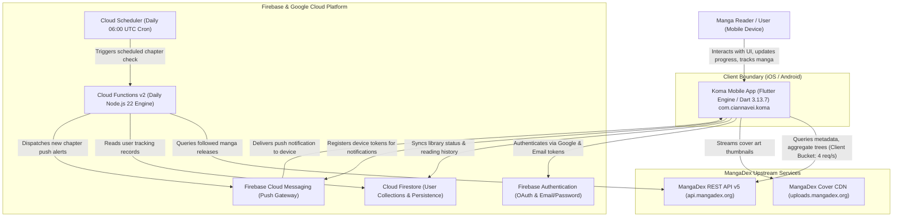
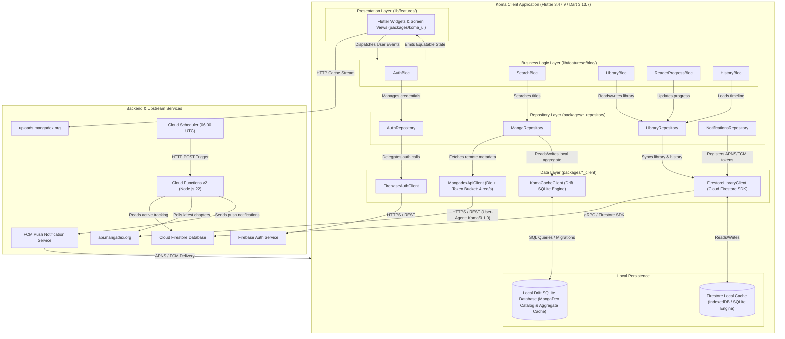
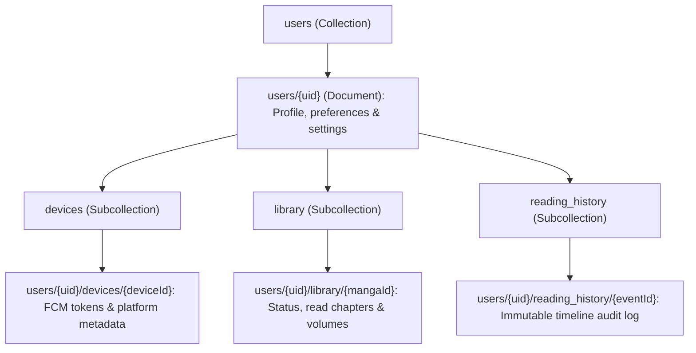
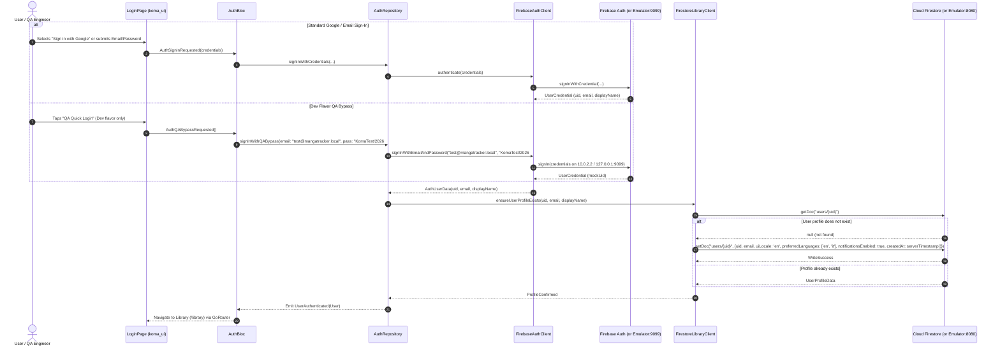
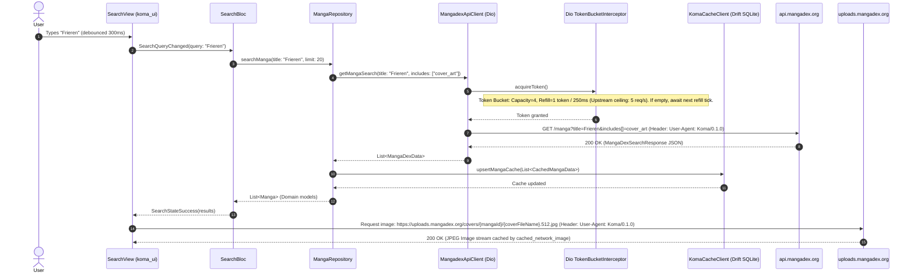
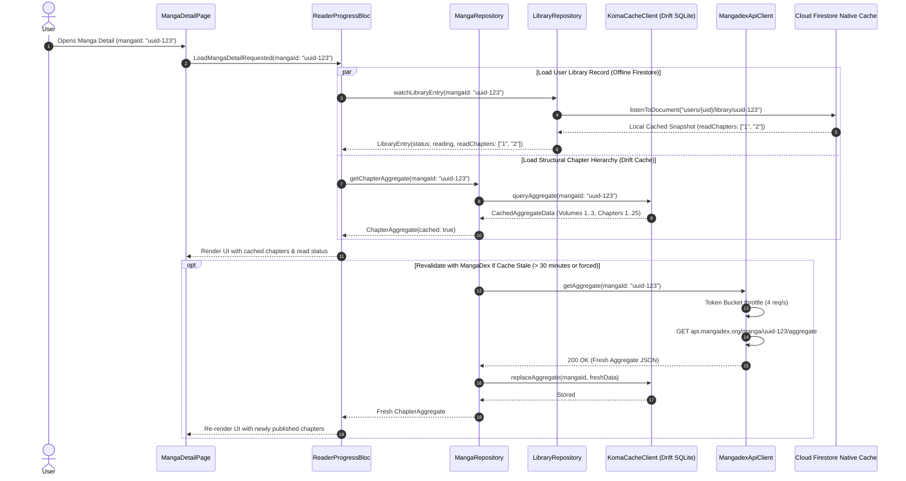
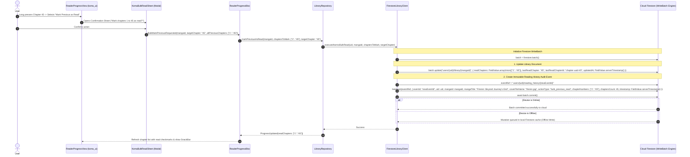
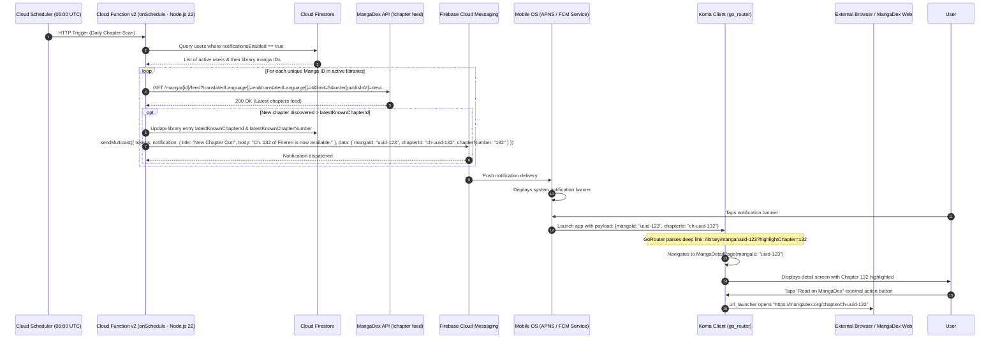

# Koma — System Architecture and Data Flow

This document specifies the end-to-end system architecture, service topology, data models, caching tiers, and interaction flows for **Koma** (`com.ciannavei.koma`), an offline-first manga reading tracker built with Flutter, Firebase, Drift SQLite, and the MangaDex API v5.

---

## 1. Architectural Principles and System Tenets

Koma is intentionally architected as a **pure tracker** rather than an image reader. It delivers high-fidelity reading tracking, metadata discovery, chapter/volume progress synchronization, and notification triggers without hosting or scraping manga image scans. The architecture conforms to five non-negotiable tenets:

1. **Strict Upstream Etiquette & Zero Scraping**:
   All communication with MangaDex (`api.mangadex.org` and `uploads.mangadex.org`) is strictly rate-limited: while MangaDex enforces an upstream ceiling of 5 requests per second per IP, Koma's client-side token bucket conservatively caps outgoing traffic at 4 requests per second (250ms interval) to provide a safety margin against 429 rate limit triggers. Requests identify themselves with the immutable User-Agent:
   ```http
   User-Agent: Koma/0.1.0 (https://github.com/mattcianna/koma)
   ```
   No web-scraping or non-API endpoints are used.

2. **Unidirectional Layered Monorepo Architecture**:
   The Flutter client strictly follows the Very Good Ventures (VGV) 4-Layer monorepo specification:
   `Presentation -> Business Logic (Bloc/Cubit) -> Repository -> Data`
   - Data and Repository layers reside in standalone packages in `packages/`.
   - Data packages contain zero Flutter dependencies and zero domain business rules.
   - Repositories never import other repositories and expose pure domain models extending `Equatable`.
   - The Presentation layer interacts solely through BLoC events and states.

3. **Multi-Tier Offline-First Reliability**:
   The app provides an instant, offline-available user experience through two complementary storage tiers:
   - **Cloud Firestore Native Offline Persistence**: Provides local LRU caching and an offline write mutation queue for user libraries, reading status, and history.
   - **Local Drift (SQLite) Cache**: Stores MangaDex catalog metadata, search indices, and structural chapter/volume hierarchies (`/aggregate` responses) to minimize upstream bandwidth and eliminate redundant network hops.

4. **Atomic Progress & Event Immutability**:
   Reading progress mutations (marking individual chapters, entire volumes, or bulk "Mark Previous as Read") are executed as atomic operations (`WriteBatch`) across the user's library document and an immutable, append-only reading history subcollection (`reading_history`).

5. **Cloud-Orchestrated Notifications**:
   A daily serverless Cloud Function v2 (`onSchedule`, Node.js 22, executing at 06:00 UTC) scans library subscriptions, queries MangaDex feeds for new chapter drops, updates user catalog pointers, and broadcasts localized push notifications through Firebase Cloud Messaging (FCM).

---

## 2. High-Level C4 Context Architecture

The C4 Context diagram illustrates how Koma integrates within its external environment, interacting with the user, MangaDex infrastructure, and Google Cloud/Firebase services.



---

## 3. C4 Container Architecture

The C4 Container diagram details the internal software systems, client packages, storage tiers, and external protocol boundaries.



### Container Responsibility Matrix

| Container / Package | Runtime | Responsibility | Storage / Protocol |
|---|---|---|---|
| `koma` (Root App) | Flutter 3.47.9 / Dart 3.13.7 | App bootstrap, DI container, `go_router` navigation, feature orchestration | In-memory Flutter state |
| `packages/koma_ui` | Flutter SDK | Reusable widgets, Material 3 theming, typography, color system | Visual rendering |
| `packages/mangadex_api_client` | Pure Dart (No Flutter) | Dio client, Retrofit API endpoints, Token Bucket rate-limiter, User-Agent interceptor | HTTPS REST with JSON serialization |
| `packages/koma_cache_client` | Pure Dart (No Flutter) | Drift SQLite table definitions, queries, migrations, aggregate serialization | SQLite file (`koma_cache.db`) |
| `packages/firebase_auth_client` | Pure Dart (No Flutter) | Wraps Google Sign-In and Firebase Auth SDK, auth status streams | OAuth2 / Secure Token Storage |
| `packages/firestore_library_client` | Pure Dart (No Flutter) | Firestore SDK bridge, atomic `WriteBatch`, document serialization | Native gRPC + local offline queue |
| `packages/auth_repository` | Pure Dart (No Flutter) | Domain models (`User`), auth state mapping, exception sanitization | Stream-based domain state |
| `packages/manga_repository` | Pure Dart (No Flutter) | Manga search, detail retrieval, SWR caching combining Drift and MangaDex | Domain models (`Manga`, `ChapterAggregate`) |
| `packages/library_repository` | Pure Dart (No Flutter) | Library status management, progress updates, reading history streams | Domain models (`LibraryEntry`, `HistoryEvent`) |
| `packages/notifications_repository` | Pure Dart (No Flutter) | Device FCM token syncing, push permission orchestration | Native APNS/FCM channels |
| `Cloud Functions v2` | Node.js 22 / TypeScript | Daily scheduled chapter check (06:00 UTC), delta calculation, FCM multicast | Cloud Scheduler HTTP trigger |

---

## 4. Canonical Data Models and Storage Specifications

### 4.1 Cloud Firestore Document Schemas

All Firestore paths adhere to an immutable user scoping hierarchy: `users/{uid}/...`. Security rules strictly enforce `request.auth.uid == uid`.



#### 1. User Profile Document: `users/{uid}`
- `uid`: `String` *(Immutable)* — Firebase Auth UID.
- `email`: `String` — User's email address.
- `displayName`: `String?` — User's display name or nickname.
- `photoUrl`: `String?` — Profile avatar URI.
- `uiLocale`: `String` — Selected UI language (`'en'` or `'it'`).
- `preferredLanguages`: `List<String>` — Content languages for chapter releases (e.g., `['en', 'it']`).
- `contentRatings`: `List<String>` — Allowed MangaDex content ratings (e.g., `['safe', 'suggestive']`).
- `notificationsEnabled`: `bool` — Global notification master toggle.
- `createdAt`: `Timestamp` *(Immutable)* — Server timestamp on creation.
- `updatedAt`: `Timestamp` — Server timestamp on last mutation.

#### 2. Device Registration Document: `users/{uid}/devices/{deviceId}`
- `token`: `String` — Firebase Cloud Messaging (FCM) registration token.
- `platform`: `String` — Client platform identifier (`'android'` or `'ios'`).
- `updatedAt`: `Timestamp` — Last token refresh timestamp.

#### 3. Library Entry Document: `users/{uid}/library/{mangaId}`
- `mangaId`: `String` *(Immutable)* — MangaDex UUID for the series.
- `uid`: `String` *(Immutable)* — Owner user UID.
- `title`: `String` — Primary localized or romanized title.
- `coverFileName`: `String` — File name of the cover image for CDN URL generation.
- `status`: `String` — Serialized reading status (`'Reading'`, `'Plan to Read'`, `'Completed'`, `'On Hold'`, `'Dropped'`).
- `preferredLanguages`: `List<String>` — Specific languages tracked for this manga.
- `readChapters`: `List<String>` — Array of completed chapter identifiers/numbers (e.g., `['1', '2', '2.5', '3']`).
- `readVolumes`: `List<String>` — Array of completed volume identifiers/numbers (e.g., `['1', '2']`).
- `lastReadChapter`: `String?` — Human-readable number of the most recently read chapter (e.g., `'104'`).
- `lastReadChapterId`: `String?` — MangaDex UUID of the most recently read chapter.
- `latestKnownChapterId`: `String?` — MangaDex UUID of the newest available release discovered by background polling.
- `latestKnownChapterNumber`: `String?` — Chapter number string of newest release.
- `addedAt`: `Timestamp` *(Immutable)* — Initial library entry creation timestamp.
- `updatedAt`: `Timestamp` — Last mutation timestamp.

#### 4. Reading History Document: `users/{uid}/reading_history/{eventId}`
- `eventId`: `String` *(Immutable)* — Unique event UUID.
- `uid`: `String` *(Immutable)* — Owner user UID.
- `mangaId`: `String` *(Immutable)* — MangaDex UUID of the manga series.
- `mangaTitle`: `String` *(Immutable)* — Snapshot of manga title at event creation.
- `coverFileName`: `String` *(Immutable)* — Snapshot of cover image filename.
- `actionType`: `String` *(Immutable)* — Enum token: `'chapter_read'`, `'volume_read'`, or `'bulk_previous_read'`.
- `chapterNumbers`: `List<String>` *(Immutable)* — List of chapter numbers affected by this action.
- `volumeNumber`: `String?` *(Immutable)* — Volume number affected, if applicable.
- `chaptersCount`: `int` *(Immutable)* — Total count of chapters marked in this transaction.
- `timestamp`: `Timestamp` *(Immutable)* — Server timestamp recording the event.

---

### 4.2 Local Drift (SQLite) Schema

Drift stores metadata locally to enable sub-millisecond search query filtering and zero-latency loading of chapter aggregation trees without hitting MangaDex endpoints repeatedly. In accordance with `docs/04` Section 6.2, local storage is partitioned into two specialized cache tables with distinct time-to-live (TTL) policies:

1. **`MangaMetadataCache` (24-Hour TTL)**: Caches search and catalog metadata payloads for 24 hours.
2. **`MangaAggregateCache` (30-Minute TTL)**: Caches structural chapter/volume hierarchies from `/manga/{id}/aggregate` partitioned by composite primary key `(manga_id, languages_key)` with a 30-minute TTL, ensuring new chapter releases are surfaced promptly while preventing redundant upstream queries.

```sql
-- Cached MangaDex Catalog Entry (MangaMetadataCache - 24-Hour TTL)
CREATE TABLE manga_metadata_cache (
    manga_id TEXT NOT NULL PRIMARY KEY,
    json_payload TEXT NOT NULL,
    cached_at INTEGER NOT NULL, -- Epoch milliseconds
    expires_at INTEGER NOT NULL -- Epoch milliseconds (cached_at + 24 hours)
);

-- Cached Chapter Aggregate Hierarchy (MangaAggregateCache - 30-Minute TTL)
CREATE TABLE manga_aggregate_cache (
    manga_id TEXT NOT NULL,
    languages_key TEXT NOT NULL, -- e.g. "en,it"
    json_payload TEXT NOT NULL,  -- Serialized MangaDex /aggregate JSON
    cached_at INTEGER NOT NULL,  -- Epoch milliseconds
    expires_at INTEGER NOT NULL, -- Epoch milliseconds (cached_at + 30 minutes)
    PRIMARY KEY (manga_id, languages_key),
    FOREIGN KEY (manga_id) REFERENCES manga_metadata_cache(manga_id) ON DELETE CASCADE
);

-- Index for instant aggregate retrieval by manga and language filter
CREATE INDEX idx_aggregate_manga_lang ON manga_aggregate_cache(manga_id, languages_key);
```

#### Drift Table Definitions (`packages/koma_cache_client`)

```dart
import 'package:drift/drift.dart';

class MangaMetadataCache extends Table {
  TextColumn get mangaId => text()();
  TextColumn get jsonPayload => text()();
  DateTimeColumn get cachedAt => dateTime()();
  DateTimeColumn get expiresAt => dateTime()();

  @override
  Set<Column> get primaryKey => {mangaId};
}

class MangaAggregateCache extends Table {
  TextColumn get mangaId => text()();
  TextColumn get languagesKey => text()(); // e.g. "en,it"
  TextColumn get jsonPayload => text()();
  DateTimeColumn get cachedAt => dateTime()();
  DateTimeColumn get expiresAt => dateTime()();

  @override
  Set<Column> get primaryKey => {mangaId, languagesKey};
}
```

---

## 5. End-to-End Sequence Diagrams & Data Flows

### 5.1 Flow A: Authentication & User Provisioning

Koma supports three distinct authentication pathways:
1. **Google Sign-In**: Native Google OAuth credential exchange.
2. **Email & Password**: Standard Firebase Auth credential validation.
3. **Development QA Bypass**: Automated test harness authentication using:
   - Email: `test@mangatracker.local`
   - Password: `KomaTest!2026#Dev`
   - Configured against the Firebase Auth Emulator on port `9099`.



---

### 5.2 Flow B: Manga Search, Rate-Limited Dio Token Bucket & Cover Art Resolution

MangaDex enforces a strict limit of 5 requests per second per IP address. Exceeding this triggers an HTTP 429 response. Koma implements a proactive client-side token bucket interceptor inside `MangadexApiClient` to throttle outgoing traffic before it leaves the device.



---

### 5.3 Flow C: Offline-First Library & Manga Detail `/aggregate` Cache Flow

When a user opens a manga detail screen, the application employs a Stale-While-Revalidate (SWR) strategy. The structural tree of chapters and volumes is loaded instantly from local SQLite storage, while a background sync verifies if upstream updates occurred on MangaDex.



---

### 5.4 Flow D: Granular Progress & Atomic "Mark Previous as Read" Transaction

When a user finishes chapter 45 and taps "Mark Previous as Read", Koma must execute an all-or-nothing mutation. It updates the tracking state of all chapters up to chapter 45 and registers a single history event audit record. A Firestore `WriteBatch` guarantees that if any part fails or loses connectivity, the entire transaction is preserved locally in the offline queue and committed atomically to the server once reconnected.



---

### 5.5 Flow E: Daily Chapter Notification Engine & Deep Linking

Koma monitors releases for all manga in a user's library. At 06:00 UTC, a Cloud Functions v2 instance wakes up, scans subscriptions, compares with MangaDex chapter feeds, updates the catalog tracking pointers, and dispatches FCM notifications. Clicking the notification deep links directly into the manga details, where the user can tap an external link to read the chapter on MangaDex.



---

## 6. Resilience, Error Handling & Upstream Constraints

### 6.1 MangaDex Rate Limit Handling (HTTP 429)

MangaDex limits API consumers to 5 requests per second per IP. If burst traffic causes an HTTP 429, the client responds gracefully:

1. **Header Inspection**: `MangadexApiClient` inspects the `Retry-After` or `X-RateLimit-Retry-After` header.
2. **Exponential Backoff with Jitter**: If no header is present, the client pauses for an initial backoff of 1000ms, doubling on consecutive failures with a randomized +/- 200ms jitter:
   ```text
   T_wait = 2^attempt * 1000ms + Uniform(-200, 200)ms
   ```
3. **Queue Pause**: The internal token bucket suspends dispatching queued requests until the retry duration expires.

### 6.2 Cloud Firestore Offline Resilience

- Cloud Firestore's native persistent disk cache ensures the application remains fully interactive in airplane mode.
- Reads are satisfied immediately from local cache (`Source.cache`).
- Write operations (`WriteBatch`) resolve locally and are appended to the pending mutation queue.
- When connectivity resumes, the Firestore SDK seamlessly synchronizes offline mutations to the cloud, resolving conflicts via server timestamps.

### 6.3 Drift SQLite Cache Versioning & Maintenance

- The Drift cache uses schema versioning with incremental migration strategies (`MigrationStrategy`).
- In accordance with `docs/04` TTL policies, `MangaMetadataCache` expires after 24 hours while `MangaAggregateCache` expires after 30 minutes.
- An LRU garbage collection routine executes during background startup, removing cached aggregate entries older than 7 days for manga not currently present in the user's library (`Reading` or `Plan to Read`).
