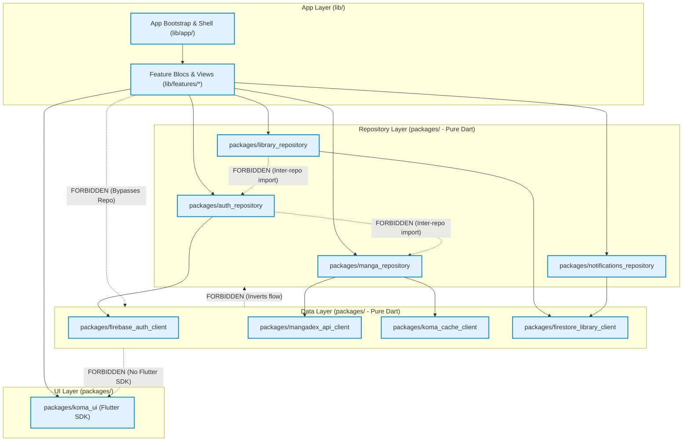

# Koma — Flutter Monorepo Structure and Packages

This document defines the monorepo architecture, package dependency contracts, code generation configurations, type-safe routing topology, internationalization setup, and multi-flavor bootstrap implementation for **Koma** (`com.ciannavei.koma`).

Target Platforms: iOS, Android  
Flutter SDK: `3.47.9`  
Dart SDK: `3.13.7` (Environment constraint: `sdk: ^3.13.0`)  
Architecture Standard: Very Good Ventures (VGV) 4-Layer Monorepo

---

## 1. Monorepo Principles and Layer Boundaries

The Koma codebase is structured as a multi-package monorepo enforcing four strict, unidirectional layers:

```text
Presentation (lib/features/ + packages/koma_ui)
      │
      ▼
Business Logic (lib/features/*/bloc/)
      │
      ▼
Repository (packages/*_repository/)
      │
      ▼
Data (packages/*_client/)
```

### Governing Architectural Rules

1. **Zero Flutter SDK in Data & Repository Layers**:
   All packages in `packages/*_client` and `packages/*_repository` are pure Dart packages. They have no dependency on `flutter` or the Flutter engine. This ensures test isolation, sub-second unit test execution (`dart test`), and reusability across CLI utilities or server-side Dart tools.
2. **Zero Inter-Repository Dependencies**:
   Repositories are strictly decoupled domain boundaries. `MangaRepository` never imports `LibraryRepository`, and `LibraryRepository` never imports `AuthRepository`. If a feature requires data from multiple repositories, orchestration occurs exclusively within the Business Logic layer (`Bloc` or `Cubit`).
3. **Encapsulated Barrel Exports**:
   Internal implementation details reside in `lib/src/`. Package consumers must import only the top-level barrel file (e.g., `package:manga_repository/manga_repository.dart`). Direct imports of `src/` (e.g., `package:manga_repository/src/...`) are strictly forbidden and enforced by `very_good_analysis`.
4. **Data Models vs. Domain Models**:
   Data layer packages serialize raw network and database schemas (`*Response`, `*Dto`). Repositories transform these representations into immutable domain models extending `Equatable` before exposing them to the business logic layer.
5. **UI Package Isolation (`packages/koma_ui`)**:
   `koma_ui` contains design system components, themes, typography, and styling tokens. It has zero knowledge of repositories, data clients, or localized string bundles (`AppLocalizations`). All text and state values are passed as constructor parameters.

---

## 2. Monorepo Directory Tree

```text
koma/
├── android/                                  # Android native host project
├── ios/                                      # iOS native host project
├── analysis_options.yaml                     # Root linter rules (very_good_analysis)
├── l10n.yaml                                 # Flutter localization config
├── pubspec.yaml                              # Root app dependencies
├── lib/
│   ├── app/
│   │   ├── app.dart                          # App barrel file
│   │   ├── router/
│   │   │   ├── app_router.dart               # GoRouter instance & redirect logic
│   │   │   ├── app_routes.dart               # @TypedGoRoute and @TypedShellRoute definitions
│   │   │   └── app_routes.g.dart             # Generated type-safe route classes
│   │   └── view/
│   │       ├── app.dart                      # Root App widget (MultiRepositoryProvider)
│   │       └── app_shell.dart                # Scaffold with BottomNavigationBar
│   ├── bootstrap.dart                        # Shared async startup & BLoC observer
│   ├── main_development.dart                 # Flavor: Dev with Firebase Emulator wiring
│   ├── main_staging.dart                     # Flavor: Staging live environment
│   ├── main_production.dart                  # Flavor: Production release environment
│   ├── l10n/
│   │   ├── arb/
│   │   │   ├── app_en.arb                    # English translation strings
│   │   │   └── app_it.arb                    # Italian translation strings
│   │   └── l10n.dart                         # Localization context extension helper
│   └── features/
│       ├── auth/                             # Feature: Authentication & Login
│       │   ├── auth.dart                     # Feature barrel
│       │   ├── bloc/
│       │   │   ├── auth_bloc.dart
│       │   │   ├── auth_event.dart
│       │   │   └── auth_state.dart
│       │   └── view/
│       │       ├── login_page.dart
│       │       └── login_view.dart
│       ├── search/                           # Feature: MangaDex Discovery & Search
│       │   ├── search.dart
│       │   ├── bloc/
│       │   │   ├── search_bloc.dart
│       │   │   ├── search_event.dart
│       │   │   └── search_state.dart
│       │   └── view/
│       │       ├── search_page.dart
│       │       └── search_view.dart
│       ├── library/                          # Feature: Tracked Manga Library Grid
│       │   ├── library.dart
│       │   ├── bloc/
│       │   │   ├── library_bloc.dart
│       │   │   ├── library_event.dart
│       │   │   └── library_state.dart
│       │   └── view/
│       │       ├── library_page.dart
│       │       └── library_view.dart
│       ├── reader_progress/                  # Feature: Manga Detail & Chapter Tracking
│       │   ├── reader_progress.dart
│       │   ├── bloc/
│       │   │   ├── reader_progress_bloc.dart
│       │   │   ├── reader_progress_event.dart
│       │   │   └── reader_progress_state.dart
│       │   └── view/
│       │       ├── manga_detail_page.dart
│       │       └── manga_detail_view.dart
│       ├── history/                          # Feature: Reading Activity Timeline
│       │   ├── history.dart
│       │   ├── bloc/
│       │   │   ├── history_bloc.dart
│       │   │   ├── history_event.dart
│       │   │   └── history_state.dart
│       │   └── view/
│       │       ├── history_page.dart
│       │       └── history_view.dart
│       └── settings/                         # Feature: App Preferences & Language
│           ├── settings.dart
│           ├── bloc/
│           │   ├── settings_bloc.dart
│           │   ├── settings_event.dart
│           │   └── settings_state.dart
│           └── view/
│               ├── settings_page.dart
│               └── settings_view.dart
├── packages/
│   ├── koma_ui/                              # UI Layer: Reusable widgets & M3 theme
│   │   ├── pubspec.yaml
│   │   └── lib/
│   │       ├── koma_ui.dart                  # UI barrel
│   │       └── src/
│   │           ├── theme/
│   │           │   ├── koma_colors.dart
│   │           │   ├── koma_spacing.dart
│   │           │   ├── koma_theme.dart
│   │           │   └── koma_typography.dart
│   │           └── widgets/
│   │               ├── koma_bulk_read_sheet.dart
│   │               ├── koma_chapter_row.dart
│   │               ├── koma_empty_state.dart
│   │               ├── koma_manga_card.dart
│   │               ├── koma_progress_header.dart
│   │               ├── koma_status_chip.dart
│   │               └── koma_volume_tile.dart
│   │
│   │   # DATA LAYER PACKAGES (Pure Dart)
│   ├── mangadex_api_client/                  # MangaDex REST API client
│   │   ├── pubspec.yaml
│   │   └── lib/
│   │       ├── mangadex_api_client.dart
│   │       └── src/
│   │           ├── client.dart
│   │           ├── interceptors/
│   │           │   ├── rate_limit_interceptor.dart
│   │           │   └── user_agent_interceptor.dart
│   │           └── models/
│   │               ├── manga_response.dart
│   │               └── aggregate_response.dart
│   ├── koma_cache_client/                    # Drift SQLite local caching
│   │   ├── pubspec.yaml
│   │   └── lib/
│   │       ├── koma_cache_client.dart
│   │       └── src/
│   │           ├── database/
│   │           │   ├── database.dart
│   │           │   ├── tables/
│   │           │   └── daos/
│   │           └── models/
│   ├── firebase_auth_client/                 # Firebase Auth & Google Sign-In SDK
│   │   ├── pubspec.yaml
│   │   └── lib/
│   │       ├── firebase_auth_client.dart
│   │       └── src/
│   │           └── auth_client.dart
│   ├── firestore_library_client/             # Firestore SDK for library & history
│   │   ├── pubspec.yaml
│   │   └── lib/
│   │       ├── firestore_library_client.dart
│   │       └── src/
│   │           ├── firestore_client.dart
│   │           └── models/
│   │
│   │   # REPOSITORY LAYER PACKAGES (Pure Dart)
│   ├── auth_repository/                      # Auth orchestration & User domain model
│   │   ├── pubspec.yaml
│   │   └── lib/
│   │       ├── auth_repository.dart
│   │       └── src/
│   │           ├── auth_repository.dart
│   │           └── models/
│   │               └── user.dart
│   ├── manga_repository/                     # Manga search & aggregate domain
│   │   ├── pubspec.yaml
│   │   └── lib/
│   │       ├── manga_repository.dart
│   │       └── src/
│   │           ├── manga_repository.dart
│   │           └── models/
│   │               ├── manga.dart
│   │               └── chapter_aggregate.dart
│   ├── library_repository/                   # Library tracking & atomic history batch
│   │   ├── pubspec.yaml
│   │   └── lib/
│   │       ├── library_repository.dart
│   │       └── src/
│   │           ├── library_repository.dart
│   │           └── models/
│   │               ├── library_entry.dart
│   │               └── history_event.dart
│   └── notifications_repository/             # Device token registration & sync
│       ├── pubspec.yaml
│       └── lib/
│           ├── notifications_repository.dart
│           └── src/
│               └── notifications_repository.dart
└── test/                                     # Root app tests mirroring lib/
```

---

## 3. Dependency Graph & Boundary Enforcement

The following Mermaid diagram maps allowed dependencies across layers and explicitly highlights forbidden cross-boundary imports.



---

## 4. Package Specifications and Reference `pubspec.yaml` Files

### 4.1 Root Application: `pubspec.yaml`

The root application aggregates repositories and presentation packages. It never directly depends on data layer clients.

```yaml
name: koma
description: "Koma — High-fidelity manga reading tracker powered by MangaDex and Firebase."
publish_to: "none"
version: 0.1.0+1

environment:
  sdk: ^3.13.0
  flutter: ">=3.47.9"

dependencies:
  flutter:
    sdk: flutter
  flutter_localizations:
    sdk: flutter
  intl: ^0.20.2

  # State Management & Architecture
  flutter_bloc: ^9.1.0
  equatable: ^2.0.7

  # Navigation & Routing
  go_router: ^18.1.4

  # Local Drift SQLite Persistence Runtime
  drift: ^2.35.4
  drift_flutter: ^0.3.1
  sqlite3: ^3.9.1

  # Network & Image Caching
  cached_network_image: ^3.4.1
  url_launcher: ^6.3.1

  # Firebase Core Suite
  firebase_core: ^3.12.1
  firebase_auth: ^5.5.1
  cloud_firestore: ^5.6.5
  firebase_messaging: ^15.2.4
  google_sign_in: ^6.2.2

  # Internal Local Package Dependencies
  koma_ui:
    path: packages/koma_ui
  auth_repository:
    path: packages/auth_repository
  manga_repository:
    path: packages/manga_repository
  library_repository:
    path: packages/library_repository
  notifications_repository:
    path: packages/notifications_repository

dev_dependencies:
  flutter_test:
    sdk: flutter
  very_good_analysis: ^11.0.0
  bloc_test: ^10.0.0
  mocktail: ^1.0.4
  build_runner: ^2.17.1
  go_router_builder: ^4.5.3

flutter:
  uses-material-design: true
  generate: true
```

---

### 4.2 Data Layer: `packages/mangadex_api_client/pubspec.yaml`

A pure Dart package wrapping MangaDex REST API v5. Contains zero Flutter SDK dependencies.

```yaml
name: mangadex_api_client
description: "Pure Dart client for MangaDex REST API v5 with built-in token bucket rate limiting."
publish_to: "none"
version: 0.1.0

environment:
  sdk: ^3.13.0

dependencies:
  dio: ^5.8.0+1
  retrofit: ^4.10.0
  json_annotation: ^4.12.0
  meta: ^1.16.0

dev_dependencies:
  build_runner: ^2.17.1
  retrofit_generator: ^10.3.3
  json_serializable: ^6.15.2
  test: ^1.25.15
  mocktail: ^1.0.4
  very_good_analysis: ^11.0.0
```

---

### 4.3 Data Layer: `packages/koma_cache_client/pubspec.yaml`

Local SQLite caching engine for MangaDex metadata and `/aggregate` chapter hierarchies using Drift.

```yaml
name: koma_cache_client
description: "Pure Dart SQLite caching client powered by Drift."
publish_to: "none"
version: 0.1.0

environment:
  sdk: ^3.13.0

dependencies:
  drift: ^2.35.4
  sqlite3: ^3.9.1
  meta: ^1.16.0
  path: ^1.9.1

dev_dependencies:
  drift_dev: ^2.35.3
  build_runner: ^2.17.1
  test: ^1.25.15
  mocktail: ^1.0.4
  very_good_analysis: ^11.0.0
```

---

### 4.4 Repository Layer: `packages/manga_repository/pubspec.yaml`

Coordinates search results, handles aggregate transformations, and orchestrates SWR between Drift and MangaDex. Pure Dart.

```yaml
name: manga_repository
description: "Pure Dart repository managing manga catalog search and chapter aggregates."
publish_to: "none"
version: 0.1.0

environment:
  sdk: ^3.13.0

dependencies:
  equatable: ^2.0.7
  meta: ^1.16.0
  mangadex_api_client:
    path: ../mangadex_api_client
  koma_cache_client:
    path: ../koma_cache_client

dev_dependencies:
  test: ^1.25.15
  mocktail: ^1.0.4
  very_good_analysis: ^11.0.0
```

---

### 4.5 Repository Layer: `packages/library_repository/pubspec.yaml`

Manages user library status, reading tracking, and atomic batch mutations for reading history. Pure Dart.

```yaml
name: library_repository
description: "Pure Dart repository managing user reading progress and library synchronization."
publish_to: "none"
version: 0.1.0

environment:
  sdk: ^3.13.0

dependencies:
  equatable: ^2.0.7
  meta: ^1.16.0
  firestore_library_client:
    path: ../firestore_library_client

dev_dependencies:
  test: ^1.25.15
  mocktail: ^1.0.4
  very_good_analysis: ^11.0.0
```

---

### 4.6 Presentation Layer: `packages/koma_ui/pubspec.yaml`

Material 3 design system tokens, themes, typography, and reusable widgets.

```yaml
name: koma_ui
description: "Koma Design System — Manga Ink & Vermilion visual widgets and theme extensions."
publish_to: "none"
version: 0.1.0

environment:
  sdk: ^3.13.0
  flutter: ">=3.47.9"

dependencies:
  flutter:
    sdk: flutter
  cached_network_image: ^3.4.1

dev_dependencies:
  flutter_test:
    sdk: flutter
  very_good_analysis: ^11.0.0
```

---

## 5. Type-Safe Routing Architecture (`GoRouter`)

Koma leverages `package:go_router` and `package:go_router_builder` to generate compile-time type-safe routes. The navigation tree enforces two mandatory rules:
- **No `extra` Parameter**: `extra` objects break deep linking, route restoration, and web compatibility. All parameters must be strongly-typed path parameters (`:id`) or query parameters (`?filter=...`).
- **Hierarchical Shell Routing**: Bottom navigation tabs are managed via `@TypedShellRoute<AppShellRouteData>` with 4 primary destinations: Library, Discover, History, and Settings.

### 5.1 Route Tree Specification (`lib/app/router/app_routes.dart`)

```dart
import 'package:flutter/material.dart';
import 'package:go_router/go_router.dart';
import 'package:koma/app/view/app_shell.dart';
import 'package:koma/features/auth/view/login_page.dart';
import 'package:koma/features/history/view/history_page.dart';
import 'package:koma/features/library/view/library_page.dart';
import 'package:koma/features/reader_progress/view/manga_detail_page.dart';
import 'package:koma/features/search/view/search_page.dart';
import 'package:koma/features/settings/view/settings_page.dart';

part 'app_routes.g.dart';

/// Authentication Screen Route (Standalone, outside Shell)
@TypedGoRoute<AuthRouteData>(
  path: '/auth',
  name: 'auth',
)
class AuthRouteData extends GoRouteData with $AuthRouteData {
  const AuthRouteData();

  @override
  Widget build(BuildContext context, GoRouterState state) => const LoginPage();
}

/// App Shell containing the 4 primary tabs
@TypedShellRoute<AppShellRouteData>(
  routes: <TypedRoute<RouteData>>[
    // Tab 1: Library
    TypedGoRoute<LibraryRouteData>(
      path: '/library',
      name: 'library',
      routes: <TypedRoute<RouteData>>[
        TypedGoRoute<MangaDetailRouteData>(
          path: 'manga/:id',
          name: 'mangaDetail',
        ),
      ],
    ),
    // Tab 2: Discover / Search
    TypedGoRoute<DiscoverRouteData>(
      path: '/discover',
      name: 'discover',
    ),
    // Tab 3: History Timeline
    TypedGoRoute<HistoryRouteData>(
      path: '/history',
      name: 'history',
    ),
    // Tab 4: Settings
    TypedGoRoute<SettingsRouteData>(
      path: '/settings',
      name: 'settings',
    ),
  ],
)
class AppShellRouteData extends ShellRouteData with $AppShellRouteData {
  const AppShellRouteData();

  @override
  Widget builder(BuildContext context, GoRouterState state, Widget navigator) {
    return AppShell(child: navigator);
  }
}

class LibraryRouteData extends GoRouteData with $LibraryRouteData {
  const LibraryRouteData({this.statusFilter});

  final String? statusFilter;

  @override
  Widget build(BuildContext context, GoRouterState state) {
    return LibraryPage(statusFilter: statusFilter);
  }
}

class MangaDetailRouteData extends GoRouteData with $MangaDetailRouteData {
  const MangaDetailRouteData({
    required this.id,
    this.highlightChapter,
  });

  final String id;
  final String? highlightChapter;

  @override
  Widget build(BuildContext context, GoRouterState state) {
    return MangaDetailPage(
      mangaId: id,
      highlightChapter: highlightChapter,
    );
  }
}

class DiscoverRouteData extends GoRouteData with $DiscoverRouteData {
  const DiscoverRouteData({this.initialQuery});

  final String? initialQuery;

  @override
  Widget build(BuildContext context, GoRouterState state) {
    return SearchPage(initialQuery: initialQuery);
  }
}

class HistoryRouteData extends GoRouteData with $HistoryRouteData {
  const HistoryRouteData();

  @override
  Widget build(BuildContext context, GoRouterState state) {
    return const HistoryPage();
  }
}

class SettingsRouteData extends GoRouteData with $SettingsRouteData {
  const SettingsRouteData();

  @override
  Widget build(BuildContext context, GoRouterState state) {
    return const SettingsPage();
  }
}
```

### 5.2 Router Instance & Authentication Guard (`lib/app/router/app_router.dart`)

```dart
import 'package:flutter/foundation.dart';
import 'package:go_router/go_router.dart';
import 'package:koma/app/router/app_routes.dart';
import 'package:koma/features/auth/bloc/auth_bloc.dart';

GoRouter createRouter(AuthBloc authBloc) {
  return GoRouter(
    initialLocation: '/library',
    debugLogDiagnostics: kDebugMode,
    refreshListenable: GoRouterRefreshStream(authBloc.stream),
    redirect: (context, state) {
      final authState = authBloc.state;
      final isLoggingIn = state.matchedLocation == '/auth';

      if (authState is AuthUnauthenticated) {
        return isLoggingIn ? null : '/auth';
      }

      if (authState is AuthAuthenticated) {
        if (isLoggingIn) {
          return '/library';
        }
      }

      return null;
    },
    routes: $appRoutes,
  );
}

class GoRouterRefreshStream extends ChangeNotifier {
  GoRouterRefreshStream(Stream<dynamic> stream) {
    notifyListeners();
    _subscription = stream.asBroadcastStream().listen((_) => notifyListeners());
  }

  late final dynamic _subscription;

  @override
  void dispose() {
    _subscription.cancel();
    super.dispose();
  }
}
```

---

## 6. Internationalization and Localization

Koma provides native localization for English (`en`) and Italian (`it`), covering both user interface elements and default MangaDex chapter feed filtering.

### 6.1 Configuration: `l10n.yaml`

```yaml
arb-dir: lib/l10n/arb
template-arb-file: app_en.arb
output-localization-file: app_localizations.dart
output-class: AppLocalizations
nullable-getter: false
```

### 6.2 English Bundle: `lib/l10n/arb/app_en.arb`

```json
{
  "@@locale": "en",
  "appTitle": "Koma",
  "@appTitle": {
    "description": "App branding name"
  },
  "navLibrary": "Library",
  "navDiscover": "Discover",
  "navHistory": "History",
  "navSettings": "Settings",
  
  "statusReading": "Reading",
  "statusPlanToRead": "Plan to Read",
  "statusCompleted": "Completed",
  "statusOnHold": "On Hold",
  "statusDropped": "Dropped",

  "searchPlaceholder": "Search manga, authors...",
  "emptyLibraryTitle": "Your library is empty",
  "emptyLibrarySubtitle": "Search MangaDex to track your favorite series.",
  
  "markPreviousTitle": "Mark Previous as Read",
  "markPreviousConfirmation": "Mark all chapters up to Chapter {chapterNumber} as read?",
  "@markPreviousConfirmation": {
    "placeholders": {
      "chapterNumber": {
        "type": "String"
      }
    }
  },
  "confirmAction": "Confirm",
  "cancelAction": "Cancel",
  
  "readOnMangaDex": "Read on MangaDex",
  "newChapterNotification": "New Chapter {chapterNumber} Available",
  "@newChapterNotification": {
    "placeholders": {
      "chapterNumber": {
        "type": "String"
      }
    }
  }
}
```

### 6.3 Italian Bundle: `lib/l10n/arb/app_it.arb`

```json
{
  "@@locale": "it",
  "appTitle": "Koma",
  "navLibrary": "Libreria",
  "navDiscover": "Esplora",
  "navHistory": "Cronologia",
  "navSettings": "Impostazioni",
  
  "statusReading": "In Lettura",
  "statusPlanToRead": "Da Leggere",
  "statusCompleted": "Completato",
  "statusOnHold": "In Pausa",
  "statusDropped": "Abbandonato",

  "searchPlaceholder": "Cerca manga, autori...",
  "emptyLibraryTitle": "La tua libreria è vuota",
  "emptyLibrarySubtitle": "Cerca su MangaDex per iniziare a seguire le tue serie preferite.",
  
  "markPreviousTitle": "Segna precedenti come letti",
  "markPreviousConfirmation": "Segnare tutti i capitoli fino al Capitolo {chapterNumber} come letti?",
  "@markPreviousConfirmation": {
    "placeholders": {
      "chapterNumber": {
        "type": "String"
      }
    }
  },
  "confirmAction": "Conferma",
  "cancelAction": "Annulla",
  
  "readOnMangaDex": "Leggi su MangaDex",
  "newChapterNotification": "Nuovo Capitolo {chapterNumber} Disponibile",
  "@newChapterNotification": {
    "placeholders": {
      "chapterNumber": {
        "type": "String"
      }
    }
  }
}
```

---

## 7. Multi-Flavor Bootstrap and Emulator Connectivity

Koma supports three environments: `development`, `staging`, and `production`. In the `development` flavor, the app automatically connects to the Firebase Local Emulator Suite.

### Emulator Network Topology

| Service | Emulator Port | Android AVD Host | iOS Simulator / macOS Host |
|---|---|---|---|
| Firebase Auth | `9099` | `10.0.2.2:9099` | `127.0.0.1:9099` |
| Cloud Firestore | `8080` | `10.0.2.2:8080` | `127.0.0.1:8080` |
| Cloud Functions | `5001` | `10.0.2.2:5001` | `127.0.0.1:5001` |
| Emulator UI | `4000` | `10.0.2.2:4000` | `127.0.0.1:4000` |

### 7.1 Shared Bootstrap: `lib/bootstrap.dart`

```dart
import 'dart:async';
import 'dart:developer';
import 'package:flutter/widgets.dart';
import 'package:flutter_bloc/flutter_bloc.dart';

class KomaBlocObserver extends BlocObserver {
  const KomaBlocObserver();

  @override
  void onChange(BlocBase<dynamic> bloc, Change<dynamic> change) {
    super.onChange(bloc, change);
    log('onChange(${bloc.runtimeType}, $change)');
  }

  @override
  void onError(BlocBase<dynamic> bloc, Object error, StackTrace stackTrace) {
    log('onError(${bloc.runtimeType}, $error, $stackTrace)');
    super.onError(bloc, error, stackTrace);
  }
}

Future<void> bootstrap(FutureOr<Widget> Function() builder) async {
  FlutterError.onError = (details) {
    log(details.exceptionAsString(), stackTrace: details.stack);
  };

  Bloc.observer = const KomaBlocObserver();

  WidgetsFlutterBinding.ensureInitialized();
  runApp(await builder());
}
```

### 7.2 Development Entrypoint: `lib/main_development.dart`

```dart
import 'dart:io';
import 'package:cloud_firestore/cloud_firestore.dart';
import 'package:drift_flutter/drift_flutter.dart';
import 'package:firebase_auth/firebase_auth.dart';
import 'package:firebase_core/firebase_core.dart';
import 'package:flutter/foundation.dart';
import 'package:flutter/rendering.dart';
import 'package:koma/app/view/app.dart';
import 'package:koma/bootstrap.dart';

import 'package:auth_repository/auth_repository.dart';
import 'package:firebase_auth_client/firebase_auth_client.dart';
import 'package:firestore_library_client/firestore_library_client.dart';
import 'package:koma_cache_client/koma_cache_client.dart';
import 'package:library_repository/library_repository.dart';
import 'package:manga_repository/manga_repository.dart';
import 'package:mangadex_api_client/mangadex_api_client.dart';
import 'package:notifications_repository/notifications_repository.dart';

void main() {
  bootstrap(() async {
    await Firebase.initializeApp();

    if (kDebugMode) {
      // Warm up semantics tree so `adb exec-out uiautomator dump` works on Pixel 9 AVD
      SemanticsBinding.instance.ensureSemantics();
    }

    // Determine host IP depending on runtime platform
    final emulatorHost = !kIsWeb && Platform.isAndroid ? '10.0.2.2' : '127.0.0.1';

    // Connect to Firebase Local Emulators
    await FirebaseAuth.instance.useAuthEmulator(emulatorHost, 9099);
    FirebaseFirestore.instance.useFirestoreEmulator(emulatorHost, 8080);
    FirebaseFirestore.instance.settings = const Settings(
      persistenceEnabled: true,
      cacheSizeBytes: Settings.CACHE_SIZE_UNLIMITED,
    );

    // Initialize Data Clients
    final firebaseAuthClient = FirebaseAuthClient(
      firebaseAuth: FirebaseAuth.instance,
    );
    final firestoreLibraryClient = FirestoreLibraryClient(
      firestore: FirebaseFirestore.instance,
    );
    final mangadexApiClient = MangadexApiClient(
      userAgent: 'Koma/0.1.0 (https://github.com/mattcianna/koma)',
    );
    final komaCacheClient = KomaCacheClient(
      driftDatabase(name: 'koma_cache'),
    );

    // Initialize Repositories
    final authRepository = AuthRepository(authClient: firebaseAuthClient);
    final mangaRepository = MangaRepository(
      apiClient: mangadexApiClient,
      cacheClient: komaCacheClient,
    );
    final libraryRepository = LibraryRepository(
      firestoreClient: firestoreLibraryClient,
    );
    final notificationsRepository = NotificationsRepository(
      firestoreClient: firestoreLibraryClient,
    );

    return KomaApp(
      authRepository: authRepository,
      mangaRepository: mangaRepository,
      libraryRepository: libraryRepository,
      notificationsRepository: notificationsRepository,
      isDevelopmentMode: true,
    );
  });
}
```

### 7.3 Staging Entrypoint: `lib/main_staging.dart`

```dart
import 'package:cloud_firestore/cloud_firestore.dart';
import 'package:drift_flutter/drift_flutter.dart';
import 'package:firebase_auth/firebase_auth.dart';
import 'package:firebase_core/firebase_core.dart';
import 'package:koma/app/view/app.dart';
import 'package:koma/bootstrap.dart';

import 'package:auth_repository/auth_repository.dart';
import 'package:firebase_auth_client/firebase_auth_client.dart';
import 'package:firestore_library_client/firestore_library_client.dart';
import 'package:koma_cache_client/koma_cache_client.dart';
import 'package:library_repository/library_repository.dart';
import 'package:manga_repository/manga_repository.dart';
import 'package:mangadex_api_client/mangadex_api_client.dart';
import 'package:notifications_repository/notifications_repository.dart';

void main() {
  bootstrap(() async {
    await Firebase.initializeApp();

    final firebaseAuthClient = FirebaseAuthClient(firebaseAuth: FirebaseAuth.instance);
    final firestoreLibraryClient = FirestoreLibraryClient(firestore: FirebaseFirestore.instance);
    final mangadexApiClient = MangadexApiClient(
      userAgent: 'Koma/0.1.0 (https://github.com/mattcianna/koma)',
    );
    final komaCacheClient = KomaCacheClient(
      driftDatabase(name: 'koma_cache'),
    );

    return KomaApp(
      authRepository: AuthRepository(authClient: firebaseAuthClient),
      mangaRepository: MangaRepository(apiClient: mangadexApiClient, cacheClient: komaCacheClient),
      libraryRepository: LibraryRepository(firestoreClient: firestoreLibraryClient),
      notificationsRepository: NotificationsRepository(firestoreClient: firestoreLibraryClient),
      isDevelopmentMode: false,
    );
  });
}
```

### 7.4 Production Entrypoint: `lib/main_production.dart`

```dart
import 'package:cloud_firestore/cloud_firestore.dart';
import 'package:drift_flutter/drift_flutter.dart';
import 'package:firebase_auth/firebase_auth.dart';
import 'package:firebase_core/firebase_core.dart';
import 'package:koma/app/view/app.dart';
import 'package:koma/bootstrap.dart';

import 'package:auth_repository/auth_repository.dart';
import 'package:firebase_auth_client/firebase_auth_client.dart';
import 'package:firestore_library_client/firestore_library_client.dart';
import 'package:koma_cache_client/koma_cache_client.dart';
import 'package:library_repository/library_repository.dart';
import 'package:manga_repository/manga_repository.dart';
import 'package:mangadex_api_client/mangadex_api_client.dart';
import 'package:notifications_repository/notifications_repository.dart';

void main() {
  bootstrap(() async {
    await Firebase.initializeApp();

    final firebaseAuthClient = FirebaseAuthClient(firebaseAuth: FirebaseAuth.instance);
    final firestoreLibraryClient = FirestoreLibraryClient(firestore: FirebaseFirestore.instance);
    final mangadexApiClient = MangadexApiClient(
      userAgent: 'Koma/0.1.0 (https://github.com/mattcianna/koma)',
    );
    final komaCacheClient = KomaCacheClient(
      driftDatabase(name: 'koma_cache'),
    );

    return KomaApp(
      authRepository: AuthRepository(authClient: firebaseAuthClient),
      mangaRepository: MangaRepository(apiClient: mangadexApiClient, cacheClient: komaCacheClient),
      libraryRepository: LibraryRepository(firestoreClient: firestoreLibraryClient),
      notificationsRepository: NotificationsRepository(firestoreClient: firestoreLibraryClient),
      isDevelopmentMode: false,
    );
  });
}
```
