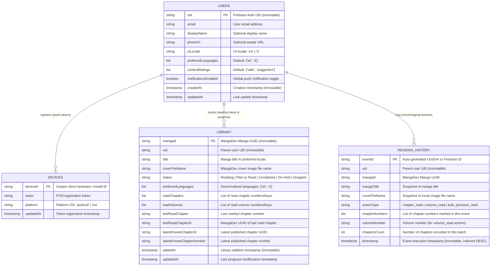

# Firestore Schema and Security Rules Specification

**Document Version:** 1.0.0  
**Status:** Canonical Reference  
**App Brand / Bundle:** Koma (`com.ciannavei.koma`)  
**Package Scope:** `packages/firestore_library_client`, `packages/library_repository`, Cloud Functions  

---

## 1. Architecture Overview and Storage Strategy

Koma uses Cloud Firestore as its primary cloud data store for user profiles, device push tokens, personal manga libraries, and chronological reading history. The database design adheres to a **hierarchical user-scoped subcollection architecture** under `users/{uid}`, ensuring natural data isolation, multi-tenant security, and zero cross-user leakage.

### 1.1 Key Architectural Decisions

1. **User Isolation via Subcollections**:
   - All user data lives beneath `users/{uid}`. Client read and write rules enforce that a client can only access documents where the path parameter matches `request.auth.uid`.
   - Client access to global collection group queries across other users is explicitly forbidden by default in security rules. Cloud Functions (such as the daily chapter release notifier) execute via the Firebase Admin SDK, bypassing client rules.

2. **Denormalization for Cloud Function Scalability**:
   - `preferredLanguages` (e.g., `['en', 'it']`) is stored in `users/{uid}` and denormalized into each `users/{uid}/library/{mangaId}` document upon library addition or preference update.
   - Denormalizing `preferredLanguages` directly onto the library document allows the daily scheduled Cloud Function (`checkMangaUpdates`) to perform a single `collectionGroup('library').where('status', '==', 'Reading')` scan. It retrieves each tracked manga alongside the user's preferred scanlation languages in a single document read, eliminating \$N\$ subsequent lookups to parent user documents (\$O(N)\$ read-cost reduction).

3. **Collection Group Owner Resolution**:
   - Each `library/{mangaId}` document explicitly includes `uid: string` matching its parent `{uid}`. While the document's parent path already encodes the user ID (`doc.ref.parent.parent.id`), having `uid` as a first-class indexed field enables efficient grouping, filtering, and target validation in background jobs.

4. **Progress Tracking Structures**:
   - `readChapters` stores a list of unique canonical chapter strings (e.g., `["1", "2", "10", "10.5"]`).
   - `readVolumes` stores a list of volume identifiers (e.g., `["1", "2"]`).
   - Single chapter reads, volume completions, and "Mark Previous as Read" operations are committed atomically using Firestore `WriteBatch` along with an appended audit entry in `reading_history`.

---

## 2. Entity-Relationship Model



---

## 3. Detailed Document Schemas and Specifications

### 3.1 Collection: `users/{uid}`

Stores account-level preferences, locale settings, and content filters.

#### Document ID
`{uid}`: The Firebase Authentication User UID (string).

#### Field Specifications

| Field Name | Firestore Type | Nullable | Mutable | Allowed Values / Constraints |
| :--- | :--- | :--- | :--- | :--- |
| `uid` | `string` | No | **Immutable** | Must equal document ID `{uid}`. Length: 1–128 chars. |
| `email` | `string` | No | Yes | Valid email format. Max 254 chars. |
| `displayName` | `string` | Yes | Yes | Max 100 chars if present. |
| `photoUrl` | `string` | Yes | Yes | Valid URI format. Max 1024 chars if present. |
| `uiLocale` | `string` | No | Yes | Enum: `'en'`, `'it'`. Default: `'en'`. |
| `preferredLanguages` | `list<string>` | No | Yes | Subset of ISO 639-1 language codes (e.g. `['en', 'it']`). Max 10 items. |
| `contentRatings` | `list<string>` | No | Yes | Allowed items: `'safe'`, `'suggestive'`, `'erotica'`, `'pornographic'`. Default: `['safe', 'suggestive']`. |
| `notificationsEnabled`| `boolean` | No | Yes | Controls push notification delivery. |
| `createdAt` | `timestamp` | No | **Immutable** | Set to `request.time` upon user creation. |
| `updatedAt` | `timestamp` | No | Yes | Must be equal to `request.time` on every write. |

#### Sample JSON Payload
```json
{
  "uid": "Uv7X39kLmNO8pQrStUvWxYz12345",
  "email": "reader@ciannavei.dev",
  "displayName": "Matteo Ciannavei",
  "photoUrl": "https://lh3.googleusercontent.com/a/ACg8ocK1...",
  "uiLocale": "en",
  "preferredLanguages": [
    "en",
    "it"
  ],
  "contentRatings": [
    "safe",
    "suggestive"
  ],
  "notificationsEnabled": true,
  "createdAt": "2026-11-13T10:00:00.000Z",
  "updatedAt": "2026-11-13T10:00:00.000Z"
}
```

---

### 3.2 Subcollection: `users/{uid}/devices/{deviceId}`

Tracks Firebase Cloud Messaging (FCM) registration tokens across the user's mobile devices (Android and iOS). Used by background functions to dispatch targeted notifications.

#### Document ID
`{deviceId}`: A deterministic or persistent client hardware/installation identifier (e.g. derived from `device_info_plus` + app instance).

#### Field Specifications

| Field Name | Firestore Type | Nullable | Mutable | Allowed Values / Constraints |
| :--- | :--- | :--- | :--- | :--- |
| `token` | `string` | No | Yes | Raw FCM registration token string. Length: 32–500 chars. |
| `platform` | `string` | No | Yes | Enum: `'android'`, `'ios'`. |
| `updatedAt` | `timestamp` | No | Yes | Must equal `request.time` on register/refresh. |

#### Sample JSON Payload
```json
{
  "token": "fXyZ9810-kmL_aBc123DeFgHiJkLmNoPqRsTuVwXyZ:APA91bF8...",
  "platform": "android",
  "updatedAt": "2026-11-13T10:05:00.000Z"
}
```

---

### 3.3 Subcollection: `users/{uid}/library/{mangaId}`

Represents a tracked manga entry within the user's personal collection. Stores current reading status, canonical read chapter sets, and latest known publication state.

#### Document ID
`{mangaId}`: The canonical MangaDex Manga UUID v4 string (e.g., `a1c7c817-4e59-42b5-bd41-522e96416fbb`).

#### Field Specifications

| Field Name | Firestore Type | Nullable | Mutable | Allowed Values / Constraints |
| :--- | :--- | :--- | :--- | :--- |
| `mangaId` | `string` | No | **Immutable** | Canonical MangaDex UUID. Must match document ID. |
| `uid` | `string` | No | **Immutable** | Must equal `{uid}` of parent user document. |
| `title` | `string` | No | Yes | Primary manga title string. Max 300 chars. |
| `coverFileName` | `string` | Yes | Yes | File name of the MangaDex cover art (e.g. `xyz.jpg`). Max 200 chars. |
| `status` | `string` | No | Yes | Enum: `'Reading'`, `'Plan to Read'`, `'Completed'`, `'On Hold'`, `'Dropped'`. Maps to Dart `ReadingStatus`. |
| `preferredLanguages` | `list<string>` | No | Yes | Denormalized from user preference (e.g. `['en', 'it']`). Max 10 items. |
| `readChapters` | `list<string>` | No | Yes | Canonical chapter numbers/keys read by user. Max 5,000 entries. |
| `readVolumes` | `list<string>` | No | Yes | Volume numbers completed (e.g. `['1', '2']`). Max 500 entries. |
| `lastReadChapter` | `string` | Yes | Yes | Human-readable number of last read chapter (e.g. `"104.5"`). Max 20 chars. |
| `lastReadChapterId` | `string` | Yes | Yes | MangaDex Chapter UUID of last read chapter. Max 36 chars. |
| `latestKnownChapterId` | `string` | Yes | Yes | Latest discovered chapter UUID from aggregate/feed. Max 36 chars. |
| `latestKnownChapterNumber`| `string` | Yes | Yes | Latest discovered chapter number string (e.g. `"105"`). Max 20 chars. |
| `addedAt` | `timestamp` | No | **Immutable** | Set to `request.time` upon initial addition. |
| `updatedAt` | `timestamp` | No | Yes | Set to `request.time` upon any modification. |

#### Dart `ReadingStatus` Enum Mapping

```dart
/// Canonical reading status values for Koma.
enum ReadingStatus {
  reading('Reading'),
  planToRead('Plan to Read'),
  completed('Completed'),
  onHold('On Hold'),
  dropped('Dropped');

  const ReadingStatus(this.firestoreValue);

  final String firestoreValue;

  static ReadingStatus fromFirestore(String value) {
    return ReadingStatus.values.firstWhere(
      (element) => element.firestoreValue == value,
      orElse: () => ReadingStatus.planToRead,
    );
  }
}
```

#### Sample JSON Payload
```json
{
  "mangaId": "a1c7c817-4e59-42b5-bd41-522e96416fbb",
  "uid": "Uv7X39kLmNO8pQrStUvWxYz12345",
  "title": "Chainsaw Man",
  "coverFileName": "9a38f36c-941f-4cb1-80ec-e34927cb78e4.jpg",
  "status": "Reading",
  "preferredLanguages": [
    "en",
    "it"
  ],
  "readChapters": [
    "1",
    "2",
    "3",
    "4",
    "5",
    "6",
    "7",
    "8",
    "9",
    "10"
  ],
  "readVolumes": [
    "1"
  ],
  "lastReadChapter": "10",
  "lastReadChapterId": "3b290cb6-7353-4876-b633-8a3d4ee385c1",
  "latestKnownChapterId": "c5f5df64-4e46-4c4f-9e77-505697d26b77",
  "latestKnownChapterNumber": "180",
  "addedAt": "2026-10-01T14:20:00.000Z",
  "updatedAt": "2026-11-13T10:30:00.000Z"
}
```

---

### 3.4 Subcollection: `users/{uid}/reading_history/{eventId}`

Immutable audit log of all reading progress actions. Enables chronological timelines, statistical streaks, and progress rollbacks.

#### Document ID
`{eventId}`: Auto-generated UUIDv4 or Firestore document ID.

#### Field Specifications

| Field Name | Firestore Type | Nullable | Mutable | Allowed Values / Constraints |
| :--- | :--- | :--- | :--- | :--- |
| `eventId` | `string` | No | **Immutable** | Matches document ID. |
| `uid` | `string` | No | **Immutable** | Matches `{uid}` of parent user. |
| `mangaId` | `string` | No | **Immutable** | Canonical MangaDex Manga UUID. |
| `mangaTitle` | `string` | No | **Immutable** | Title snapshot at the time of reading. Max 300 chars. |
| `coverFileName` | `string` | Yes | **Immutable** | Cover image snapshot. Max 200 chars. |
| `actionType` | `string` | No | **Immutable** | Enum: `'chapter_read'`, `'volume_read'`, `'bulk_previous_read'`. |
| `chapterNumbers` | `list<string>` | No | **Immutable** | Chapter numbers marked read in this operation. Max 500 items. |
| `volumeNumber` | `string` | Yes | **Immutable** | Required if `actionType == 'volume_read'`, null otherwise. Max 20 chars. |
| `chaptersCount` | `int` | No | **Immutable** | Must equal `chapterNumbers.length`. Integer >= 1. |
| `timestamp` | `timestamp` | No | **Immutable** | Must equal `request.time`. Indexed descending for timeline feeds. |

#### Sample JSON Payloads

##### Single Chapter Read (`actionType: 'chapter_read'`)
```json
{
  "eventId": "hist_01JCA0V8P2QK94Z67A5E0W1234",
  "uid": "Uv7X39kLmNO8pQrStUvWxYz12345",
  "mangaId": "a1c7c817-4e59-42b5-bd41-522e96416fbb",
  "mangaTitle": "Chainsaw Man",
  "coverFileName": "9a38f36c-941f-4cb1-80ec-e34927cb78e4.jpg",
  "actionType": "chapter_read",
  "chapterNumbers": [
    "11"
  ],
  "volumeNumber": null,
  "chaptersCount": 1,
  "timestamp": "2026-11-13T10:45:00.000Z"
}
```

##### Full Volume Read (`actionType: 'volume_read'`)
```json
{
  "eventId": "hist_01JCA0V8P2QK94Z67A5E0W5678",
  "uid": "Uv7X39kLmNO8pQrStUvWxYz12345",
  "mangaId": "a1c7c817-4e59-42b5-bd41-522e96416fbb",
  "mangaTitle": "Chainsaw Man",
  "coverFileName": "9a38f36c-941f-4cb1-80ec-e34927cb78e4.jpg",
  "actionType": "volume_read",
  "chapterNumbers": [
    "12",
    "13",
    "14",
    "15",
    "16",
    "17",
    "18",
    "19",
    "20",
    "21"
  ],
  "volumeNumber": "2",
  "chaptersCount": 10,
  "timestamp": "2026-11-13T11:00:00.000Z"
}
```

##### Bulk Previous Read (`actionType: 'bulk_previous_read'`)
```json
{
  "eventId": "hist_01JCA0V8P2QK94Z67A5E0W9999",
  "uid": "Uv7X39kLmNO8pQrStUvWxYz12345",
  "mangaId": "a1c7c817-4e59-42b5-bd41-522e96416fbb",
  "mangaTitle": "Chainsaw Man",
  "coverFileName": "9a38f36c-941f-4cb1-80ec-e34927cb78e4.jpg",
  "actionType": "bulk_previous_read",
  "chapterNumbers": [
    "1",
    "2",
    "3",
    "4",
    "5",
    "6",
    "7",
    "8",
    "9",
    "10",
    "11",
    "12",
    "13",
    "14",
    "15"
  ],
  "volumeNumber": null,
  "chaptersCount": 15,
  "timestamp": "2026-11-13T11:15:00.000Z"
}
```

---

## 4. Atomic WriteBatch Dart/Firestore Patterns

All progress update operations must guarantee **transactional consistency**: modifying reading status/chapters in `users/{uid}/library/{mangaId}` and recording the corresponding audit record in `users/{uid}/reading_history/{eventId}` must either succeed together or fail together.

### 4.1 500-Operation Limit Strategy

Firestore imposes a strict upper limit of **500 operations per `WriteBatch` or Transaction**.
In Koma:
- A progress update writes to **1 library document** and **1 history event document**.
- To prevent exhausting Firestore batch limits when marking hundreds of chapters as read (e.g. marking 200 previous chapters read in *One Piece*), Koma uses a **consolidated history architecture**:
  - All marked chapter numbers are stored inside the `chapterNumbers` array of a single `bulk_previous_read` history document.
  - The total batch size for a "Mark Previous as Read" action is exactly **2 writes** (1 library document update + 1 history entry), easily fitting well within Firestore's 500-write ceiling.

### 4.2 Pattern Implementation in Pure Dart (`packages/firestore_library_client`)

The following production Dart patterns demonstrate the atomic batch mutations executed by Koma's data layer:

```dart
import 'package:cloud_firestore/cloud_firestore.dart';

/// Pure Dart client for managing Firestore library items and history entries.
class FirestoreLibraryClient {
  FirestoreLibraryClient({required FirebaseFirestore firestore})
      : _firestore = firestore;

  final FirebaseFirestore _firestore;

  DocumentReference<Map<String, dynamic>> _userDoc(String uid) =>
      _firestore.collection('users').doc(uid);

  DocumentReference<Map<String, dynamic>> _libraryDoc(
    String uid,
    String mangaId,
  ) =>
      _userDoc(uid).collection('library').doc(mangaId);

  CollectionReference<Map<String, dynamic>> _historyCollection(String uid) =>
      _userDoc(uid).collection('reading_history');

  /// 1. Mark a single chapter as read atomically.
  Future<void> markChapterRead({
    required String uid,
    required String mangaId,
    required String mangaTitle,
    required String? coverFileName,
    required String chapterNumber,
    required String chapterId,
  }) async {
    final batch = _firestore.batch();
    final now = FieldValue.serverTimestamp();

    // 1a. Update Library document
    final libRef = _libraryDoc(uid, mangaId);
    batch.update(libRef, {
      'readChapters': FieldValue.arrayUnion([chapterNumber]),
      'lastReadChapter': chapterNumber,
      'lastReadChapterId': chapterId,
      'updatedAt': now,
    });

    // 1b. Create Reading History entry
    final histRef = _historyCollection(uid).doc();
    batch.set(histRef, {
      'eventId': histRef.id,
      'uid': uid,
      'mangaId': mangaId,
      'mangaTitle': mangaTitle,
      'coverFileName': coverFileName,
      'actionType': 'chapter_read',
      'chapterNumbers': [chapterNumber],
      'volumeNumber': null,
      'chaptersCount': 1,
      'timestamp': now,
    });

    await batch.commit();
  }

  /// 2. Mark an entire volume as read atomically.
  Future<void> markVolumeRead({
    required String uid,
    required String mangaId,
    required String mangaTitle,
    required String? coverFileName,
    required String volumeNumber,
    required List<String> volumeChapterNumbers,
    required String? lastChapterNumberInVolume,
    required String? lastChapterIdInVolume,
  }) async {
    final batch = _firestore.batch();
    final now = FieldValue.serverTimestamp();

    final libRef = _libraryDoc(uid, mangaId);
    final updateData = <String, dynamic>{
      'readVolumes': FieldValue.arrayUnion([volumeNumber]),
      'readChapters': FieldValue.arrayUnion(volumeChapterNumbers),
      'updatedAt': now,
    };

    if (lastChapterNumberInVolume != null) {
      updateData['lastReadChapter'] = lastChapterNumberInVolume;
    }
    if (lastChapterIdInVolume != null) {
      updateData['lastReadChapterId'] = lastChapterIdInVolume;
    }

    batch.update(libRef, updateData);

    final histRef = _historyCollection(uid).doc();
    batch.set(histRef, {
      'eventId': histRef.id,
      'uid': uid,
      'mangaId': mangaId,
      'mangaTitle': mangaTitle,
      'coverFileName': coverFileName,
      'actionType': 'volume_read',
      'chapterNumbers': volumeChapterNumbers,
      'volumeNumber': volumeNumber,
      'chaptersCount': volumeChapterNumbers.length,
      'timestamp': now,
    });

    await batch.commit();
  }

  /// 3. Mark all previous chapters as read atomically in a single WriteBatch.
  ///
  /// Splits `previousChapterNumbersToMark` into history chunks of <= 450 items
  /// to satisfy `reading_history.chapterNumbers.size() <= 500` in firestore.rules,
  /// while committing the library document update and all history chunk documents
  /// inside ONE atomic Firestore WriteBatch (e.g. 800 chapters = 3 batch ops total).
  Future<void> markPreviousChaptersRead({
    required String uid,
    required String mangaId,
    required String mangaTitle,
    required String? coverFileName,
    required String targetChapterNumber,
    required String targetChapterId,
    required List<String> previousChapterNumbersToMark,
  }) async {
    if (previousChapterNumbersToMark.isEmpty) return;

    // 450 chapters per reading_history doc stays safely below the 500-item
    // list cap enforced by isValidHistoryEvent() in firestore.rules.
    const maxChaptersPerHistoryDoc = 450;
    final chunks = <List<String>>[];
    for (var i = 0;
        i < previousChapterNumbersToMark.length;
        i += maxChaptersPerHistoryDoc) {
      final end =
          (i + maxChaptersPerHistoryDoc < previousChapterNumbersToMark.length)
              ? i + maxChaptersPerHistoryDoc
              : previousChapterNumbersToMark.length;
      chunks.add(previousChapterNumbersToMark.sublist(i, end));
    }

    // Guard against exceeding the 5,000-chapter library cap or 500-op WriteBatch limit
    assert(
      chunks.length + 1 <= 500,
      'Total WriteBatch operations (${chunks.length + 1}) cannot exceed 500.',
    );

    final batch = _firestore.batch();
    final now = FieldValue.serverTimestamp();

    // 1. Update the library document once with all newly marked chapters
    final libRef = _libraryDoc(uid, mangaId);
    batch.update(libRef, {
      'readChapters': FieldValue.arrayUnion(previousChapterNumbersToMark),
      'lastReadChapter': targetChapterNumber,
      'lastReadChapterId': targetChapterId,
      'updatedAt': now,
    });

    // 2. Append all consolidated history chunk documents to the SAME WriteBatch
    for (final chunk in chunks) {
      final histRef = _historyCollection(uid).doc();
      batch.set(histRef, {
        'eventId': histRef.id,
        'uid': uid,
        'mangaId': mangaId,
        'mangaTitle': mangaTitle,
        'coverFileName': coverFileName,
        'actionType': 'bulk_previous_read',
        'chapterNumbers': chunk,
        'volumeNumber': null,
        'chaptersCount': chunk.length,
        'timestamp': now,
      });
    }

    // Single atomic commit for library update + all history records
    await batch.commit();
  }
}
```

---

## 5. Index Configuration (`firestore.indexes.json`)

Firestore requires explicit composite indexes for compound queries, and single-field index exemptions for collection groups.

### 5.1 Collection Group Exemption Rationale
The daily update Cloud Function queries `collectionGroup('library').where('status', '==', 'Reading')`. To query across the entire database without index bloat, a collection-group scope index exemption is enabled on `library.status`.

### 5.2 Composite Index Rationale
User reading history queries order by `timestamp DESC` filtered by user scope, and queryable by manga ID.

```json
{
  "indexes": [
    {
      "collectionGroup": "reading_history",
      "queryScope": "COLLECTION",
      "fields": [
        {
          "fieldPath": "uid",
          "order": "ASCENDING"
        },
        {
          "fieldPath": "timestamp",
          "order": "DESCENDING"
        }
      ]
    },
    {
      "collectionGroup": "reading_history",
      "queryScope": "COLLECTION",
      "fields": [
        {
          "fieldPath": "mangaId",
          "order": "ASCENDING"
        },
        {
          "fieldPath": "timestamp",
          "order": "DESCENDING"
        }
      ]
    },
    {
      "collectionGroup": "library",
      "queryScope": "COLLECTION",
      "fields": [
        {
          "fieldPath": "status",
          "order": "ASCENDING"
        },
        {
          "fieldPath": "updatedAt",
          "order": "DESCENDING"
        }
      ]
    }
  ],
  "fieldOverrides": [
    {
      "collectionGroup": "library",
      "fieldPath": "status",
      "indexes": [
        {
          "order": "ASCENDING",
          "queryScope": "COLLECTION_GROUP"
        }
      ]
    },
    {
      "collectionGroup": "library",
      "fieldPath": "readChapters",
      "indexes": []
    },
    {
      "collectionGroup": "reading_history",
      "fieldPath": "chapterNumbers",
      "indexes": []
    }
  ]
}
```

> [!NOTE]
> The single-field index overrides on `readChapters` and `chapterNumbers` disable automatic indexing of large array items, preventing Firestore index write amplification while preserving performance and cost efficiency.

---

## 6. Complete Prototype Security Rules (`firestore.rules`)

> [!WARNING]
> **Prototype Status Disclaimer:** The following Security Rules represent the comprehensive specification and baseline implementation for Koma. Prior to production launch, these rules must undergo dedicated verification and auditing (delegated to `firestore-rules-author` and verified via `firebase-security-rules-auditor` as detailed in Phase 2).

```javascript
rules_version = '2';

/**
 * Cloud Firestore Security Rules for Koma (com.ciannavei.koma)
 *
 * ASSUMED DATA MODEL:
 * - /users/{userId}
 *     - uid: string (1..128, immutable, matches {userId})
 *     - email: string (3..254, valid email format)
 *     - displayName: string? (1..100, optional/nullable)
 *     - photoUrl: string? (1..1024, http/https URL, optional/nullable)
 *     - uiLocale: string ('en' | 'it')
 *     - preferredLanguages: list<string> (1..10 items, ISO 639-1 codes)
 *     - contentRatings: list<string> (1..4 items, subset of ['safe', 'suggestive', 'erotica', 'pornographic'])
 *     - notificationsEnabled: bool
 *     - createdAt: timestamp (immutable, == request.time on create)
 *     - updatedAt: timestamp (== request.time on create/update)
 * - /users/{userId}/devices/{deviceId}
 *     - token: string (32..500)
 *     - platform: string ('android' | 'ios')
 *     - updatedAt: timestamp (== request.time on create/update)
 * - /users/{userId}/library/{mangaId}
 *     - mangaId: string (1..36, UUID, immutable, matches {mangaId})
 *     - uid: string (1..128, immutable, matches {userId})
 *     - title: string (1..300)
 *     - coverFileName: string? (1..200, optional/nullable)
 *     - status: string ('Reading' | 'Plan to Read' | 'Completed' | 'On Hold' | 'Dropped')
 *     - preferredLanguages: list<string> (1..10 items)
 *     - readChapters: list<string> (0..5000 items)
 *     - readVolumes: list<string> (0..500 items)
 *     - lastReadChapter: string? (1..20, optional/nullable)
 *     - lastReadChapterId: string? (1..36, optional/nullable)
 *     - latestKnownChapterId: string? (1..36, optional/nullable)
 *     - latestKnownChapterNumber: string? (1..20, optional/nullable)
 *     - addedAt: timestamp (immutable, == request.time on create)
 *     - updatedAt: timestamp (== request.time on create/update)
 * - /users/{userId}/reading_history/{eventId}
 *     - eventId: string (1..64, immutable, matches {eventId})
 *     - uid: string (1..128, immutable, matches {userId})
 *     - mangaId: string (1..36, UUID, immutable)
 *     - mangaTitle: string (1..300, immutable)
 *     - coverFileName: string? (1..200, optional/nullable, immutable)
 *     - actionType: string ('chapter_read' | 'volume_read' | 'bulk_previous_read', immutable)
 *     - chapterNumbers: list<string> (1..500 items, immutable)
 *     - volumeNumber: string? (1..20, required iff actionType == 'volume_read', immutable)
 *     - chaptersCount: int (1..500, == chapterNumbers.size(), immutable)
 *     - timestamp: timestamp (== request.time on create, immutable)
 */

service cloud.firestore {
  match /databases/{database}/documents {

    // =========================================================================
    // Core Authorization & Inspection Helpers
    // =========================================================================

    function isAuthenticated() {
      return request.auth != null && request.auth.uid != null;
    }

    function isOwner(userId) {
      return isAuthenticated() && request.auth.uid == userId;
    }

    function hasOnlyAllowedFields(allowedFields) {
      return request.resource.data.keys().hasOnly(allowedFields);
    }

    function hasRequiredFields(requiredFields) {
      return request.resource.data.keys().hasAll(requiredFields);
    }

    function areImmutableFieldsUnchanged(immutableFields) {
      return !request.resource.data.diff(resource.data).affectedKeys().hasAny(immutableFields);
    }

    function isValidString(val, minLen, maxLen) {
      return val is string && val.size() >= minLen && val.size() <= maxLen;
    }

    // Safely handles both omitted map keys (via data.get(field, null)) and explicit null values
    function isValidOptionalString(val, minLen, maxLen) {
      return val == null || (val is string && val.size() >= minLen && val.size() <= maxLen);
    }

    function isValidEmail(email) {
      return isValidString(email, 3, 254) &&
        email.matches('^[a-zA-Z0-9._%+-]+@[a-zA-Z0-9.-]+\\.[a-zA-Z]{2,}$');
    }

    function isValidOptionalUrl(url, maxLen) {
      return url == null || (
        isValidString(url, 8, maxLen) &&
        (url.matches('^https://.*') || url.matches('^http://.*'))
      );
    }

    function isValidList(val, minItems, maxItems) {
      return val is list && val.size() >= minItems && val.size() <= maxItems;
    }

    function isValidStringListBoundaries(val, minItems, maxItems, maxElemLen) {
      return isValidList(val, minItems, maxItems) && (
        val.size() == 0 || (
          isValidString(val[0], 1, maxElemLen) &&
          isValidString(val[val.size() - 1], 1, maxElemLen)
        )
      );
    }

    // =========================================================================
    // Domain Model Validators
    // =========================================================================

    function isValidUser(userId) {
      let data = request.resource.data;
      return hasRequiredFields([
        'uid', 'email', 'uiLocale', 'preferredLanguages',
        'contentRatings', 'notificationsEnabled', 'createdAt', 'updatedAt'
      ]) &&
      hasOnlyAllowedFields([
        'uid', 'email', 'displayName', 'photoUrl', 'uiLocale',
        'preferredLanguages', 'contentRatings', 'notificationsEnabled',
        'createdAt', 'updatedAt'
      ]) &&
      data.uid == userId &&
      isValidString(data.uid, 1, 128) &&
      isValidEmail(data.email) &&
      isValidOptionalString(data.get('displayName', null), 1, 100) &&
      isValidOptionalUrl(data.get('photoUrl', null), 1024) &&
      data.uiLocale in ['en', 'it'] &&
      isValidStringListBoundaries(data.preferredLanguages, 1, 10, 10) &&
      isValidList(data.contentRatings, 1, 4) &&
      data.contentRatings.hasOnly(['safe', 'suggestive', 'erotica', 'pornographic']) &&
      data.notificationsEnabled is bool &&
      data.createdAt is timestamp &&
      data.updatedAt == request.time;
    }

    function isValidDevice() {
      let data = request.resource.data;
      return hasRequiredFields(['token', 'platform', 'updatedAt']) &&
      hasOnlyAllowedFields(['token', 'platform', 'updatedAt']) &&
      isValidString(data.token, 32, 500) &&
      data.platform in ['android', 'ios'] &&
      data.updatedAt == request.time;
    }

    function isValidLibraryItem(userId, mangaId) {
      let data = request.resource.data;
      return hasRequiredFields([
        'mangaId', 'uid', 'title', 'status', 'preferredLanguages',
        'readChapters', 'readVolumes', 'addedAt', 'updatedAt'
      ]) &&
      hasOnlyAllowedFields([
        'mangaId', 'uid', 'title', 'coverFileName', 'status',
        'preferredLanguages', 'readChapters', 'readVolumes',
        'lastReadChapter', 'lastReadChapterId', 'latestKnownChapterId',
        'latestKnownChapterNumber', 'addedAt', 'updatedAt'
      ]) &&
      data.mangaId == mangaId &&
      isValidString(data.mangaId, 1, 36) &&
      data.uid == userId &&
      isValidString(data.uid, 1, 128) &&
      isValidString(data.title, 1, 300) &&
      isValidOptionalString(data.get('coverFileName', null), 1, 200) &&
      data.status in ['Reading', 'Plan to Read', 'Completed', 'On Hold', 'Dropped'] &&
      isValidStringListBoundaries(data.preferredLanguages, 1, 10, 10) &&
      isValidStringListBoundaries(data.readChapters, 0, 5000, 20) &&
      isValidStringListBoundaries(data.readVolumes, 0, 500, 20) &&
      isValidOptionalString(data.get('lastReadChapter', null), 1, 20) &&
      isValidOptionalString(data.get('lastReadChapterId', null), 1, 36) &&
      isValidOptionalString(data.get('latestKnownChapterId', null), 1, 36) &&
      isValidOptionalString(data.get('latestKnownChapterNumber', null), 1, 20) &&
      data.addedAt is timestamp &&
      data.updatedAt == request.time;
    }

    function isValidHistoryEvent(userId, eventId) {
      let data = request.resource.data;
      let vol = data.get('volumeNumber', null);
      return hasRequiredFields([
        'eventId', 'uid', 'mangaId', 'mangaTitle', 'actionType',
        'chapterNumbers', 'chaptersCount', 'timestamp'
      ]) &&
      hasOnlyAllowedFields([
        'eventId', 'uid', 'mangaId', 'mangaTitle', 'coverFileName',
        'actionType', 'chapterNumbers', 'volumeNumber', 'chaptersCount',
        'timestamp'
      ]) &&
      data.eventId == eventId &&
      isValidString(data.eventId, 1, 64) &&
      data.uid == userId &&
      isValidString(data.uid, 1, 128) &&
      isValidString(data.mangaId, 1, 36) &&
      isValidString(data.mangaTitle, 1, 300) &&
      isValidOptionalString(data.get('coverFileName', null), 1, 200) &&
      data.actionType in ['chapter_read', 'volume_read', 'bulk_previous_read'] &&
      isValidStringListBoundaries(data.chapterNumbers, 1, 500, 20) &&
      data.chaptersCount is int &&
      data.chaptersCount == data.chapterNumbers.size() &&
      data.chaptersCount >= 1 &&
      (
        (data.actionType == 'chapter_read' && data.chaptersCount == 1 && vol == null) ||
        (data.actionType == 'volume_read' && isValidString(vol, 1, 20)) ||
        (data.actionType == 'bulk_previous_read' && vol == null)
      ) &&
      data.timestamp == request.time;
    }

    // =========================================================================
    // Default Deny Rule
    // =========================================================================
    match /{document=**} {
      allow read, write: if false;
    }

    // =========================================================================
    // Collection Group Security (Zero Client Access)
    // Cloud Functions execute via Admin SDK and bypass these client rules.
    // =========================================================================
    match /{path=**}/library/{mangaId} {
      allow read, write: if false;
    }

    match /{path=**}/reading_history/{eventId} {
      allow read, write: if false;
    }

    // =========================================================================
    // User Scope Security Rules
    // =========================================================================
    match /users/{userId} {
      allow read: if isOwner(userId);
      allow create: if isOwner(userId) &&
        isValidUser(userId) &&
        request.resource.data.createdAt == request.time;
      allow update: if isOwner(userId) &&
        isValidUser(userId) &&
        areImmutableFieldsUnchanged(['uid', 'createdAt']);
      allow delete: if false; // User document deletion must be handled via Cloud Function

      // -----------------------------------------------------------------------
      // Subcollection: devices
      // -----------------------------------------------------------------------
      match /devices/{deviceId} {
        allow read: if isOwner(userId);
        allow create, update: if isOwner(userId) &&
          isValidString(deviceId, 1, 128) &&
          isValidDevice();
        allow delete: if isOwner(userId);
      }

      // -----------------------------------------------------------------------
      // Subcollection: library
      // -----------------------------------------------------------------------
      match /library/{mangaId} {
        allow read: if isOwner(userId);
        allow create: if isOwner(userId) &&
          isValidLibraryItem(userId, mangaId) &&
          request.resource.data.addedAt == request.time;
        allow update: if isOwner(userId) &&
          isValidLibraryItem(userId, mangaId) &&
          areImmutableFieldsUnchanged(['mangaId', 'uid', 'addedAt']);
        allow delete: if isOwner(userId);
      }

      // -----------------------------------------------------------------------
      // Subcollection: reading_history
      // -----------------------------------------------------------------------
      match /reading_history/{eventId} {
        allow read: if isOwner(userId);
        allow create: if isOwner(userId) && isValidHistoryEvent(userId, eventId);
        allow update, delete: if false; // Reading history entries are strictly append-only & immutable
      }
    }
  }
}
```

---

## 7. Testing and Verification Checklist

When validating Firestore rules and schema integrity (in local emulator via `firebase emulators:start --only firestore` or CI):

1. **Authentication Enforcement**:
   - Unauthenticated requests to `/users/{uid}`, `/library`, or `/reading_history` return `PERMISSION_DENIED`.
   - Authenticated user `alice` cannot read or write `/users/bob` or any of Bob's subcollections.
2. **Schema & Field Size Enforcement**:
   - Creating a user or library item with unauthorized extra fields returns `PERMISSION_DENIED`.
   - Exceeding string size caps (e.g. `title.size() > 300` or `token.size() > 500`) returns `PERMISSION_DENIED`.
3. **Immutability Enforcement**:
   - Attempting to update `addedAt`, `uid`, or `mangaId` on a library document returns `PERMISSION_DENIED`.
   - Attempting to update or delete any document in `/reading_history/{eventId}` returns `PERMISSION_DENIED`.
4. **Collection Group Boundary**:
   - Client calling `FirebaseFirestore.instance.collectionGroup('library').get()` returns `PERMISSION_DENIED`.
   - Admin SDK calling `admin.firestore().collectionGroup('library').where('status', '==', 'Reading').get()` succeeds.
