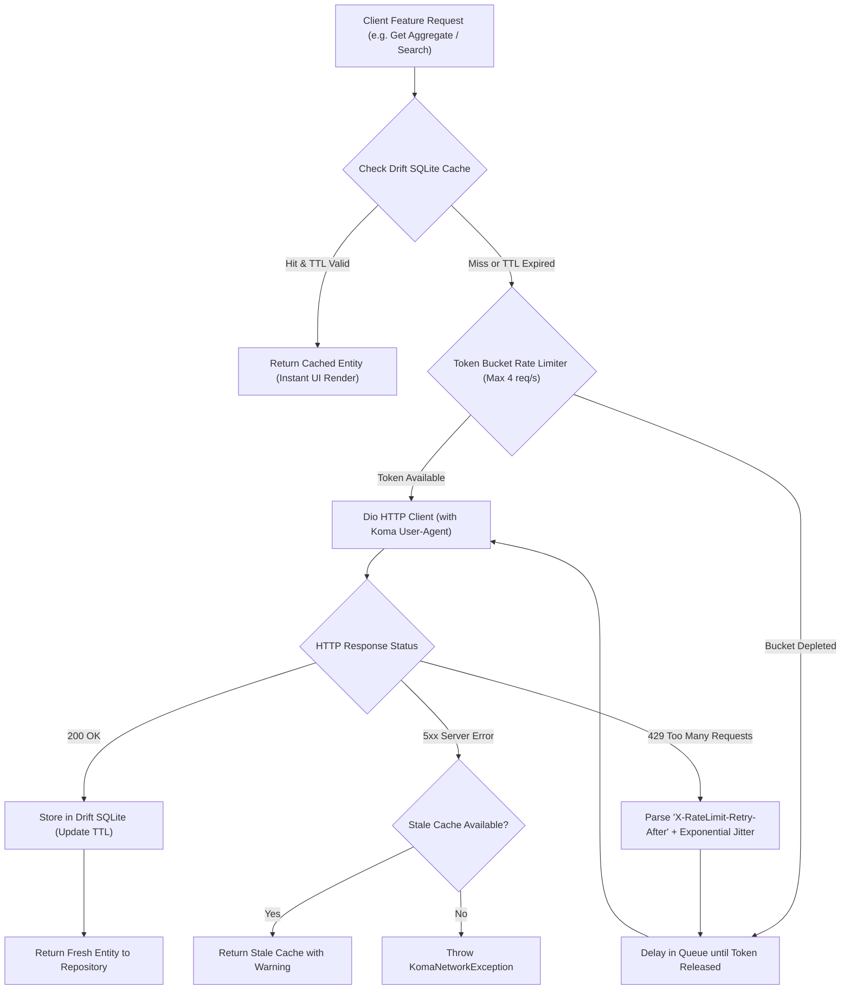

# MangaDex API Integration Guide

**Document Version:** 1.0.0  
**Status:** Canonical Reference  
**App Brand / Bundle:** Koma (`com.ciannavei.koma`)  
**Package Scope:** `packages/mangadex_api_client`, `packages/koma_cache_client`, `packages/manga_repository`  
**API Specification:** MangaDex REST API v5 (`https://api.mangadex.org`)  

---

## 1. Integration Architecture Overview

Koma integrates directly with the **MangaDex v5 REST API** to deliver manga discovery, rich metadata search, and canonical volume/chapter aggregation. 

> [!IMPORTANT]
> **Product Scope Boundary**: Koma is exclusively a **Manga Progress Tracker**. It interacts with MangaDex metadata, cover imagery, and chapter feeds to track reading progress. It does **not** download or render manga page scans (no MangaDex@Home integration or page image reader). When users wish to read chapters, Koma offers an external direct link to the canonical chapter URL on `mangadex.org`.

### 1.1 Base URLs and Domains

| Service | Base URL | Purpose |
| :--- | :--- | :--- |
| **REST API** | `https://api.mangadex.org` | Metadata search, manga details, chapter feed, aggregate tree |
| **Cover / Media CDN** | `https://uploads.mangadex.org` | Thumbnail, medium, and high-resolution cover image assets |
| **Web Portal** | `https://mangadex.org` | External reading links (e.g. `https://mangadex.org/chapter/{chapterId}`) |

---

## 2. Mandatory User-Agent & Compliance

MangaDex requires all API clients to adhere strictly to their Acceptable Use Policy. To protect the public infrastructure and prevent automated IP blocking:

1. **Mandatory Custom `User-Agent`**:
   Every HTTP request made to `api.mangadex.org` and `uploads.mangadex.org` **must** transmit the exact identification string:
   ```http
   User-Agent: Koma/0.1.0 (https://github.com/mattcianna/koma)
   ```
   - **Never spoof** standard browser User-Agents (e.g., Chrome or Safari).
   - This header must be configured globally in the client's `Dio` instance and supplied to image providers.

2. **Image CDN Anti-Hotlinking Rules & CDN Behavior**:
   Requests to `uploads.mangadex.org` must include the proper `User-Agent` and omit third-party `Referer` headers. Live empirical verification confirms:
   - **`HEAD` Requests Disallowed**: `uploads.mangadex.org` rejects `HEAD` requests with **HTTP `405 Method Not Allowed`** (`allow: GET, OPTIONS`). Image pre-fetching or validity checks must use `GET` with byte ranges or standard `CachedNetworkImage` loading.
   - **Empty User-Agent Blocked**: Requests without a `User-Agent` return **HTTP `400 Bad Request`** (`You must set an appropriate User-Agent header`).
   - **Mobile Client Compatibility**: Mobile clients (Android and iOS) using `CachedNetworkImage` with `User-Agent: Koma/0.1.0 (...)` and **no `Referer` header** receive **HTTP `200 OK`** with the authentic cover JPEG (`max-age=315360000`).
   - **The Silent HTTP `200 OK` Hotlink Trap**: If a third-party `Referer` header (e.g. `Referer: https://koma.app/`) is attached, MangaDex does **not** return 403. Instead, it returns **HTTP `200 OK`** (`cache-control: private, no-store`, `etag: "5ed7c990-e858"`, `59,480` bytes) with an anti-hotlink cat placeholder image stating *"You can read this at: MANGADEX https://mangadex.org/"*. Koma image and HTTP clients must **never** attach a custom `Referer` header.

   In Flutter, `CachedNetworkImage` and `Image.network` must pass `httpHeaders`:
   ```dart
   CachedNetworkImage(
     imageUrl: 'https://uploads.mangadex.org/covers/$mangaId/$coverFileName.256.jpg',
     httpHeaders: const {
       'User-Agent': 'Koma/0.1.0 (https://github.com/mattcianna/koma)',
     },
   );
   ```

---

## 3. Request Pipeline and Local Caching Flow



---

## 4. Endpoints and Integration Specifications

### 4.1 Search and Discovery: `GET /manga`

Searches manga titles, filters by localized scanlations, and embeds related resources (`cover_art` and `author`) in a single network round-trip.

#### Request Specification
- **Method**: `GET`
- **Path**: `https://api.mangadex.org/manga`
- **Headers**:
  - `User-Agent`: `Koma/0.1.0 (https://github.com/mattcianna/koma)`
  - `Accept`: `application/json`

#### Query Parameters

| Parameter | Type | Required | Description / Example |
| :--- | :--- | :--- | :--- |
| `title` | `string` | Optional | User search query (e.g., `"Frieren"`). |
| `limit` | `int` | Optional | Pagination size. Default: `20` (max 100). |
| `offset` | `int` | Optional | Pagination offset. Default: `0`. |
| `includes[]` | `string[]` | **Required** | Must pass `includes[]=cover_art` and `includes[]=author`. |
| `contentRating[]` | `string[]` | **Required** | Pass `contentRating[]=safe` and `contentRating[]=suggestive` (matches user settings). |
| `availableTranslatedLanguage[]` | `string[]` | **Required** | Pass `availableTranslatedLanguage[]=en` and `availableTranslatedLanguage[]=it`. |
| `order[relevance]` | `string` | Optional | `order[relevance]=desc` when query is present; `order[followedCount]=desc` or `order[rating]=desc` for discovery browse. |

#### Sample Request URL
```http
GET https://api.mangadex.org/manga?title=Dungeon%20Meshi&limit=20&offset=0&includes[]=cover_art&includes[]=author&contentRating[]=safe&contentRating[]=suggestive&availableTranslatedLanguage[]=en&availableTranslatedLanguage[]=it&order[relevance]=desc
```

#### Sample Response JSON (Truncated for Key Fields)
```json
{
  "result": "ok",
  "response": "collection",
  "data": [
    {
      "id": "d90ea6cb-7bc3-4d80-8af0-28557e6c4e17",
      "type": "manga",
      "attributes": {
        "title": {
          "ja-ro": "Dungeon Meshi"
        },
        "altTitles": [
          { "en": "Delicious in Dungeon" },
          { "it": "Dungeon Food" },
          { "ja": "ダンジョン飯" }
        ],
        "description": {
          "en": "What do you get when you cross dungeon adventures and food manga? You get Delicious in Dungeon...",
          "it": "Cosa ottieni quando incroci le avventure nei dungeon con i manga di cucina?..."
        },
        "status": "completed",
        "contentRating": "safe",
        "lastVolume": "14",
        "lastChapter": "97"
      },
      "relationships": [
        {
          "id": "3be93c31-b844-4860-9118-0fb53c631b6e",
          "type": "author",
          "attributes": {
            "name": "KUI Ryoko"
          }
        },
        {
          "id": "3be93c31-b844-4860-9118-0fb53c631b6e",
          "type": "artist"
        },
        {
          "id": "8bbbb9ca-e028-4034-8c81-805178553fb4",
          "type": "cover_art",
          "attributes": {
            "fileName": "62bf1433-ea33-4f9e-bd55-a0bc88f0376b.jpg"
          }
        }
      ]
    }
  ],
  "limit": 20,
  "offset": 0,
  "total": 1
}
```

#### Empirical Edge Cases on `GET /manga`

1. **Primary `attributes.title` Often Lacks `'en'` and `'it'`**:
   Flagship titles (*One Piece* `a1c7c817-4e59-43b7-9365-09675a149a6f`, *Dungeon Meshi* `d90ea6cb-7bc3-4d80-8af0-28557e6c4e17`, *Sousou no Frieren* `b0b721ff-c388-4486-aa0f-c2b0bb321512`, and *Solo Leveling* `32d76d19-8a05-4db0-9fc2-e0b0648fe9d0`) frequently key `attributes.title` exclusively by romanized Japanese/Korean (`{"ja-ro": "..."}` or `{"ko-ro": "..."}`), while localized English and Italian titles reside within `attributes.altTitles` (`List<Map<String, String>>`).
2. **Mixed Expanded and Unexpanded Relationships**:
   Relationships whose types are not included in `includes[]` (such as `type: "artist"` or `type: "manga"`) are returned with **no `"attributes"` object** (`attributes == null`). Deserializers must guard against null `attributes`.

```dart
/// Resolves localized strings from MangaDex title, altTitles, and description maps.
class MangaDexLocaleResolver {
  const MangaDexLocaleResolver._();

  static Map<String, dynamic> sanitizeMap(Object? raw) {
    if (raw is Map<String, dynamic>) return raw;
    if (raw is Map) return Map<String, dynamic>.from(raw);
    return const <String, dynamic>{};
  }

  /// Resolves the best display title given user preferred languages (e.g. `['it', 'en']`).
  static String resolveTitle({
    required Object? rawTitle,
    required Object? rawAltTitles,
    List<String> preferredLocales = const ['en', 'it'],
  }) {
    final titleMap = sanitizeMap(rawTitle);
    final altList = rawAltTitles is List ? rawAltTitles : const <Object?>[];

    // 1. Check primary title map for preferred locales in priority order
    for (final locale in preferredLocales) {
      final candidate = titleMap[locale];
      if (candidate is String && candidate.trim().isNotEmpty) {
        return candidate.trim();
      }
    }

    // 2. Search altTitles list of single-key maps for preferred locales
    for (final locale in preferredLocales) {
      for (final item in altList) {
        final map = sanitizeMap(item);
        final candidate = map[locale];
        if (candidate is String && candidate.trim().isNotEmpty) {
          return candidate.trim();
        }
      }
    }

    // 3. Fallback to English in primary title or altTitles
    final enTitle = titleMap['en'];
    if (enTitle is String && enTitle.trim().isNotEmpty) {
      return enTitle.trim();
    }
    for (final item in altList) {
      final map = sanitizeMap(item);
      final candidate = map['en'];
      if (candidate is String && candidate.trim().isNotEmpty) {
        return candidate.trim();
      }
    }

    // 4. Fallback to romanized Japanese/Korean/Chinese or first available key
    for (final fallbackKey in const ['ja-ro', 'ko-ro', 'zh-ro', 'ja', 'ko']) {
      final candidate = titleMap[fallbackKey];
      if (candidate is String && candidate.trim().isNotEmpty) {
        return candidate.trim();
      }
    }

    for (final value in titleMap.values) {
      if (value is String && value.trim().isNotEmpty) {
        return value.trim();
      }
    }

    return 'Unknown Title';
  }

  /// Resolves localized description with fallback to `'en'` or first available entry.
  static String? resolveDescription({
    required Object? rawDescription,
    List<String> preferredLocales = const ['en', 'it'],
  }) {
    final descMap = sanitizeMap(rawDescription);
    if (descMap.isEmpty) return null;

    for (final locale in [...preferredLocales, 'en']) {
      final value = descMap[locale];
      if (value is String && value.trim().isNotEmpty) {
        return value.trim();
      }
    }

    for (final value in descMap.values) {
      if (value is String && value.trim().isNotEmpty) {
        return value.trim();
      }
    }
    return null;
  }

  /// Extracts `fileName` from expanded cover_art relationship, ignoring unexpanded types.
  static String? extractCoverFileName(Object? rawRelationships) {
    if (rawRelationships is! List) return null;
    for (final rel in rawRelationships) {
      final map = sanitizeMap(rel);
      if (map['type'] == 'cover_art') {
        final attrs = sanitizeMap(map['attributes']);
        final fileName = attrs['fileName'];
        if (fileName is String && fileName.isNotEmpty) {
          return fileName;
        }
      }
    }
    return null;
  }
}
```

---

### 4.2 Cover Art Resolution Specification

MangaDex hosts covers in 3 standardized sizes on `uploads.mangadex.org`. Koma resolves the image URL by extracting the `cover_art` relationship's `fileName` and the `manga.id`.

#### Image URL Structure

| Variant | Resolution | URL Pattern | Koma Usage |
| :--- | :--- | :--- | :--- |
| **Grid Thumbnail** | 256px wide | `https://uploads.mangadex.org/covers/{mangaId}/{fileName}.256.jpg` | Library 2-column & 3-column grid cards, Search result lists |
| **Detail Header** | 512px wide | `https://uploads.mangadex.org/covers/{mangaId}/{fileName}.512.jpg` | Manga Detail Screen hero banner, Bottom sheet previews |
| **Original High-Res**| Original | `https://uploads.mangadex.org/covers/{mangaId}/{fileName}` | Interactive zoom viewer, full-bleed artwork modal |

#### Dart Cover Resolver Helper
```dart
/// Utility class to generate canonical MangaDex CDN cover URLs.
class MangaDexCoverUrlResolver {
  const MangaDexCoverUrlResolver._();

  static const String _baseUrl = 'https://uploads.mangadex.org/covers';

  /// Generates the 256px thumbnail for grid cards.
  static String thumbnail256({
    required String mangaId,
    required String fileName,
  }) =>
      '$_baseUrl/$mangaId/$fileName.256.jpg';

  /// Generates the 512px medium image for detail screens.
  static String medium512({
    required String mangaId,
    required String fileName,
  }) =>
      '$_baseUrl/$mangaId/$fileName.512.jpg';

  /// Generates the full original uncompressed asset URL.
  static String original({
    required String mangaId,
    required String fileName,
  }) =>
      '$_baseUrl/$mangaId/$fileName';
}
```

---

### 4.3 Volume and Chapter Aggregation: `GET /manga/{id}/aggregate`

Retrieves a pre-computed hierarchical map of all published volumes and canonical chapter identifiers for a manga, grouped by volume and chapter number.

#### Request Specification
- **Method**: `GET`
- **Path**: `https://api.mangadex.org/manga/{id}/aggregate`
- **Headers**:
  - `User-Agent`: `Koma/0.1.0 (https://github.com/mattcianna/koma)`
- **Query Parameters**:
  - `translatedLanguage[]=en`
  - `translatedLanguage[]=it` (can be repeated for multiple user-configured preferred languages)

#### Sample Request URL
```http
GET https://api.mangadex.org/manga/d90ea6cb-7bc3-4d80-8af0-28557e6c4e17/aggregate?translatedLanguage[]=en&translatedLanguage[]=it
```

#### Sample Response JSON
```json
{
  "result": "ok",
  "volumes": {
    "1": {
      "volume": "1",
      "count": 6,
      "chapters": {
        "1": {
          "chapter": "1",
          "id": "e67e3a9c-091f-4b06-b371-477ef94c643b",
          "isUnavailable": false,
          "others": [
            "20c48792-75d1-4475-a8c7-4560ea3d6f14"
          ],
          "count": 2
        },
        "2": {
          "chapter": "2",
          "id": "7878d6b8-6a3a-4416-861f-366579bb5ee5",
          "isUnavailable": false,
          "others": [],
          "count": 1
        }
      }
    },
    "none": {
      "volume": "none",
      "count": 1,
      "chapters": {
        "97.5": {
          "chapter": "97.5",
          "id": "9982f1b4-4b55-46aa-bd1a-96e578c772c1",
          "isUnavailable": false,
          "others": [],
          "count": 1
        }
      }
    }
  }
}
```

#### Parsing Rules and Defensive Handling

> [!WARNING]
> **MangaDex Empty Array vs Map Quirk**:  
> In PHP-based backends like MangaDex, an empty associative array is serialized as `[]` (JSON array) rather than `{}` (JSON object). If a manga has no volumes or a volume has no chapters in the requested language, `volumes` or `chapters` will be `[]`.
> A standard Dart `Map<String, dynamic>.fromJson` will throw a `TypeError: type 'List<dynamic>' is not a subtype of type 'Map<String, dynamic>'`.
> Koma's deserializer **must** verify whether the JSON node is a `Map` or a `List` before parsing.

```dart
/// Defensive JSON parser for MangaDex aggregate structure.
Map<String, dynamic> sanitizeMapField(dynamic value) {
  if (value is Map<String, dynamic>) {
    return value;
  }
  // When empty, MangaDex returns [] instead of {}
  return <String, dynamic>{};
}
```

#### Natural/Decimal Chapter Comparator in Dart

Chapter numbering in manga contains decimals (`10.5`), bonuses (`10.1`, `10.2`), and non-numeric labels (`"10a"`, `"omake"`, `"ex"`, `"none"`). Standard alphanumeric sorting causes `"10"` to sort before `"2"`. Additionally, naive string/number parsing can cause `"11"` to sort before `"10a"`.

Koma implements a **Production Natural Decimal Chapter Comparator**:

```dart
/// Production natural/decimal chapter comparator for MangaDex chapter keys.
///
/// Correctly orders:
/// `"0"` < `"1"` < `"2"` < `"10"` < `"10a"` < `"10b"` < `"10.1"` < `"10.5"` < `"11"` < `"extra"` < `"none"`
class ChapterComparator {
  const ChapterComparator._();

  static final RegExp _prefixRegex = RegExp(r'^(\d+(?:\.\d+)?)(.*)$');

  static int compare(String a, String b) {
    if (a == b) return 0;

    final normA = a.trim();
    final normB = b.trim();
    final lowerA = normA.toLowerCase();
    final lowerB = normB.toLowerCase();

    // Pin "none" (unnumbered chapters/oneshots) to the end
    if (lowerA == 'none' && lowerB == 'none') return 0;
    if (lowerA == 'none') return 1;
    if (lowerB == 'none') return -1;

    final matchA = _prefixRegex.firstMatch(normA);
    final matchB = _prefixRegex.firstMatch(normB);

    // Both start with a numeric value (e.g. "10", "10.5", "10a", "11")
    if (matchA != null && matchB != null) {
      final numA = double.parse(matchA.group(1)!);
      final numB = double.parse(matchB.group(1)!);
      final numDiff = numA.compareTo(numB);
      if (numDiff != 0) return numDiff;

      final suffixA = matchA.group(2)!.trim();
      final suffixB = matchB.group(2)!.trim();
      if (suffixA.isEmpty && suffixB.isNotEmpty) return -1;
      if (suffixA.isNotEmpty && suffixB.isEmpty) return 1;
      return suffixA.compareTo(suffixB);
    }

    // Chapters with a leading number sort before purely non-numeric labels ("extra", "omake")
    if (matchA != null && matchB == null) return -1;
    if (matchA == null && matchB != null) return 1;

    return lowerA.compareTo(lowerB);
  }
}
```

---

### 4.4 Chapter Feed and Release Updates: `GET /manga/{id}/feed` & `GET /chapter`

Used to check for newly published chapters since a specific timestamp.

#### Request Specification (`GET /manga/{id}/feed`)
- **Query Parameters**:
  - `translatedLanguage[]=en`
  - `translatedLanguage[]=it`
  - `publishAtSince`: **Strict ISO-8601 UTC string without milliseconds and without trailing 'Z'**:
    `YYYY-MM-DDTHH:mm:ss` (e.g. `2026-11-12T00:00:00`).
  - `order[publishAt]=desc`
  - `limit`: `100`

> [!CAUTION]
> **Strict Timestamp Formatting for MangaDex**:  
> The MangaDex API parser rejects standard Dart `dateTime.toIso8601String()` because Dart outputs milliseconds and `Z` (e.g. `2026-11-12T00:00:00.000Z`), triggering HTTP `400 Bad Request` with a `validation_exception`:
> ```json
> {
>   "result": "error",
>   "errors": [
>     {
>       "id": "9c346772-7b14-5982-b4b6-7b5888522762",
>       "status": 400,
>       "title": "validation_exception",
>       "detail": "Error validating /publishAtSince: Does not match the regex pattern ^\\d{4}-[0-1]\\d-([0-2]\\d|3[0-1])T([0-1]\\d|2[0-3]):[0-5]\\d:[0-5]\\d$",
>       "context": null
>     }
>   ]
> }
> ```
> Always format `publishAtSince` with exact pattern:
> ```dart
> String formatMangaDexTimestamp(DateTime utcDateTime) {
>   final d = utcDateTime.toUtc();
>   String pad(int n) => n.toString().padLeft(2, '0');
>   return '${d.year}-${pad(d.month)}-${pad(d.day)}T${pad(d.hour)}:${pad(d.minute)}:${pad(d.second)}';
> }
> ```

---

## 5. Rate-Limit Mitigation & Token-Bucket Architecture

### 5.1 MangaDex Rate Limits

MangaDex enforces a global rate limit of **5 requests per second (req/s) per IP**.
Exceeding this threshold triggers an HTTP `429 Too Many Requests` response.

### 5.2 Header Inspection

MangaDex transmits current rate limit state in standard HTTP response headers:
- `X-RateLimit-Limit`: Maximum allowed requests per window (e.g. `5`).
- `X-RateLimit-Remaining`: Remaining request quota in the current window.
- `X-RateLimit-Retry-After`: Unix timestamp (or seconds) to sleep before dispatching the next request.

### 5.3 Dart Token-Bucket Interceptor (`packages/mangadex_api_client`)

To provide safe headroom against 429 errors, Koma constrains client network traffic to **4 requests per second**:

```dart
import 'dart:async';
import 'dart:math';
import 'package:dio/dio.dart';

/// Leaky / Token-bucket Dio interceptor that throttles outgoing requests to 4 req/s
/// and transparently retries on HTTP 429 with full jitter exponential backoff.
class MangaDexRateLimitInterceptor extends QueuedInterceptor {
  MangaDexRateLimitInterceptor({
    this.requestsPerSecond = 4,
    this.maxBurst = 4,
  }) : _tokenInterval = Duration(milliseconds: 1000 ~/ requestsPerSecond) {
    _availableTokens = maxBurst.toDouble();
    _lastRefill = DateTime.now();
  }

  final int requestsPerSecond;
  final int maxBurst;
  final Duration _tokenInterval;

  double _availableTokens = 4.0;
  DateTime _lastRefill = DateTime.now();
  final Random _random = Random();

  void _refillTokens() {
    final now = DateTime.now();
    final elapsed = now.difference(_lastRefill).inMilliseconds;
    final tokensToAdd = elapsed / _tokenInterval.inMilliseconds;
    if (tokensToAdd > 0) {
      _availableTokens = min(maxBurst.toDouble(), _availableTokens + tokensToAdd);
      _lastRefill = now;
    }
  }

  @override
  Future<void> onRequest(
    RequestOptions options,
    RequestInterceptorHandler handler,
  ) async {
    // 1. Mandatory User-Agent enforcement
    options.headers['User-Agent'] = 'Koma/0.1.0 (https://github.com/mattcianna/koma)';

    // 2. Token Bucket gate
    while (true) {
      _refillTokens();
      if (_availableTokens >= 1.0) {
        _availableTokens -= 1.0;
        return handler.next(options);
      }
      // Wait for next token generation
      await Future<void>.delayed(const Duration(milliseconds: 250));
    }
  }

  @override
  Future<void> onError(
    DioException err,
    ErrorInterceptorHandler handler,
  ) async {
    if (err.response?.statusCode == 429) {
      final retryAfterHeader = err.response?.headers.value('x-ratelimit-retry-after');
      int waitMs = 2000; // Default fallback wait

      if (retryAfterHeader != null) {
        final parsed = int.tryParse(retryAfterHeader.trim());
        if (parsed != null) {
          final nowMs = DateTime.now().millisecondsSinceEpoch;
          if (parsed < 100000) {
            // Relative delta in seconds
            waitMs = parsed * 1000;
          } else if (parsed < 100000000000) {
            // Unix timestamp in seconds (e.g. 1794593250)
            waitMs = (parsed * 1000) - nowMs;
          } else {
            // Unix timestamp in milliseconds
            waitMs = parsed - nowMs;
          }
        }
      }

      // Add full jitter to prevent thundering herd
      final jitter = _random.nextInt(500);
      final totalWait = max(1000, waitMs + jitter);

      await Future<void>.delayed(Duration(milliseconds: totalWait));

      // Retry request with cloned options
      try {
        final dio = Dio();
        final response = await dio.fetch(err.requestOptions);
        return handler.resolve(response);
      } on DioException catch (retryErr) {
        return handler.next(retryErr);
      }
    }

    return handler.next(err);
  }
}
```

---

## 6. Drift SQLite Local Caching Architecture

To drastically reduce round-trips to MangaDex, Koma employs **Drift SQLite (`packages/koma_cache_client`)** with explicit Cache-Control TTLs:

### 6.1 Cache TTL Policies

| Entity | Route | TTL | Eviction Strategy |
| :--- | :--- | :--- | :--- |
| **Manga Metadata** | `GET /manga/{id}` | **24 Hours** | LRU table cap (max 500 items) |
| **Volume/Chapter Aggregate** | `GET /manga/{id}/aggregate` | **30 Minutes** | Invalidation on user pull-to-refresh or TTL expiration |
| **Search Queries** | `GET /manga?title=...` | **15 Minutes** | LRU table cap (max 50 query results) |

### 6.2 Cache Storage Schema (Drift Definition)

```dart
import 'package:drift/drift.dart';

class MangaMetadataCache extends Table {
  TextColumn get mangaId => text()();
  TextColumn get jsonPayload => text()();
  DateTimeColumn get cachedAt => dateTime()();
  DateTimeColumn get expiresAt => dateTime()();

  @override
  Set<Column> get primaryKey => {mangaId};
}

class MangaAggregateCache extends Table {
  TextColumn get mangaId => text()();
  TextColumn get languagesKey => text()(); // e.g. "en,it"
  TextColumn get jsonPayload => text()();
  DateTimeColumn get cachedAt => dateTime()();
  DateTimeColumn get expiresAt => dateTime()();

  @override
  Set<Column> get primaryKey => {mangaId, languagesKey};
}
```

### 6.3 Repository Cache-First Pattern

When `MangaRepository.getAggregate(mangaId)` is invoked:
1. Query `MangaAggregateCache` where `mangaId == id` and `languagesKey == preferredLangs`.
2. If row exists and `DateTime.now().isBefore(expiresAt)`: immediately deserialize and return cached `MangaAggregate`.
3. If row does not exist or expired:
   - Call `MangaDexApiClient.getAggregate(mangaId, languages)`.
   - Upsert row into `MangaAggregateCache` with `expiresAt = DateTime.now().add(const Duration(minutes: 30))`.
   - Return fresh `MangaAggregate`.
4. If network fails with offline or 5xx error and a stale cache entry exists: return stale cache entry with a log warning, providing seamless offline usability.
