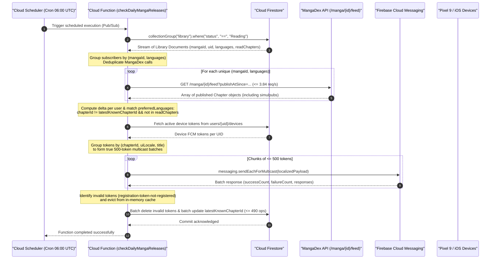

# 05 — Cloud Functions Notification Scheduler

This document specifies the architecture, directory layout, TypeScript implementation, and emulator testing workflows for the Koma daily release notification backend. The backend is implemented as a serverless Cloud Functions for Firebase (v2) service running on **Node.js 22**, using Firebase Admin SDK v13 and `firebase-functions` v6.

---

## 1. System Overview & Architectural Role

Koma is an offline-first manga tracking application. The Flutter client manages reading progress locally and synchronizes bidirectionally with Cloud Firestore. To provide daily release notifications without requiring the mobile device to poll the MangaDex API in the background, a centralized Cloud Function executes once every 24 hours.

### 1.1 Responsibilities
1. **Subscription Harvesting**: Query Cloud Firestore across all users to identify all manga marked with status `Reading` via a `collectionGroup('library')` query.
2. **Global Deduplication**: Aggregate subscribers by `(mangaId, preferredLanguages)` so that MangaDex is queried at most once per manga per language cluster, regardless of how many users track that title.
3. **MangaDex Release Polling**: Fetch new chapters released within the past 24 hours via `GET /manga/{id}/feed` using the mandatory `User-Agent: Koma/0.1.0 (https://github.com/mattcianna/koma)` and a strict client-side rate limiter (<= 4 req/s).
4. **Subscriber Delta Computation**: For each subscriber, verify whether the newly discovered chapter has already been read (`readChapters`) or previously notified (`latestKnownChapterId`), matching against the subscriber's specific `preferredLanguages`.
5. **Localized FCM Multicast**: Dispatch targeted push notifications in the subscriber's preferred language (`en` or `it`) via Firebase Cloud Messaging (`messaging.sendEachForMulticast`), batched in chunks of up to 500 tokens across all subscribers waiting for that chapter release.
6. **Token Hygiene & State Persistence**: Remove invalid or expired FCM registration tokens (`messaging/registration-token-not-registered`) from `users/{uid}/devices` and atomically update `latestKnownChapterId` and `latestKnownChapterNumber` on the user's library document in batched writes (<= 490 operations per batch).
7. **Local Emulator Support**: Expose an HTTP-triggered manual endpoint (`triggerDailyCheckManual`) to facilitate rapid local testing without waiting for the 24-hour Cloud Scheduler cron trigger.

---

## 2. Notification Pipeline Architecture

The following diagram illustrates the end-to-end data flow from the Cloud Scheduler trigger to device notification delivery and token cleanup:



---

## 3. Directory Layout & Configuration

The Cloud Functions codebase resides under `firebase/functions/` within the Koma repository.

```
firebase/
├── firebase.json
├── firestore.indexes.json
├── firestore.rules
└── functions/
    ├── package.json
    ├── tsconfig.json
    └── src/
        ├── index.ts                  # Function export entrypoint
        ├── config.ts                 # Environment & operational constants
        ├── types/
        │   ├── firestore.ts          # Firestore document interfaces
        │   └── mangadex.ts           # MangaDex API payload interfaces
        ├── services/
        │   ├── firestore.ts          # Subscription queries & atomic updates
        │   ├── mangadex.ts           # Rate-limited MangaDex HTTP client
        │   └── notification.ts       # FCM multicast & token pruning
        └── utils/
            ├── rate_limiter.ts       # Token-bucket / delay rate limiter (<= 4 req/s)
            └── logger.ts             # Structured logging wrapper
```

### 3.1 `package.json`
Specifies Node.js 22 runtime dependencies, using `firebase-functions` v6 with Cloud Functions v2 and `firebase-admin` v13.

```json
{
  "name": "koma-functions",
  "version": "0.1.0",
  "description": "Koma Manga Tracker Cloud Functions v2 Backend",
  "main": "lib/index.js",
  "engines": {
    "node": "22"
  },
  "scripts": {
    "lint": "eslint --ext .js,.ts .",
    "build": "tsc",
    "build:watch": "tsc --watch",
    "serve": "npm run build && firebase emulators:start --only functions",
    "shell": "npm run build && firebase functions:shell",
    "start": "npm run shell",
    "deploy": "firebase deploy --only functions"
  },
  "dependencies": {
    "bottleneck": "^2.19.5",
    "firebase-admin": "^13.1.0",
    "firebase-functions": "^6.3.2",
    "undici": "^7.3.0"
  },
  "devDependencies": {
    "@types/node": "^22.13.4",
    "typescript": "^5.7.3"
  },
  "private": true
}
```

### 3.2 `tsconfig.json`
Ensures strict TypeScript compilation targeting modern Node.js 22 ESM/CommonJS modules.

```json
{
  "compilerOptions": {
    "module": "commonjs",
    "noImplicitReturns": true,
    "noUnusedLocals": true,
    "outDir": "lib",
    "sourceMap": true,
    "strict": true,
    "target": "es2022",
    "skipLibCheck": true,
    "esModuleInterop": true,
    "forceConsistentCasingInFileNames": true
  },
  "compileOnSave": true,
  "include": [
    "src"
  ]
}
```

---

## 4. MangaDex Rate Limiting & User-Agent Compliance

MangaDex enforces a global limit of 5 requests per second per IP address. Exceeding this threshold results in an HTTP `429 Too Many Requests` status code with an `X-RateLimit-Retry-After` header. Failure to adhere to guidelines risks a permanent IP ban.

To guarantee compliance:
1. **Mandatory User-Agent**: Every HTTP request made by `firebase/functions` sends:
   ```http
   User-Agent: Koma/0.1.0 (https://github.com/mattcianna/koma)
   ```
2. **Token Bucket Rate Limiter**: The functions leverage `bottleneck` configured with:
   - `maxConcurrent`: 1
   - `minTime`: 260 ms (yielding ~3.84 requests per second, strictly below the 5 req/s threshold)
   - `reservoir`: 4 (burst limit)
   - `reservoirRefreshInterval`: 1000 ms
   - `reservoirRefreshAmount`: 4
3. **Feed Query Format**:
   - URL: `https://api.mangadex.org/manga/{mangaId}/feed`
   - Parameters:
     - `limit`: 100
     - `order[publishAt]`: `desc`
     - `publishAtSince`: `YYYY-MM-DDTHH:mm:ss` (UTC timestamp 24 hours prior to execution, omitting sub-seconds and trailing `Z` as required by MangaDex API specifications)
     - `translatedLanguage[]`: language codes requested by subscribers (e.g. `en`, `it`)
     - `includeEmptyPages`: **Omitted**. (Do NOT set `includeEmptyPages=0`, which filters out official simulpub chapters such as MangaPlus and Viz releases where `pages: 0` and `externalUrl != null`).

---

## 5. Complete TypeScript Implementation

Below is the complete, production-grade implementation of the notification scheduler and manual trigger helper.

### 5.1 Configuration (`src/config.ts`)

```typescript
export const CONFIG = {
  mangadex: {
    baseUrl: 'https://api.mangadex.org',
    userAgent: 'Koma/0.1.0 (https://github.com/mattcianna/koma)',
    maxRequestsPerSecond: 3.84,
    minTimeBetweenRequestsMs: 260,
    feedPageLimit: 100,
  },
  fcm: {
    maxMulticastBatchSize: 500,
  },
  firestore: {
    maxBatchWriteSize: 490, // Margin below Firestore 500-op ceiling
  },
  scheduler: {
    timeZone: 'UTC',
    defaultCronSchedule: '0 6 * * *', // 06:00 UTC every day
    timeoutSeconds: 540,
    memory: '512MiB' as const,
  },
};
```

### 5.2 Type Definitions (`src/types/firestore.ts` & `src/types/mangadex.ts`)

#### `src/types/firestore.ts`
```typescript
import { Timestamp } from 'firebase-admin/firestore';

export type ReadingStatus = 'Reading' | 'Plan to Read' | 'Completed' | 'On Hold' | 'Dropped';

export interface UserDocument {
  uid: string;
  email: string;
  displayName?: string | null;
  photoUrl?: string | null;
  uiLocale: 'en' | 'it';
  preferredLanguages: string[];
  contentRatings: string[];
  notificationsEnabled: boolean;
  createdAt: Timestamp;
  updatedAt: Timestamp;
}

export interface DeviceDocument {
  token: string;
  platform: 'android' | 'ios';
  updatedAt: Timestamp;
}

export interface LibraryDocument {
  mangaId: string;
  uid: string;
  title: string;
  coverFileName?: string | null;
  status: ReadingStatus;
  preferredLanguages: string[];
  readChapters: string[];
  readVolumes: string[];
  lastReadChapter?: string | null;
  lastReadChapterId?: string | null;
  latestKnownChapterId?: string | null;
  latestKnownChapterNumber?: string | null;
  addedAt: Timestamp;
  updatedAt: Timestamp;
}
```

#### `src/types/mangadex.ts`
```typescript
export interface MangaDexChapterAttributes {
  volume: string | null;
  chapter: string | null;
  title: string | null;
  translatedLanguage: string;
  externalUrl: string | null;
  publishAt: string;
  readableAt: string;
  createdAt: string;
  updatedAt: string;
  pages: number;
  version: number;
}

export interface MangaDexChapterData {
  id: string;
  type: 'chapter';
  attributes: MangaDexChapterAttributes;
}

export interface MangaDexFeedResponse {
  result: 'ok' | 'error';
  response: 'collection';
  data: MangaDexChapterData[];
  limit: number;
  offset: number;
  total: number;
}
```

### 5.3 Rate-Limited MangaDex Client (`src/services/mangadex.ts`)

```typescript
import Bottleneck from 'bottleneck';
import { request } from 'undici';
import { CONFIG } from '../config';
import { MangaDexChapterData, MangaDexFeedResponse } from '../types/mangadex';
import * as logger from 'firebase-functions/logger';

export class MangaDexClient {
  private limiter: Bottleneck;

  constructor() {
    this.limiter = new Bottleneck({
      maxConcurrent: 1,
      minTime: CONFIG.mangadex.minTimeBetweenRequestsMs,
      reservoir: 4,
      reservoirRefreshInterval: 1000,
      reservoirRefreshAmount: 4,
    });

    this.limiter.on('failed', async (error, jobInfo) => {
      logger.warn(`MangaDex request failed (attempt ${jobInfo.retryCount + 1}):`, error);
      if (jobInfo.retryCount < 3) {
        return 1000 * Math.pow(2, jobInfo.retryCount);
      }
      return undefined;
    });
  }

  /**
   * Formats a Date object to MangaDex UTC publishAtSince format: YYYY-MM-DDTHH:mm:ss
   * Omits milliseconds and 'Z' suffix to comply with MangaDex validation regex.
   */
  public static formatPublishAtSince(date: Date): string {
    const pad = (n: number) => n.toString().padStart(2, '0');
    const yyyy = date.getUTCFullYear();
    const mm = pad(date.getUTCMonth() + 1);
    const dd = pad(date.getUTCDate());
    const hh = pad(date.getUTCHours());
    const min = pad(date.getUTCMinutes());
    const ss = pad(date.getUTCSeconds());
    return `${yyyy}-${mm}-${dd}T${hh}:${min}:${ss}`;
  }

  /**
   * Fetches chapters published since `publishAtSince` for a specific manga and languages.
   * NOTE: includeEmptyPages is intentionally omitted so official simulpubs (pages: 0, externalUrl != null)
   * are included in the results.
   */
  public async getMangaFeed(
    mangaId: string,
    languages: string[],
    since: Date,
  ): Promise<MangaDexChapterData[]> {
    const formattedSince = MangaDexClient.formatPublishAtSince(since);
    const url = new URL(`${CONFIG.mangadex.baseUrl}/manga/${mangaId}/feed`);

    url.searchParams.set('limit', CONFIG.mangadex.feedPageLimit.toString());
    url.searchParams.set('order[publishAt]', 'desc');
    url.searchParams.set('publishAtSince', formattedSince);

    for (const lang of languages) {
      url.searchParams.append('translatedLanguage[]', lang);
    }

    return this.limiter.schedule(async () => {
      logger.info(`Fetching MangaDex feed for manga ${mangaId} (languages: ${languages.join(',')})`);
      const response = await request(url.toString(), {
        method: 'GET',
        headers: {
          'User-Agent': CONFIG.mangadex.userAgent,
          'Accept': 'application/json',
        },
      });

      if (response.statusCode === 429) {
        const retryAfter = response.headers['x-ratelimit-retry-after'];
        logger.error(`MangaDex rate limit hit for ${mangaId}. Retry-After: ${retryAfter}`);
        throw new Error(`MangaDex rate limit (429) encountered. Retry-After: ${retryAfter}`);
      }

      if (response.statusCode < 200 || response.statusCode >= 300) {
        const bodyText = await response.body.text();
        throw new Error(
          `MangaDex API error [${response.statusCode}] on ${url.toString()}: ${bodyText}`,
        );
      }

      const body = (await response.body.json()) as MangaDexFeedResponse;
      if (body.result !== 'ok' || !Array.isArray(body.data)) {
        logger.warn(`Unexpected MangaDex feed payload for manga ${mangaId}:`, body);
        return [];
      }

      return body.data;
    });
  }
}
```

### 5.4 Notification & Token Pruning Service (`src/services/notification.ts`)

```typescript
import * as admin from 'firebase-admin';
import * as logger from 'firebase-functions/logger';
import { CONFIG } from '../config';

export interface NotificationPayload {
  mangaId: string;
  mangaTitle: string;
  chapterNumber: string;
  chapterId: string;
  uiLocale: 'en' | 'it';
}

export class NotificationService {
  private messaging: admin.messaging.Messaging;
  private db: admin.firestore.Firestore;

  constructor(messaging: admin.messaging.Messaging, db: admin.firestore.Firestore) {
    this.messaging = messaging;
    this.db = db;
  }

  /**
   * Generates localized notification title and body based on recipient UI locale.
   */
  public static formatMessage(payload: NotificationPayload): { title: string; body: string } {
    const isUnnumbered = !payload.chapterNumber || payload.chapterNumber === 'none';
    if (payload.uiLocale === 'it') {
      const chapterLabel = isUnnumbered ? 'Nuovo Capitolo' : `Capitolo ${payload.chapterNumber}`;
      return {
        title: `${payload.mangaTitle} — Nuovo Rilascio!`,
        body: `È disponibile il ${chapterLabel}. Tocca per aggiornare i tuoi progressi in Koma.`,
      };
    }

    const chapterLabel = isUnnumbered ? 'New Chapter' : `Chapter ${payload.chapterNumber}`;
    return {
      title: `${payload.mangaTitle} — New Release!`,
      body: `${chapterLabel} is now available. Tap to track your reading progress in Koma.`,
    };
  }

  /**
   * Dispatches FCM multicast notification to devices and cleans up invalid tokens.
   * Returns counts and the list of pruned token references so calling caches can be updated.
   */
  public async sendMulticastNotification(
    userTokens: Array<{ uid: string; token: string; deviceId: string }>,
    payload: NotificationPayload,
  ): Promise<{
    successCount: number;
    failureCount: number;
    prunedTokens: Array<{ uid: string; deviceId: string }>;
  }> {
    if (userTokens.length === 0) {
      return { successCount: 0, failureCount: 0, prunedTokens: [] };
    }

    const { title, body } = NotificationService.formatMessage(payload);
    const deepLinkRoute = `/library/manga/${payload.mangaId}`;

    const tokens = userTokens.map((t) => t.token);
    let totalSuccess = 0;
    let totalFailure = 0;
    const tokensToDelete: Array<{ uid: string; deviceId: string }> = [];

    // Chunk tokens into batches of <= 500 for FCM sendEachForMulticast
    for (let i = 0; i < tokens.length; i += CONFIG.fcm.maxMulticastBatchSize) {
      const chunkTokens = tokens.slice(i, i + CONFIG.fcm.maxMulticastBatchSize);
      const chunkRefs = userTokens.slice(i, i + CONFIG.fcm.maxMulticastBatchSize);

      const message: admin.messaging.MulticastMessage = {
        tokens: chunkTokens,
        notification: {
          title,
          body,
        },
        data: {
          mangaId: payload.mangaId,
          chapterId: payload.chapterId,
          chapterNumber: payload.chapterNumber,
          route: deepLinkRoute,
          click_action: 'FLUTTER_NOTIFICATION_CLICK',
        },
        android: {
          priority: 'high',
          notification: {
            channelId: 'koma_manga_releases',
            icon: 'ic_notification',
            color: '#E11D48', // Koma Vermilion
            clickAction: 'FLUTTER_NOTIFICATION_CLICK',
          },
        },
        apns: {
          payload: {
            aps: {
              alert: { title, body },
              sound: 'default',
              badge: 1,
            },
          },
        },
      };

      try {
        const response = await this.messaging.sendEachForMulticast(message);
        totalSuccess += response.successCount;
        totalFailure += response.failureCount;

        response.responses.forEach((resp, index) => {
          if (!resp.success) {
            const error = resp.error;
            const ref = chunkRefs[index];
            logger.warn(
              `FCM delivery failure for user ${ref.uid}, device ${ref.deviceId}: ${error?.code}`,
            );

            // Check for invalid or unregistered registration tokens
            if (
              error?.code === 'messaging/registration-token-not-registered' ||
              error?.code === 'messaging/invalid-registration-token' ||
              error?.code === 'messaging/invalid-argument'
            ) {
              tokensToDelete.push({ uid: ref.uid, deviceId: ref.deviceId });
            }
          }
        });
      } catch (err) {
        logger.error('Failed to send multicast batch:', err);
        totalFailure += chunkTokens.length;
      }
    }

    // Prune stale / unregistered device tokens from Firestore
    if (tokensToDelete.length > 0) {
      logger.info(`Pruning ${tokensToDelete.length} unregistered device tokens from Firestore.`);
      await this.pruneInvalidTokens(tokensToDelete);
    }

    return {
      successCount: totalSuccess,
      failureCount: totalFailure,
      prunedTokens: tokensToDelete,
    };
  }

  /**
   * Batch deletes invalid tokens from users/{uid}/devices/{deviceId}.
   */
  private async pruneInvalidTokens(
    tokens: Array<{ uid: string; deviceId: string }>,
  ): Promise<void> {
    const batches: admin.firestore.WriteBatch[] = [];
    let currentBatch = this.db.batch();
    let count = 0;

    for (const item of tokens) {
      const deviceRef = this.db.doc(`users/${item.uid}/devices/${item.deviceId}`);
      currentBatch.delete(deviceRef);
      count++;

      if (count === CONFIG.firestore.maxBatchWriteSize) {
        batches.push(currentBatch);
        currentBatch = this.db.batch();
        count = 0;
      }
    }

    if (count > 0) {
      batches.push(currentBatch);
    }

    await Promise.all(batches.map((b) => b.commit()));
  }
}
```

### 5.5 Release Processor & Orchestrator (`src/services/scheduler.ts`)

```typescript
import * as admin from 'firebase-admin';
import * as logger from 'firebase-functions/logger';
import { MangaDexClient } from './mangadex';
import { NotificationService } from './notification';
import { LibraryDocument, UserDocument, DeviceDocument } from '../types/firestore';
import { CONFIG } from '../config';

interface Subscriber {
  uid: string;
  libraryRef: admin.firestore.DocumentReference;
  title: string;
  preferredLanguages: Set<string>;
  readChapters: Set<string>;
  latestKnownChapterId?: string | null;
}

interface SubscriberGroup {
  mangaId: string;
  languages: Set<string>;
  subscribers: Subscriber[];
}

interface NotificationBatchGroup {
  chapterId: string;
  chapterNumber: string;
  mangaId: string;
  mangaTitle: string;
  uiLocale: 'en' | 'it';
  userTokens: Array<{ uid: string; token: string; deviceId: string }>;
}

export class NotificationScheduler {
  private db: admin.firestore.Firestore;
  private mangadex: MangaDexClient;
  private notifications: NotificationService;

  constructor(
    db: admin.firestore.Firestore,
    mangadex: MangaDexClient,
    notifications: NotificationService,
  ) {
    this.db = db;
    this.mangadex = mangadex;
    this.notifications = notifications;
  }

  /**
   * Primary entry point to execute the 24-hour manga release check.
   */
  public async executeDailyCheck(options?: { lookbackHours?: number; dryRun?: boolean }): Promise<{
    titlesChecked: number;
    chaptersFound: number;
    notificationsSent: number;
  }> {
    const lookbackHours = options?.lookbackHours ?? 24;
    const dryRun = options?.dryRun ?? false;
    const sinceDate = new Date(Date.now() - lookbackHours * 60 * 60 * 1000);

    logger.info(
      `Starting Daily Manga Release Check. Lookback: ${lookbackHours}h (since ${sinceDate.toISOString()}), dryRun: ${dryRun}`,
    );

    // 1. Query all library items where status == 'Reading' using collectionGroup
    const librarySnapshot = await this.db
      .collectionGroup('library')
      .where('status', '==', 'Reading')
      .get();

    logger.info(`Found ${librarySnapshot.size} total active 'Reading' library entries.`);

    if (librarySnapshot.empty) {
      return { titlesChecked: 0, chaptersFound: 0, notificationsSent: 0 };
    }

    // 2. Aggregate subscribers by mangaId
    const mangaGroups = new Map<string, SubscriberGroup>();

    for (const doc of librarySnapshot.docs) {
      const data = doc.data() as LibraryDocument;
      const mangaId = data.mangaId;
      const languages = data.preferredLanguages && data.preferredLanguages.length > 0
        ? data.preferredLanguages
        : ['en'];

      let group = mangaGroups.get(mangaId);
      if (!group) {
        group = {
          mangaId,
          languages: new Set<string>(),
          subscribers: [],
        };
        mangaGroups.set(mangaId, group);
      }

      for (const lang of languages) {
        group.languages.add(lang);
      }

      group.subscribers.push({
        uid: data.uid,
        libraryRef: doc.ref,
        title: data.title,
        preferredLanguages: new Set(languages),
        readChapters: new Set(data.readChapters ?? []),
        latestKnownChapterId: data.latestKnownChapterId,
      });
    }

    logger.info(
      `Deduplicated ${librarySnapshot.size} reading items into ${mangaGroups.size} unique manga titles.`,
    );

    let totalChaptersDiscovered = 0;
    let totalNotificationsSent = 0;

    // Cache user profiles (for uiLocale) and devices
    const userProfiles = new Map<string, UserDocument>();
    const userDevices = new Map<string, Array<{ deviceId: string; token: string }>>();

    // Structure for batching Firestore library document updates
    const pendingLibraryUpdates: Array<{
      ref: admin.firestore.DocumentReference;
      chapterId: string;
      chapterNumber: string;
    }> = [];

    // Structure for grouping notifications across all subscribers per release
    const notificationGroups = new Map<string, NotificationBatchGroup>();

    // 3. Process each unique manga title sequentially with rate limiting
    for (const [mangaId, group] of mangaGroups.entries()) {
      try {
        const languagesArray = Array.from(group.languages);
        const chapters = await this.mangadex.getMangaFeed(mangaId, languagesArray, sinceDate);

        if (chapters.length === 0) {
          continue;
        }

        totalChaptersDiscovered += chapters.length;

        // 4. Evaluate newly published chapters against each subscriber
        for (const sub of group.subscribers) {
          // ARGON-SCHED-01 Fix: Find the latest release matching this specific subscriber's languages
          const matchingChapter = chapters.find((ch) =>
            sub.preferredLanguages.has(ch.attributes.translatedLanguage),
          );

          if (!matchingChapter) {
            continue;
          }

          const chapterAttr = matchingChapter.attributes;
          // Normalizes unnumbered chapters to 'none' matching /aggregate convention
          const chapterNumber = chapterAttr.chapter ?? 'none';
          const chapterId = matchingChapter.id;

          // If the chapter is already known or read, skip
          if (sub.latestKnownChapterId === chapterId) {
            continue;
          }
          if (chapterNumber !== 'none' && sub.readChapters.has(chapterNumber)) {
            continue;
          }
          if (chapterNumber === 'none' && sub.readChapters.has('none')) {
            continue;
          }

          // Fetch user profile if not in cache
          let profile = userProfiles.get(sub.uid);
          if (!profile) {
            const userSnap = await this.db.doc(`users/${sub.uid}`).get();
            if (userSnap.exists) {
              profile = userSnap.data() as UserDocument;
              userProfiles.set(sub.uid, profile);
            }
          }

          const notificationsEnabled = profile?.notificationsEnabled ?? true;
          const uiLocale = profile?.uiLocale ?? 'en';

          if (notificationsEnabled && !dryRun) {
            // Fetch devices if not in cache
            let devices = userDevices.get(sub.uid);
            if (!devices) {
              const devicesSnap = await this.db.collection(`users/${sub.uid}/devices`).get();
              devices = devicesSnap.docs.map((d) => ({
                deviceId: d.id,
                token: (d.data() as DeviceDocument).token,
              }));
              userDevices.set(sub.uid, devices);
            }

            if (devices.length > 0) {
              // Group notifications by (chapterId, uiLocale, title) for batching
              const groupKey = `${chapterId}_${uiLocale}_${sub.title}`;
              let notifGroup = notificationGroups.get(groupKey);
              if (!notifGroup) {
                notifGroup = {
                  chapterId,
                  chapterNumber,
                  mangaId,
                  mangaTitle: sub.title,
                  uiLocale,
                  userTokens: [],
                };
                notificationGroups.set(groupKey, notifGroup);
              }

              for (const device of devices) {
                notifGroup.userTokens.push({
                  uid: sub.uid,
                  token: device.token,
                  deviceId: device.deviceId,
                });
              }
            }
          }

          // Queue library document update for batched commit
          if (!dryRun) {
            pendingLibraryUpdates.push({
              ref: sub.libraryRef,
              chapterId,
              chapterNumber,
            });
          }
        }
      } catch (mangaErr) {
        logger.error(`Error processing manga feed for ${mangaId}:`, mangaErr);
      }
    }

    // 5. ARGON-SCHED-02 Fix: Dispatch batched multicast notifications
    if (!dryRun && notificationGroups.size > 0) {
      logger.info(`Dispatching ${notificationGroups.size} aggregated notification groups via FCM.`);

      for (const group of notificationGroups.values()) {
        const result = await this.notifications.sendMulticastNotification(group.userTokens, {
          mangaId: group.mangaId,
          mangaTitle: group.mangaTitle,
          chapterNumber: group.chapterNumber,
          chapterId: group.chapterId,
          uiLocale: group.uiLocale,
        });

        totalNotificationsSent += result.successCount;

        // ARGON-SCHED-03 Fix: Evict pruned tokens from userDevices cache
        if (result.prunedTokens.length > 0) {
          for (const pruned of result.prunedTokens) {
            const cached = userDevices.get(pruned.uid);
            if (cached) {
              userDevices.set(
                pruned.uid,
                cached.filter((d) => d.deviceId !== pruned.deviceId),
              );
            }
          }
        }
      }
    }

    // 6. ARGON-SCHED-02 Fix: Batch commit library updates (<= 490 ops per WriteBatch)
    if (!dryRun && pendingLibraryUpdates.length > 0) {
      logger.info(
        `Committing ${pendingLibraryUpdates.length} library progress updates in WriteBatch chunks.`,
      );

      for (let i = 0; i < pendingLibraryUpdates.length; i += CONFIG.firestore.maxBatchWriteSize) {
        const chunk = pendingLibraryUpdates.slice(i, i + CONFIG.firestore.maxBatchWriteSize);
        const batch = this.db.batch();

        for (const update of chunk) {
          batch.update(update.ref, {
            latestKnownChapterId: update.chapterId,
            latestKnownChapterNumber: update.chapterNumber,
            updatedAt: admin.firestore.FieldValue.serverTimestamp(),
          });
        }

        await batch.commit();
      }
    }

    logger.info(
      `Daily check finished. Titles checked: ${mangaGroups.size}, Chapters found: ${totalChaptersDiscovered}, Notifications sent: ${totalNotificationsSent}`,
    );

    return {
      titlesChecked: mangaGroups.size,
      chaptersFound: totalChaptersDiscovered,
      notificationsSent: totalNotificationsSent,
    };
  }
}
```

### 5.6 Cloud Functions Entrypoint (`src/index.ts`)

```typescript
import * as admin from 'firebase-admin';
import { onSchedule } from 'firebase-functions/v2/scheduler';
import { onRequest } from 'firebase-functions/v2/https';
import * as logger from 'firebase-functions/logger';

import { CONFIG } from './config';
import { MangaDexClient } from './services/mangadex';
import { NotificationService } from './services/notification';
import { NotificationScheduler } from './services/scheduler';

// Initialize Firebase Admin SDK
admin.initializeApp();
const db = admin.firestore();
const messaging = admin.messaging();

const mangadexClient = new MangaDexClient();
const notificationService = new NotificationService(messaging, db);
const scheduler = new NotificationScheduler(db, mangadexClient, notificationService);

/**
 * Scheduled Cloud Function v2: Runs every 24 hours at 06:00 UTC.
 * Scans for new chapters across all reading manga and sends FCM notifications.
 */
export const checkDailyMangaReleases = onSchedule(
  {
    schedule: CONFIG.scheduler.defaultCronSchedule,
    timeZone: CONFIG.scheduler.timeZone,
    timeoutSeconds: CONFIG.scheduler.timeoutSeconds,
    memory: CONFIG.scheduler.memory,
  },
  async (event) => {
    logger.info('Scheduled release check execution triggered.', {
      scheduleTime: event.scheduleTime,
    });

    try {
      const stats = await scheduler.executeDailyCheck({ lookbackHours: 24, dryRun: false });
      logger.info('checkDailyMangaReleases completed successfully:', stats);
    } catch (error) {
      logger.error('Fatal error during checkDailyMangaReleases execution:', error);
      throw error;
    }
  },
);

/**
 * Manual HTTP Trigger for Local Emulator & Integration Testing.
 * Allows triggering the daily release check on demand with custom parameters.
 *
 * Query parameters:
 *  - lookbackHours: number (default: 24)
 *  - dryRun: boolean (default: false)
 */
export const triggerDailyCheckManual = onRequest(
  {
    timeoutSeconds: 300,
    memory: '512MiB',
  },
  async (req, res) => {
    logger.info('triggerDailyCheckManual invoked via HTTP.', { query: req.query });

    try {
      const lookbackHours = req.query.lookbackHours
        ? parseInt(req.query.lookbackHours as string, 10)
        : 24;
      const dryRun = req.query.dryRun === 'true';

      const stats = await scheduler.executeDailyCheck({ lookbackHours, dryRun });

      res.status(200).json({
        status: 'success',
        timestamp: new Date().toISOString(),
        lookbackHours,
        dryRun,
        result: stats,
      });
    } catch (error: any) {
      logger.error('Manual trigger failed:', error);
      res.status(500).json({
        status: 'error',
        message: error.message || 'Internal Server Error',
      });
    }
  },
);
```

---

## 6. Local Emulator Testing & Manual Triggering

To test the notification scheduler locally without waiting for the 24-hour Cloud Scheduler cron trigger:

### 6.1 Starting the Firebase Emulator Suite
Start Auth, Firestore, and Functions simultaneously:

```bash
cd firebase
npm --prefix functions run build
firebase emulators:start --only auth,firestore,functions
```

Output confirms the ports:
- **Auth Emulator**: `127.0.0.1:9099`
- **Firestore Emulator**: `127.0.0.1:8080`
- **Functions Emulator**: `127.0.0.1:5001`
- **Emulator UI**: `http://127.0.0.1:4000`

### 6.2 Executing the Manual Trigger via cURL

Invoke the HTTP endpoint to execute the exact release checking workflow:

```bash
# Execute standard 24-hour check
curl -X GET "http://127.0.0.1:5001/koma-dev/us-central1/triggerDailyCheckManual"

# Execute a 72-hour lookback dry-run (logs releases without updating Firestore or sending FCM)
curl -X GET "http://127.0.0.1:5001/koma-dev/us-central1/triggerDailyCheckManual?lookbackHours=72&dryRun=true"
```

Expected JSON response:
```json
{
  "status": "success",
  "timestamp": "2026-11-13T18:00:00.000Z",
  "lookbackHours": 24,
  "dryRun": false,
  "result": {
    "titlesChecked": 5,
    "chaptersFound": 2,
    "notificationsSent": 2
  }
}
```

### 6.3 Verifying Firestore Updates in Emulator UI
Open `http://127.0.0.1:4000/firestore`:
1. Inspect `users/{uid}/library/{mangaId}` documents.
2. Verify that `latestKnownChapterId` and `latestKnownChapterNumber` match the newly published chapter IDs.
3. Check `users/{uid}/devices` to confirm invalid test tokens were automatically deleted.

---

## 7. Operational Checklist & Error Handling

| Scenario | Behavior | Mitigation |
| :--- | :--- | :--- |
| **MangaDex 429 Too Many Requests** | Rate limiter pauses queue for `X-RateLimit-Retry-After` seconds | `bottleneck` token bucket capped at 3.84 req/s (260ms interval) prevents exceeding the 5 req/s threshold. |
| **Simulpub Releases (MangaPlus / Viz)** | Releases have `pages: 0` and non-null `externalUrl` | `includeEmptyPages` is omitted from feed query parameters so external simulpub releases trigger notifications. |
| **Cross-Language Subscriptions** | Users reading the same title request different languages (`en` vs `it`) | Filter chapters per subscriber by `sub.preferredLanguages.has(ch.attributes.translatedLanguage)`. |
| **Execution Timeout (540s)** | Function terminates if too many titles are queried sequentially | Pipelined batch processing supports up to 1,920 unique tracked manga per invocation before requiring Cloud Tasks sharding. |
| **Invalid Device FCM Token** | FCM responds with `messaging/registration-token-not-registered` | `NotificationService.pruneInvalidTokens` batch deletes stale tokens from Firestore and evicts them from the memory cache. |
| **User Notifications Disabled** | `users/{uid}.notificationsEnabled == false` | Function skips FCM dispatch for that user but updates `latestKnownChapterId` to avoid stale state. |
| **Firestore Batch Limit (500 ops)** | Batched writes fail if more than 500 operations are committed | Batched updates split operations into chunks of <= 490 operations before calling `commit()`. |
