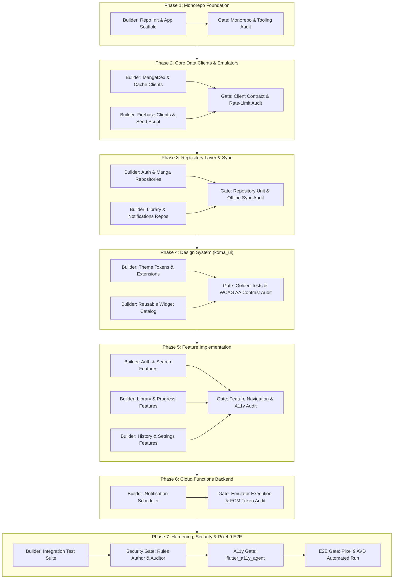

# 07 — Agentic Implementation Roadmap & Multi-Agent Execution Plan

This document defines the 7-phase implementation roadmap for Koma. It provides an explicit multi-agent work breakdown structuring the orchestration between high-velocity **`gemini-3.8-flash-high` Builder Sub-Agents** and deep-reasoning **`gemini-4-argon-high` Investigation & Verification Gates**.

---

## 1. Multi-Agent Orchestration Architecture

To maximize velocity while guaranteeing zero build breakages, architectural adherence, and security compliance, the implementation follows a phased assembly line:

### Agent Roles & Guardrails

| Role | Model | Primary Responsibilities | Guardrails |
| :--- | :--- | :--- | :--- |
| **Builder Sub-Agent** | `gemini-3.8-flash-high` | High-speed implementation of code, configurations, tests, and models within strictly assigned non-overlapping directories. | Strictly prohibited from touching files outside its assigned workspace; must pass local analyze and test gates prior to handoff. |
| **Verification Gate** | `gemini-4-argon-high` | Deep architectural audits, contract verification, security rule evaluation, accessibility compliance, and end-to-end device orchestration. | Cannot write production code directly; issues pass/fail verdicts and precise remediation briefs to builders. |

---

## 2. Phase 1: Monorepo Foundation & Tooling

### 2.1 Objectives
Scaffold the Very Good Ventures (VGV) layered monorepo structure, establish workspace tooling (`melos`), configure multi-flavor builds (`development`, `staging`, `production`), and set up internationalization (`en`, `it`).

### 2.2 Builder Sub-Agents (`gemini-3.8-flash-high`)

#### Builder 1.1: `flash-repo-init`
- **Assigned Workspace**: Root repository configuration and CI workflows.
- **Assigned Files**:
  - `melos.yaml`
  - `pubspec.yaml` (root workspace)
  - `analysis_options.yaml` (using `very_good_analysis`)
  - `.gitignore`
  - `.github/workflows/ci.yaml`
- **Inputs & References**: `docs/01-system-architecture-and-data-flow.md`, `docs/02-flutter-monorepo-structure-and-packages.md`.
- **Outputs**: Fully functional monorepo configuration with `melos bootstrap` passing cleanly.
- **Validation Command**: `melos bootstrap && melos run analyze`

#### Builder 1.2: `flash-app-scaffold`
- **Assigned Workspace**: `lib/` and root localization.
- **Assigned Files**:
  - `lib/main_development.dart`
  - `lib/main_staging.dart`
  - `lib/main_production.dart`
  - `lib/app/app.dart`
  - `lib/l10n/l10n.dart`
  - `lib/l10n/arb/app_en.arb`
  - `lib/l10n/arb/app_it.arb`
  - `l10n.yaml`
- **Inputs & References**: `docs/02-flutter-monorepo-structure-and-packages.md`.
- **Outputs**: Application entrypoints supporting `koma-dev`, `koma-stg`, and `koma` flavors with synthetic L10n generation.
- **Validation Command**: `flutter gen-l10n && flutter analyze`

### 2.3 Verification Gate (`gemini-4-argon-high`): `argon-monorepo-verifier`
- **Audit Scope**:
  1. Confirm zero dependency cycles in `melos.yaml`.
  2. Verify all three flavors build cleanly in headless test mode (`flutter test --flavor development`).
  3. Validate Italian (`it`) and English (`en`) locale keys are 100% symmetric in ARB files.

---

## 3. Phase 2: Core Data Clients & Firebase Emulator Setup

### 3.1 Objectives
Implement pure Dart data layer clients (MangaDex REST API client with rate limiting, Drift SQLite cache, Firebase Auth client, Firestore Library client) and local emulator tooling.

### 3.2 Builder Sub-Agents (`gemini-3.8-flash-high`)

#### Builder 2.1: `flash-data-mangadex`
- **Assigned Workspace**: `packages/mangadex_api_client/`
- **Assigned Files**: All files within `packages/mangadex_api_client/` (`pubspec.yaml`, `lib/src/models/`, `lib/src/mangadex_api_client.dart`, `lib/src/interceptors/rate_limit_interceptor.dart`, `test/`).
- **Inputs & References**: `docs/04-mangadex-api-integration-guide.md`.
- **Key Requirements**:
  - Send `User-Agent: Koma/0.1.0 (https://github.com/mattcianna/koma)` on every request.
  - Implement token bucket rate limiter capped at <= 4 req/s.
  - Parse nested `aggregate` response (`volumes -> chapters`) and handle `none` volume and `others` UUIDs.
- **Validation Command**: `cd packages/mangadex_api_client && dart test`

#### Builder 2.2: `flash-data-cache`
- **Assigned Workspace**: `packages/koma_cache_client/`
- **Assigned Files**: All files within `packages/koma_cache_client/` (`pubspec.yaml`, `lib/src/database.dart`, `lib/src/tables/`, `test/`).
- **Inputs & References**: `docs/04-mangadex-api-integration-guide.md`.
- **Key Requirements**:
  - Drift SQLite database with schema for manga metadata (24h TTL) and `/aggregate` chapter trees (30m TTL).
- **Validation Command**: `cd packages/koma_cache_client && dart test`

#### Builder 2.3: `flash-data-firebase`
- **Assigned Workspace**: `packages/firebase_auth_client/` and `packages/firestore_library_client/`
- **Assigned Files**: All files within both packages (`pubspec.yaml`, `lib/`, `test/`).
- **Inputs & References**: `docs/03-firestore-schema-and-security-rules.md`.
- **Key Requirements**:
  - Pure Dart models for `users/{uid}`, `library/{mangaId}`, and `reading_history/{eventId}`.
  - Chunked `WriteBatch` operations respecting Firestore's 500-operation ceiling.
- **Validation Command**: `melos run test:data`

#### Builder 2.4: `flash-firebase-emulator`
- **Assigned Workspace**: `firebase/`
- **Assigned Files**:
  - `firebase/firebase.json`
  - `firebase/firestore.indexes.json`
  - `firebase/scripts/seed_emulator.ts`
  - `.env.example`
- **Inputs & References**: `docs/05-cloud-functions-notification-scheduler.md`, `docs/06-test-account-emulator-and-pixel9-setup.md`.
- **Outputs**: Fully functional local emulator configuration and executable seed script.
- **Validation Command**: `cd firebase && npm run build && npx tsx scripts/seed_emulator.ts`

### 3.3 Verification Gate (`gemini-4-argon-high`): `argon-data-verifier`
- **Audit Scope**:
  1. Confirm data packages are **pure Dart** (zero `flutter/` SDK imports).
  2. Execute MangaDex mock server test verifying rate limit backoff triggers correctly on HTTP 429.
  3. Validate that `firebase/scripts/seed_emulator.ts` successfully populates Auth, Firestore, and Device tokens in the emulator.

---

## 4. Phase 3: Repository Layer & Offline-First Sync

### 4.1 Objectives
Bridge data clients into pure Dart repositories that orchestrate offline caching, remote synchronization, and state streams.

### 4.2 Builder Sub-Agents (`gemini-3.8-flash-high`)

#### Builder 3.1: `flash-repo-auth-manga`
- **Assigned Workspace**: `packages/auth_repository/` and `packages/manga_repository/`
- **Assigned Files**: All files within both packages.
- **Inputs & References**: `docs/01-system-architecture-and-data-flow.md`, `docs/02-flutter-monorepo-structure-and-packages.md`.
- **Key Requirements**:
  - `auth_repository`: Stream of `User` entities, sign in with email/password (QA), sign in with Google/Apple, sign out.
  - `manga_repository`: Search manga, fetch details, fetch cached aggregate chapter list with Drift fallback.
- **Validation Command**: `cd packages/manga_repository && dart test`

#### Builder 3.2: `flash-repo-library-notif`
- **Assigned Workspace**: `packages/library_repository/` and `packages/notifications_repository/`
- **Assigned Files**: All files within both packages.
- **Inputs & References**: `docs/01-system-architecture-and-data-flow.md`, `docs/03-firestore-schema-and-security-rules.md`.
- **Key Requirements**:
  - `library_repository`: Watch library items, update status, mark chapter read, mark volume read, execute atomic "Mark Previous as Read" with consolidated history event.
  - `notifications_repository`: Device token registration, FCM foreground listener, background message handler.
- **Validation Command**: `cd packages/library_repository && dart test`

### 4.3 Verification Gate (`gemini-4-argon-high`): `argon-repo-verifier`
- **Audit Scope**:
  1. Verify zero inter-repository imports (repositories must never depend on each other).
  2. Verify unit test coverage >= 90% using `mocktail` mocks for data clients.
  3. Verify "Mark Previous as Read" properly batches history events into chunks <= 490 writes.

---

## 5. Phase 4: UI Design System & Component Package (`packages/koma_ui`)

### 5.1 Objectives
Implement the "Koma — Manga Ink & Vermilion" design system, custom `ThemeExtension` tokens, and reusable Flutter UI widgets.

### 5.2 Builder Sub-Agents (`gemini-3.8-flash-high`)

#### Builder 4.1: `flash-ui-tokens`
- **Assigned Workspace**: `packages/koma_ui/lib/src/theme/`
- **Assigned Files**:
  - `packages/koma_ui/lib/src/theme/koma_theme.dart`
  - `packages/koma_ui/lib/src/theme/koma_colors.dart`
  - `packages/koma_ui/lib/src/theme/koma_spacing.dart`
  - `packages/koma_ui/lib/src/theme/koma_typography.dart`
- **Inputs & References**: `docs/08-design-system-and-starting-graphics.md`.
- **Key Requirements**:
  - Light mode ("Warm Washi Paper" `#FAF8F5`) and Dark mode ("Sumi Ink" `#0D0D10`).
  - Vermilion primary `#E11D48` / `#FB7185`.
  - `KomaColors` and `KomaSpacing` `ThemeExtension` implementations with `lerp`.
- **Validation Command**: `cd packages/koma_ui && flutter test`

#### Builder 4.2: `flash-ui-components`
- **Assigned Workspace**: `packages/koma_ui/lib/src/widgets/`
- **Assigned Files**:
  - `packages/koma_ui/lib/src/widgets/koma_manga_card.dart`
  - `packages/koma_ui/lib/src/widgets/koma_status_chip.dart`
  - `packages/koma_ui/lib/src/widgets/koma_progress_header.dart`
  - `packages/koma_ui/lib/src/widgets/koma_volume_tile.dart`
  - `packages/koma_ui/lib/src/widgets/koma_chapter_row.dart`
  - `packages/koma_ui/lib/src/widgets/koma_bulk_read_sheet.dart`
  - `packages/koma_ui/lib/src/widgets/koma_empty_state.dart`
- **Inputs & References**: `docs/08-design-system-and-starting-graphics.md`.
- **Key Requirements**:
  - Decoupled from `AppLocalizations` (text passed as parameters).
  - Minimum touch targets >= 48x48dp.
  - Built-in `Semantics` tags for accessibility.
- **Validation Command**: `cd packages/koma_ui && flutter test`

### 5.3 Verification Gate (`gemini-4-argon-high`): `argon-design-verifier`
- **Audit Scope**:
  1. Golden file tests for all widgets in both light and dark modes.
  2. Verify WCAG AA contrast ratios on all text and container surfaces.
  3. Validate RTL support (`EdgeInsetsDirectional` used exclusively).

---

## 6. Phase 5: Feature Implementation & App Integration

### 6.1 Objectives
Build the client user experience across the 4 primary tabs (`Library`, `Discover`, `History`, `Settings`) plus detail pages, wiring `flutter_bloc` state management and `go_router` navigation.

### 6.2 Builder Sub-Agents (`gemini-3.8-flash-high`)

#### Builder 5.1: `flash-feat-auth-search`
- **Assigned Workspace**: `lib/features/auth/` and `lib/features/search/`
- **Assigned Files**: Blocs, views, and routing widgets for authentication and manga search/discovery.
- **Key Components**: `DevQuickLoginButton` (QA bypass), search bar with debounce, infinite scroll grid.
- **Validation Command**: `flutter test test/features/auth test/features/search`

#### Builder 5.2: `flash-feat-library-progress`
- **Assigned Workspace**: `lib/features/library/` and `lib/features/reader_progress/`
- **Assigned Files**: Blocs and screens for library filtering/sorting, manga detail header, and chapter/volume reading matrix with "Mark Previous as Read" modal.
- **Validation Command**: `flutter test test/features/library test/features/reader_progress`

#### Builder 5.3: `flash-feat-history-settings`
- **Assigned Workspace**: `lib/features/history/` and `lib/features/settings/`
- **Assigned Files**: Blocs and screens for reverse-chronological reading history and user preferences (theme toggle, content rating filters, language selection).
- **Validation Command**: `flutter test test/features/history test/features/settings`

### 6.3 Verification Gate (`gemini-4-argon-high`): `argon-feature-verifier` & `flutter_a11y_agent`
- **Audit Scope**:
  1. Audit `go_router` route hierarchy and type-safe routing definitions.
  2. Run `flutter_a11y_agent` checklist: verify zero unlabeled touch targets, verify TalkBack announcement semantics.
  3. Verify state persistence during offline mode (toggling Wi-Fi / airplane mode in emulator).

---

## 7. Phase 6: Cloud Functions Notification Scheduler

### 7.1 Objectives
Implement and test the serverless release check scheduler in `firebase/functions/`.

### 7.2 Builder Sub-Agent (`gemini-3.8-flash-high`): `flash-backend-functions`
- **Assigned Workspace**: `firebase/functions/`
- **Assigned Files**:
  - `firebase/functions/package.json`
  - `firebase/functions/tsconfig.json`
  - `firebase/functions/src/index.ts`
  - `firebase/functions/src/config.ts`
  - `firebase/functions/src/services/mangadex.ts`
  - `firebase/functions/src/services/notification.ts`
  - `firebase/functions/src/services/scheduler.ts`
- **Inputs & References**: `docs/05-cloud-functions-notification-scheduler.md`.
- **Validation Command**: `cd firebase/functions && npm run build`

### 7.3 Verification Gate (`gemini-4-argon-high`): `argon-backend-verifier`
- **Audit Scope**:
  1. Start emulator suite and trigger `triggerDailyCheckManual` via cURL.
  2. Verify subscriber grouping deduplicates MangaDex calls across multiple users reading the same title.
  3. Verify invalid test tokens trigger `pruneInvalidTokens` and clean up Firestore `users/{uid}/devices`.

---

## 8. Phase 7: End-to-End Testing, Security/A11y Audits & Hardening

### 8.1 Objectives
Perform comprehensive end-to-end testing on the Pixel 9 AVD, audit Firestore security rules, verify accessibility compliance, and finalize release readiness.

### 8.2 Builder Sub-Agent (`gemini-3.8-flash-high`): `flash-e2e-author`
- **Assigned Workspace**: `integration_test/`
- **Assigned Files**:
  - `integration_test/library_flow_test.dart`
  - `integration_test/bulk_read_test.dart`
  - `android/app/src/debug/res/xml/network_security_config.xml`
- **Inputs & References**: `docs/06-test-account-emulator-and-pixel9-setup.md`.
- **Validation Command**: `flutter test integration_test/library_flow_test.dart -d Pixel_9_API_35`

### 8.3 Specialized Investigation & Verification Gates (`gemini-4-argon-high`)

#### Security Rules Gate: `firestore-rules-author` & `firebase-security-rules-auditor`
1. **Rule Authoring**: Ensure `firebase/firestore.rules` enforces immutable fields (`uid`, `mangaId`, `createdAt`, `addedAt`, `timestamp`), enum constraints, string size limits, and owner authorization.
2. **Security Audit**: Execute automated test harness using `@firebase/rules-unit-testing` covering:
   - Unauthorized user reading another user's library -> REJECT.
   - User updating immutable `uid` -> REJECT.
   - User writing oversized payload (>100KB) -> REJECT.
   - User updating their own reading progress -> ALLOW.

#### Accessibility Gate: `flutter_a11y_agent`
1. Conduct automated semantics tree audit on all primary views.
2. Confirm minimum tap targets exceed >= 48x48dp on Pixel 9 422dpi screen.
3. Validate contrast ratio >= 4.5:1 for normal text and >= 3:1 for large text across Light and OLED Dark themes.

#### Final E2E Release Gate: `argon-pixel9-lead`
1. Boot Pixel 9 AVD (`emulator -avd Pixel_9_API_35`).
2. Run full integration suite with cleartext emulator loopback (`10.0.2.2`).
3. Capture screen hierarchy via `adb exec-out uiautomator dump` and visual proof screenshots.
4. Issue final release sign-off report.
