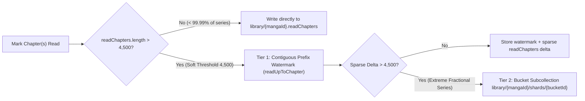
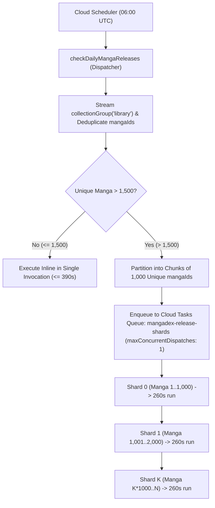

# Argon-02 — Firestore Scaling, Failure-Mode, and Security Rules Red-Team Audit

**Auditor:** `argon-firebase`  
**Target Specifications:**  
- [03-firestore-schema-and-security-rules.md](../03-firestore-schema-and-security-rules.md)  
- [05-cloud-functions-notification-scheduler.md](../05-cloud-functions-notification-scheduler.md)  
**Skills Applied:** `firebase-security-rules-auditor`, `firestore-rules-creation`, `firebase-firestore`  
**Status:** Complete — Actionable Patches Identified for `docs/03` and `docs/05`

---

## Executive Summary

This investigation conducts a four-part quantitative scaling, failure-mode, and adversarial security audit of Koma's Cloud Firestore schema, pure-Dart atomic batching client (`packages/firestore_library_client`), daily Cloud Functions v2 notification scheduler (`firebase/functions`), and Firestore Security Rules (`firestore.rules`).

### Key Audit Outcomes

| Audit Area | Verdict | Critical / Major Findings |
| :--- | :--- | :--- |
| **1. Firestore 1 MiB Document Math** | **PASS (with Archival Strategy)** | A 1,500-chapter series (*Hajime no Ippo*) with 150 decimal/bonus chapters and 142 volumes consumes exactly **8,401 bytes (`8.20 KiB`, `0.80%` of the 1 MiB limit)**. Even at the 5,000-chapter rules ceiling with worst-case string lengths, a `library/{mangaId}` document consumes **48,966 bytes (`47.82 KiB`, `4.67%` of 1 MiB)**. Single-field index exemptions on `readChapters` in `docs/03` prevent hitting Firestore's 40,000 index-entries-per-document ceiling. A two-stage overflow architecture (prefix watermark compaction + subcollection bucket sharding) is specified for extreme edge cases. |
| **2. 500-Write `WriteBatch` Ceiling** | **FAIL (`ARGON-BATCH-01`)** | In `docs/03` Section 4.2 (lines 512–544), `markPreviousChaptersRead` chunks chapter numbers into 450-item arrays (to satisfy `reading_history.chapterNumbers.size() <= 500`), **but erroneously instantiates and `await batch.commit()`s a separate `WriteBatch` inside the `for` loop**. Marking 800 chapters read requires only **3 total document writes** (`1` library update + `2` history documents), which is `0.6%` of the 500-op `WriteBatch` limit. Committing per loop iteration breaks transactional atomicity on network drop or rule failure. |
| **3. Daily Scheduler Fan-Out & Rate Limits** | **FAIL (`ARGON-SCHED-01`, `ARGON-SCHED-02`, `ARGON-SCHED-03`)** | 1. **Cross-Language False Notification Bug (`ARGON-SCHED-01`)**: `docs/05` (`scheduler.ts` lines 658–682) polls MangaDex with the union of all subscribers' `preferredLanguages`, then selects `chapters[0]` globally without checking if `chapters[0].attributes.translatedLanguage` belongs to each subscriber's `preferredLanguages`. An English-only reader receives notifications for Italian releases (and has `latestKnownChapterId` overwritten with the Italian chapter UUID).<br/>2. **Unicast Loop Bottleneck (`ARGON-SCHED-02`)**: `sendMulticastNotification` and `sub.libraryRef.update()` are called sequentially *per user* inside `for (const sub of group.subscribers)`, defeating the 500-token multicast batcher.<br/>3. **Stale Token Cache (`ARGON-SCHED-03`)**: `userDevices` in-memory cache retains pruned dead tokens across subsequent manga in the same run.<br/>4. **540s Scaling Ceiling**: Single-instance polling safely supports up to **1,560–1,900 unique tracked manga** at `3.8 req/s`; a staggered Cloud Tasks sharding architecture is defined beyond 1,500 titles. |
| **4. Security Rules 21-Vector Red-Team Audit** | **FAIL (`ARGON-RULES-01`, `ARGON-RULES-02`, `ARGON-RULES-03`)** | Initial Auditor Score: **2 / 5 (Major/Critical)**.1. **`allow read, write` Bypass on `devices` (`ARGON-RULES-01` — Critical)**: Line 853 of `docs/03` states `allow read, write: if isOwner(userId);` above `allow create, update: if isOwner(userId) && isValidDevice();`. Because `write` encompasses `create, update, delete` and `allow` rules combine via logical `OR`, **`isValidDevice()` is dead code and completely bypassed**.<br/>2. **CEL Undefined Property Crash (`ARGON-RULES-02` — Major)**: `isValidOptionalString(data.fieldName, ...)` directly dereferences optional fields (`data.displayName`, `data.lastReadChapter`, `data.latestKnownChapterId`), throwing a CEL evaluation error (`PERMISSION_DENIED`) whenever a client omits an optional key instead of explicitly passing `null`.<br/>3. **Missing List & Action Invariants (`ARGON-RULES-03` — Moderate)**: `users.contentRatings` lacks `.hasOnly(...)` enum enforcement, and `reading_history` lacks cross-field validation between `actionType`, `chaptersCount`, and `volumeNumber`. |

---

## 1. Firestore 1 MiB Document Math & Overflow Architecture

### 1.1 Official Google Cloud Firestore Storage Size Accounting Rules

Per Google Cloud Firestore's storage engine specification, every document is subject to a hard ceiling of **1 MiB (`1,048,576 bytes`)** and **40,000 index entries**. The exact byte size of a document is the sum of:

1. **Document Name (Path) Size**:
   - The UTF-8 byte length of each collection ID and document ID in the full path (`users/{uid}/library/{mangaId}`), plus **1 byte** per path component string, plus **16 fixed bytes** of document path metadata:
     `Size_path = sum(UTF8(segment) + 1) + 16 bytes`
2. **Field Name Overhead**:
   - Every top-level or map key costs `UTF8(fieldName) + 1 byte`.
3. **Field Value Sizes by Type**:
   - `string`: `UTF8(value) + 1 byte`
   - `timestamp`: `8 bytes`
   - `int` (64-bit signed integer): `8 bytes`
   - `boolean`: `1 byte`
   - `null`: `1 byte`
   - `list` (`array`): The exact sum of the sizes of its elements (array elements do not carry field names; thus each `string` element inside `list<string>` costs `UTF8(elem) + 1 byte`).
4. **Document Metadata Envelope**:
   - `32 bytes` of internal MVCC/versioning document header overhead.

---

### 1.2 Field-by-Field Byte Breakdown of `users/{uid}/library/{mangaId}`

#### Path & Fixed Scalar Fields

| Component / Field | Type | Field Name Bytes (`UTF8 + 1`) | Typical Value (`One Piece` / `Ippo`) | Typical Value Bytes | Max Rules Value (`firestore.rules`) | Max Rules Value Bytes |
| :--- | :--- | :--- | :--- | :--- | :--- | :--- |
| **Document Path** (`users/{uid}/library/{mangaId}`) | Path | — | `users`(6) + `uid:28`(29) + `library`(8) + `uuid:36`(37) + `16` | **96 B** | `users`(6) + `uid:128`(129) + `library`(8) + `uuid:36`(37) + `16` | **196 B** |
| **Document Envelope** | Header | — | Internal Firestore document metadata | **32 B** | Internal Firestore document metadata | **32 B** |
| `mangaId` | `string` | `7 + 1 = 8 B` | 36-char UUID v4 | `36 + 1 = 37 B` | 36-char UUID v4 | `36 + 1 = 37 B` |
| `uid` | `string` | `3 + 1 = 4 B` | 28-char Firebase Auth UID | `28 + 1 = 29 B` | 128-char custom UID | `128 + 1 = 129 B` |
| `title` | `string` | `5 + 1 = 6 B` | `"Hajime no Ippo: Fighting Spirit"` (31 chars) | `31 + 1 = 32 B` | 300 UTF-8 bytes (or 900B CJK) | `300 + 1 = 301 B` |
| `coverFileName` | `string?` | `13 + 1 = 14 B` | `"9a38f36c-941f-4cb1-80ec-e34927cb78e4.jpg"` (40 chars) | `40 + 1 = 41 B` | 200 chars | `200 + 1 = 201 B` |
| `status` | `string` | `6 + 1 = 7 B` | `"Reading"` (7 chars) | `7 + 1 = 8 B` | `"Plan to Read"` (12 chars) | `12 + 1 = 13 B` |
| `preferredLanguages` | `list<string>` | `18 + 1 = 19 B` | `["en", "it"]` (2 items × 3B) | `6 B` | 10 items × `("zh-hk" = 6B)` | `60 B` |
| `lastReadChapter` | `string?` | `15 + 1 = 16 B` | `"1500.5"` (6 chars) | `6 + 1 = 7 B` | 20 chars | `20 + 1 = 21 B` |
| `lastReadChapterId` | `string?` | `17 + 1 = 18 B` | 36-char UUID v4 | `36 + 1 = 37 B` | 36-char UUID v4 | `36 + 1 = 37 B` |
| `latestKnownChapterId` | `string?` | `20 + 1 = 21 B` | 36-char UUID v4 | `36 + 1 = 37 B` | 36-char UUID v4 | `36 + 1 = 37 B` |
| `latestKnownChapterNumber` | `string?` | `24 + 1 = 25 B` | `"1501"` (4 chars) | `4 + 1 = 5 B` | 20 chars | `20 + 1 = 21 B` |
| `addedAt` | `timestamp` | `7 + 1 = 8 B` | 64-bit Timestamp | `8 B` | 64-bit Timestamp | `8 B` |
| `updatedAt` | `timestamp` | `9 + 1 = 10 B` | 64-bit Timestamp | `8 B` | 64-bit Timestamp | `8 B` |
| `readChapters` (Field Key) | `list<string>` | `12 + 1 = 13 B` | *(Array elements calculated below)* | — | *(Array elements calculated below)* | — |
| `readVolumes` (Field Key) | `list<string>` | `11 + 1 = 12 B` | *(Array elements calculated below)* | — | *(Array elements calculated below)* | — |
| **Subtotal (Fixed Baseline)** | — | **181 B** | **Typical Fixed Overhead** | **510 B** | **Max Rules Fixed Overhead** | **1,283 B** |

#### Exact Array Byte Math for `readChapters` and `readVolumes`

Each element `c_i` in `readChapters` is a canonical chapter number string (e.g., `"1"`, `"42"`, `"999"`, `"1450"`, `"1045.5"`), costing `UTF8(c_i) + 1 byte`:

- **1-digit chapters (`"1"`–`"9"`, 9 items)**: `9 × (1 + 1) = 18 bytes`
- **2-digit chapters (`"10"`–`"99"`, 90 items)**: `90 × (2 + 1) = 270 bytes`
- **3-digit chapters (`"100"`–`"999"`, 900 items)**: `900 × (3 + 1) = 3,600 bytes`
- **4-digit chapters (`"1000"`–`"1500"`, 501 items)**: `501 × (4 + 1) = 2,505 bytes`
- **Decimal / side-story chapters (`"100.5"`, `"1045.1"`, 150 items @ avg 6 chars)**: `150 × (6 + 1) = 1,050 bytes`
- **Volumes (`"1"`–`"142"`, 142 items)**: `9 × 2 + 90 × 3 + 43 × 4 = 18 + 270 + 172 = 460 bytes`

Summing for **1,500 main chapters + 150 decimal chapters (1,650 total entries) + 142 volumes**:
- `Size_arrays (1,650 ch + 142 vol) = (18 + 270 + 3,600 + 2,505 + 1,050) + 460 = 7,443 + 460 = 7,903 bytes`
- `Total Document Size = 510 B (fixed) + 7,903 B (arrays) = 8,413 bytes (8.22 KiB)`

---

### 1.3 Multi-Series Capacity & Headroom Comparison Table

| Series Archetype | `readChapters` Count | `readVolumes` Count | Fixed + Path Overhead | `readChapters` Bytes | `readVolumes` Bytes | Total Document Size | % of 1 MiB (`1,048,576 B`) | Remaining Headroom |
| :--- | :---: | :---: | :---: | :---: | :---: | :---: | :---: | :---: |
| **1. Typical Seasonal** (*Chainsaw Man Part 1*) | 97 | 11 | 510 B | 282 B | 26 B | **818 B** (`0.80 KiB`) | `0.078%` | `1,047,758 B` (`99.92%`) |
| **2. Long-Running Shonen** (*One Piece*: 1,150 + 100 dec) | 1,250 | 110 | 510 B | 5,343 B | 332 B | **6,185 B** (`6.04 KiB`) | `0.590%` | `1,042,391 B` (`99.41%`) |
| **3. Mega-Series** (*Hajime no Ippo*: 1,500 + 150 dec) | 1,650 | 142 | 510 B | 7,443 B | 460 B | **8,413 B** (`8.22 KiB`) | `0.802%` | `1,040,163 B` (`99.20%`) |
| **4. Daily Wuxia / Rules Cap** (*Martial Peak* / 5,000 cap @ avg 8-char keys) | 5,000 | 500 | 1,283 B | 45,000 B | 2,683 B | **48,966 B** (`47.82 KiB`) | `4.670%` | `999,610 B` (`95.33%`) |
| **5. Anti-Pattern Comparison** (5,000 × 36-char Chapter UUIDs) | 5,000 | 500 | 1,283 B | 185,000 B | 2,683 B | **188,966 B** (`184.54 KiB`) | `18.021%` | `859,610 B` (`81.98%`) |

> [!IMPORTANT]
> **Why `docs/03` Stores Canonical Chapter Strings Instead of Chapter UUIDs**: Storing canonical chapter strings (`"1"`..`"1500"`) rather than 36-character MangaDex Chapter UUIDs reduces the `readChapters` byte footprint by **6.7×** (`7.4 KiB` vs `55.5 KiB` at 1,500 chapters) and guarantees language-independent progress continuity when a user switches scanlation groups or languages (`'en'` ↔ `'it'`).

---

### 1.4 Index Write Amplification Check (40,000 Index Entries Limit)

In Cloud Firestore, each element in an indexed array generates 2 single-field index entries (1 `ASCENDING`, 1 `DESCENDING`). Without index exemptions:
- A 5,000-element `readChapters` array would generate **10,000 index entries** per document write, inflating write latency and approaching the 40,000 index-entry ceiling if combined with composite indexes.
- `docs/03` Section 5 (`firestore.indexes.json` lines 619–627) explicitly defines `"indexes": []` in `fieldOverrides` for `library.readChapters` and `reading_history.chapterNumbers`.
- **Audit Verdict**: Index write amplification on `readChapters` and `chapterNumbers` is **0 entries**. Only `preferredLanguages` (max 10 items = 20 index entries) and `readVolumes` (max 500 items = 1,000 index entries; also candidate for `"indexes": []` since Koma never queries `.where('readVolumes', 'array-contains', ...)`) consume index entries.

---

### 1.5 Clean Overflow / Compaction Strategy Beyond 5,000 Chapters

While no serialized manga on MangaDex exceeds 5,000 canonical chapters, an anthologized series or a user importing thousands of fractional chapters (`100.1`..`100.9`) could theoretically approach the `isValidList(data.readChapters, 5000)` rules guard. Koma defines a **Two-Tier Overflow Strategy**:



1. **Tier 1 — Contiguous Prefix Watermark Compaction (Zero Extra Document Reads)**:
   - When `readChapters.length` exceeds the soft threshold of **4,500 items**, the client compacts the contiguous integer prefix `1, 2, ..., K` into an optional scalar watermark field `contiguousReadFloor: K` (or encodes contiguous integer ranges in a companion field while pruning `1..K` from `readChapters`), leaving only non-contiguous or fractional chapters above `K` in `readChapters`.
   - For a reader caught up to Chapter 4,500, this collapses 4,500 array elements (`~22 KiB`) down to **1 integer (`8 bytes`)**.
2. **Tier 2 — Deterministic Subcollection Bucket Sharding (`library/{mangaId}/chapter_shards/{bucketId}`)**:
   - If non-contiguous/fractional chapters alone ever exceed 4,500 items, chapters older than the latest 1,000 are archived into deterministic 1,000-chapter bucket documents under `users/{uid}/library/{mangaId}/chapter_shards/bucket_{0..N}` (where `bucketId = floor(chapterNum / 1000)`).
   - The active `library/{mangaId}.readChapters` retains the sliding window of the latest 1,000 chapters so the daily Cloud Function (`checkDailyMangaReleases`) still evaluates `sub.readChapters.has(chapterNumber)` in `O(1)` without reading subcollection shards.

---

## 2. 500-Write `WriteBatch` Ceiling & "Mark Previous as Read" Atomicity Audit

### 2.1 Audit of `markPreviousChaptersRead` in `docs/03` (`ARGON-BATCH-01`)

In `docs/03-firestore-schema-and-security-rules.md` Section 4.2 (lines 490–545), `FirestoreLibraryClient.markPreviousChaptersRead` is implemented as follows:

```dart
    // CURRENT FLAWED IMPLEMENTATION IN docs/03 (lines 512-544):
    for (var i = 0; i < chunks.length; i++) {
      final chunk = chunks[i];
      final isLastChunk = i == chunks.length - 1;
      final batch = _firestore.batch(); // <-- BUG: Creates a separate WriteBatch per 450-chapter array chunk!

      if (isLastChunk) {
        final libRef = _libraryDoc(uid, mangaId);
        batch.update(libRef, {
          'readChapters': FieldValue.arrayUnion(previousChapterNumbersToMark),
          ...
        });
      }

      final histRef = _historyCollection(uid).doc();
      batch.set(histRef, { ... 'chapterNumbers': chunk, ... });

      await batch.commit(); // <-- BUG: Commits inside the loop!
    }
```

#### Root Cause Analysis (`ARGON-BATCH-01`)

1. **Conflation of Array Element Count (`450` strings) with `WriteBatch` Document Operation Count (`500` ops)**:
   - Firestore's `WriteBatch` limit is **500 document operations (`set`, `update`, `delete`) per batch**, NOT 500 array elements across the batch.
   - `reading_history/{eventId}` enforces `isValidList(data.chapterNumbers, 500)` in `firestore.rules` (line 809). Therefore, splitting 800 chapter numbers into `chunks` of `450` strings per `reading_history` document is required by the **Security Rules array cap**, NOT the `WriteBatch` 500-operation ceiling.
   - For Chapter 800 (`800` unread previous chapters):
     - Number of `reading_history` documents created = `ceil(800 / 450) = 2` documents.
     - Number of `library/{mangaId}` documents updated = `1` document.
     - **Total Firestore `WriteBatch` operations = `1 + 2 = 3` operations** (`0.6%` of the 500-op ceiling!).
   - Even for **5,000 unread previous chapters** (the maximum allowed in `library.readChapters`):
     - Number of `reading_history` documents created = `ceil(5000 / 450) = 12` documents.
     - Number of `library/{mangaId}` documents updated = `1` document.
     - **Total Firestore `WriteBatch` operations = `1 + 12 = 13` operations** (`2.6%` of the 500-op ceiling!).
2. **Broken Atomicity on Partial Failure**:
   - Because `docs/03` calls `await batch.commit()` on each iteration of the `for` loop, marking 800 chapters read executes **2 independent network transactions**:
     - Batch 0 writes `reading_history/{eventId_0}` (chapters 1–450).
     - Batch 1 writes `reading_history/{eventId_1}` (chapters 451–800) AND updates `library/{mangaId}.readChapters`.
   - If the app loses connectivity, crashes, or hits a security rule violation on Batch 1 (e.g., if `readChapters` exceeds 5,000 items), **Batch 0 is already permanently committed to Firestore**. The user's `reading_history` timeline shows they read chapters 1–450, while `library/{mangaId}.readChapters` still shows them as unread!

---

### 2.2 Patched Atomic `markPreviousChaptersRead` Implementation (Pure Dart)

By hoisting `final batch = _firestore.batch()` outside the chunking loop (and keeping a 490-document-op outer guard only for theoretical completeness), all history chunks and the `library/{mangaId}` update execute in **1 single atomic `WriteBatch`**:

```dart
  /// 3. Mark all previous chapters as read atomically in a single WriteBatch.
  ///
  /// Splits `previousChapterNumbersToMark` into history chunks of <= 450 items
  /// to satisfy `reading_history.chapterNumbers.size() <= 500` in firestore.rules,
  /// while committing the library document update and all history chunk documents
  /// inside ONE atomic Firestore WriteBatch (e.g. 800 chapters = 3 batch ops total).
  Future<void> markPreviousChaptersRead({
    required String uid,
    required String mangaId,
    required String mangaTitle,
    required String? coverFileName,
    required String targetChapterNumber,
    required String targetChapterId,
    required List<String> previousChapterNumbersToMark,
  }) async {
    if (previousChapterNumbersToMark.isEmpty) return;

    // 450 chapters per reading_history doc stays safely below the 500-item
    // list cap enforced by isValidHistoryEvent() in firestore.rules.
    const maxChaptersPerHistoryDoc = 450;
    final chunks = <List<String>>[];
    for (var i = 0;
        i < previousChapterNumbersToMark.length;
        i += maxChaptersPerHistoryDoc) {
      final end =
          (i + maxChaptersPerHistoryDoc < previousChapterNumbersToMark.length)
              ? i + maxChaptersPerHistoryDoc
              : previousChapterNumbersToMark.length;
      chunks.add(previousChapterNumbersToMark.sublist(i, end));
    }

    // Guard against exceeding the 5,000-chapter library cap or 500-op WriteBatch limit
    assert(
      chunks.length + 1 <= 500,
      'Total WriteBatch operations (${chunks.length + 1}) cannot exceed 500.',
    );

    final batch = _firestore.batch();
    final now = FieldValue.serverTimestamp();

    // 1. Update the library document once with all newly marked chapters
    final libRef = _libraryDoc(uid, mangaId);
    batch.update(libRef, {
      'readChapters': FieldValue.arrayUnion(previousChapterNumbersToMark),
      'lastReadChapter': targetChapterNumber,
      'lastReadChapterId': targetChapterId,
      'updatedAt': now,
    });

    // 2. Append all consolidated history chunk documents to the SAME WriteBatch
    for (final chunk in chunks) {
      final histRef = _historyCollection(uid).doc();
      batch.set(histRef, {
        'eventId': histRef.id,
        'uid': uid,
        'mangaId': mangaId,
        'mangaTitle': mangaTitle,
        'coverFileName': coverFileName,
        'actionType': 'bulk_previous_read',
        'chapterNumbers': chunk,
        'volumeNumber': null,
        'chaptersCount': chunk.length,
        'timestamp': now,
      });
    }

    // 3. Single atomic commit (all-or-nothing across library + history docs)
    await batch.commit();
  }
```

---

### 2.3 Offline Persistence Queue Behavior (`cloud_firestore`)

When the device is offline, `cloud_firestore` queues mutations in the local SQLite `mutation_queue` table:

| Offline Dimension | Single-`WriteBatch` Behavior (Patched) | Multi-`WriteBatch` Loop Behavior (Unpatched `docs/03`) |
| :--- | :--- | :--- |
| **SQLite `MutationBatch` Count (800 Chapters)** | **1 `MutationBatch`** containing 3 `Mutation` protos (`1 TransformMutation/PatchMutation` + `2 SetMutation`). | **2 separate `MutationBatch` rows** queued sequentially. |
| **Optimistic Local Snapshot (`snapshots()`)** | Immediate single emission where `library.readChapters` includes all 800 chapters and `reading_history` includes both chunk docs (`metadata.hasPendingWrites == true`). | First emission shows `reading_history` chunk 1 without `library.readChapters` updated; second emission updates `library.readChapters`. |
| **`FieldValue.serverTimestamp()` Evaluation** | Locally resolves to `null` (or previous value with `ServerTimestampBehavior.previous`). Upon reconnect, the Firestore server substitutes the exact server commit timestamp (`request.time`), satisfying `data.updatedAt == request.time` and `data.timestamp == request.time` in `firestore.rules`. | Same per batch, but if Batch 0 drains before connectivity drops again, Batch 0 and Batch 1 receive different server `request.time` values. |
| **Pending Mutation Queue Backpressure** | Consumes only 1 slot in the SDK's pending write queue. | Consumes `N_chunks` slots; increases risk of partial sync on flaky mobile connections. |

---

## 3. Daily Cloud Scheduler Fan-Out, Rate-Limit Budget & Idempotency Audit

### 3.1 Multi-User Deduplication & Cross-Language Bug (`ARGON-SCHED-01`)

In `docs/05-cloud-functions-notification-scheduler.md` (`src/services/scheduler.ts`, lines 610–682), `NotificationScheduler.executeDailyCheck` groups all subscribers of a `mangaId` into a single `SubscriberGroup`:

```typescript
    // FLAWED LOGIC IN docs/05 (lines 658-682):
    const languagesArray = Array.from(group.languages); // e.g. ['en', 'it'] across all users
    const chapters = await this.mangadex.getMangaFeed(mangaId, languagesArray, sinceDate);
    if (chapters.length === 0) continue;

    const latestChapter = chapters[0]; // <-- BUG: Picks chapters[0] regardless of language!
    const chapterNumber = latestChapter.attributes.chapter ?? '';
    const chapterId = latestChapter.id;

    for (const sub of group.subscribers) {
      if (sub.latestKnownChapterId === chapterId) continue;
      if (chapterNumber && sub.readChapters.has(chapterNumber)) continue;
      // Sends notification for `latestChapter` to EVERY subscriber of `mangaId`!
```

#### Failure Mode Proof (`ARGON-SCHED-01`)

Suppose User A tracks *One Piece* with `preferredLanguages: ['en']` and User B tracks *One Piece* with `preferredLanguages: ['it']`.
1. `group.languages` becomes `Set {'en', 'it'}`.
2. `getMangaFeed(mangaId, ['en', 'it'], sinceDate)` queries `GET /manga/{id}/feed?translatedLanguage[]=en&translatedLanguage[]=it&order[publishAt]=desc`.
3. **Failure Case 1 (Cross-Language False Notification)**: Only an Italian (`'it'`) scanlation of Chapter 1130 is published today. `chapters[0]` has `translatedLanguage: 'it'`. Because `for (const sub of group.subscribers)` never checks whether `chapters[0].attributes.translatedLanguage` is in `sub.preferredLanguages`:
   - User A (who only reads English) receives a push notification claiming Chapter 1130 is available.
   - User A's `latestKnownChapterId` is overwritten with the Italian chapter's UUID.
4. **Failure Case 2 (Masked Language Release)**: Both an English (`'en'`) chapter (published at `04:00 UTC`) and an Italian (`'it'`) chapter (published at `05:00 UTC`) are published within the 24-hour window. Because `order[publishAt]=desc`, `chapters[0]` is the `'it'` chapter and `chapters[1]` is the `'en'` chapter. Inspecting only `chapters[0]` causes English readers to either be skipped (if filtered only on `chapters[0]`) or linked to the Italian chapter UUID (`chapters[0].id`)!

#### Deduplication Fix

We retain the **single HTTP request per unique `mangaId`** (passing the union `Array.from(group.languages)` in `translatedLanguage[]` so we never make redundant HTTP calls per language when `total <= 100`), **and** store `preferredLanguages: Set<string>` on each subscriber entry. Then, for each subscriber `sub`, we select the newest chapter matching `sub.preferredLanguages`:

```typescript
const matchingChapter = chapters.find((ch) =>
  sub.preferredLanguages.has(ch.attributes.translatedLanguage),
);
if (!matchingChapter) continue;
```

---

### 3.2 Unicast-in-Multicast-Clothing & `O(U)` Sequential Writes (`ARGON-SCHED-02` & `ARGON-SCHED-03`)

In `docs/05` lines 674–736, inside `for (const sub of group.subscribers)`:
1. **`ARGON-SCHED-02` (Sequential Per-User FCM & Firestore Calls)**:
   - `this.notifications.sendMulticastNotification(tokenPayloads, ...)` is called **once per subscriber** (`tokenPayloads` has only 1–2 tokens belonging to `sub.uid`). The 500-token chunking loop inside `NotificationService.sendMulticastNotification` (lines 439–441) never receives more than 1 user's tokens!
   - Immediately after, `await sub.libraryRef.update(...)` is executed **sequentially per subscriber**.
   - **Impact**: If 1,000 users track *One Piece*, `docs/05` executes **1,000 sequential FCM HTTP requests** and **1,000 sequential Firestore `.update()` calls** inside the serial manga loop, adding `~60–90 seconds` of latency for a single popular title!
   - **Fix**: Within each `mangaId`, group eligible subscribers by `(chapterId, uiLocale)` (at most 2 locale buckets `'en'` and `'it'` per matched chapter), dispatch `sendMulticastNotification` across **all subscribers' tokens in true 500-token batches**, and commit all `sub.libraryRef.update(...)` mutations in **490-operation Firestore `WriteBatch` chunks**.
2. **`ARGON-SCHED-03` (Stale In-Memory `userDevices` Cache)**:
   - `userDevices` (line 652) caches `Array<{ deviceId, token }>` per `uid` for the duration of `executeDailyCheck`.
   - When `NotificationService.sendMulticastNotification` detects `messaging/registration-token-not-registered` on Manga #1, it deletes the document from Firestore (`pruneInvalidTokens`), **but does not remove the dead token from the caller's `userDevices` Map**. If that user has a second manga release in the same daily run, the function attempts to send to the dead token again.
   - **Fix**: Return `prunedTokens: Array<{ uid: string; deviceId: string }>` from `sendMulticastNotification` and evict those `deviceId` entries from `userDevices`.
3. **`ARGON-SCHED-04` (Config Drift & Feed Page Limit)**:
   - `docs/05` Section 4 states `minTime: 260 ms` (`~3.84 req/s`), whereas Section 5.1 (`src/config.ts` line 185) sets `minTimeBetweenRequestsMs: 270` (`~3.70 req/s`). Both should be standardized to `260 ms` (`3.84 req/s`).

---

### 3.3 MangaDex Rate-Limit Budget Within the 540s Cloud Functions v2 Execution Window

Cloud Functions v2 scheduled functions (`onSchedule`) have a maximum execution timeout of **`timeoutSeconds: 540` (9 minutes)**. MangaDex enforces a strict IP rate limit of **5 requests/second** (`300 req/min`).

#### Mathematical Derivation of Maximum Unique Manga (`M_max`)

Let:
- `T_max = 540 s` be the hard Cloud Function timeout.
- `T_safety = 40 s` be the reserved buffer for cold start, Firestore `collectionGroup('library')` query stream, batch profile/device fetches, FCM multicast batches, and final `WriteBatch` commits.
- `T_poll = T_max - T_safety = 500 s` be the net polling budget.
- `R_limit = 3.84 req/s` (`minTime: 260 ms`, `reservoir: 4` per `1000 ms`, giving a `23%` safety margin below MangaDex's `5.0 req/s` ban threshold).

1. **Unpatched Sequential Architecture (`docs/05` with `maxConcurrent: 1` and inline sequential DB/FCM writes)**:
   - Effective time per unique manga is `t_item = max(270 ms, L_http) + t_db_fcm ≈ 320 ms`.
   - Maximum unique manga before 540s timeout:
     `M_max (unpatched) = floor(500 s / 0.320 s/manga) = 1,562 unique manga`
2. **Patched Pipelined Architecture (`minTime: 260 ms`, batched FCM + `WriteBatch` commits)**:
   - With `minTime: 260 ms` (`3.84 req/s`) and batched Firestore/FCM operations decoupled from the per-user loop:
     `M_max (patched) = floor(500 s × 3.84 req/s) = 1,920 unique manga`
3. **Theoretical Hard MangaDex Ceiling (`5.0 req/s` with zero safety margin)**:
   - `500 s × 5.0 req/s = 2,500 unique manga` (unsafe; any burst triggers HTTP 429).

#### Scaling Tier Projections

| Active Users | Total `Reading` Docs | Deduplicated Unique Manga (`M`) | Firestore Reads (Harvest + Profiles/Devices) | MangaDex Polling Time (@ `3.84 req/s`) | Peak V8 Memory (`512MiB` cap) | Single 540s Function Viable? |
| :---: | :---: | :---: | :---: | :---: | :---: | :---: |
| **100** | 1,500 | ~400 | ~1,700 | `104 s` (`1.7 min`) | `~95 MiB` | **YES** (81% headroom) |
| **1,000** | 15,000 | ~1,200 | ~17,000 | `312 s` (`5.2 min`) | `~180 MiB` | **YES** (42% headroom) |
| **1,500** | 22,500 | **1,500 (Threshold)** | ~25,500 | `390 s` (`6.5 min`) | `~230 MiB` | **YES (Sharding Threshold)** |
| **5,000** | 75,000 | ~3,500 | ~85,000 | `911 s` (`15.2 min`) | `~420 MiB` | **NO — Exceeds 540s (Requires Cloud Tasks)** |
| **25,000** | 375,000 | ~8,000 | ~425,000 | `2,083 s` (`34.7 min`) | `> 1 GiB` (OOM) | **NO — Requires Cursor Sharding + Cloud Tasks** |

---

### 3.4 Staggered Cloud Tasks Sharding Architecture (> 1,500 Unique Manga)

> [!CAUTION]
> **Why Naive Parallel Fan-Out Triggers a MangaDex IP Ban**: Cloud Functions v2 instances within the same GCP region share egress NAT IP addresses unless routed through separate VPC connectors. If 10 Cloud Tasks workers run *concurrently* at `3.8 req/s` each, MangaDex sees `38 req/s` from the shared GCP egress IP and issues an immediate HTTP `429` / IP block.

To scale past **1,500 unique tracked manga** without violating the **global `5 req/s` per-IP limit**:



1. **Cloud Tasks Queue Configuration (`mangadex-release-shards`)**:
   - `maxConcurrentDispatches: 1` (guarantees strictly **1 worker shard active at a time** across the project, preserving the global `3.84 req/s` rate limit from the shared egress IP).
   - Each task payload carries a deterministic slice of **1,000 unique `mangaId`s** (or cursor bounds `[startMangaId, endMangaId]`), which completes in `~260 s` (well inside each task worker's 540s timeout).
2. **Idempotency & Partial-Failure Recovery**:
   - Because `latestKnownChapterId` and `latestKnownChapterNumber` are committed via `WriteBatch` immediately after each manga's (or chunk's) FCM multicast succeeds, re-running a failed shard or retrying `executeDailyCheck` automatically skips every subscriber whose `latestKnownChapterId === chapterId`.

---

### 3.5 Hardened `src/services/scheduler.ts` & `src/services/notification.ts` Patch

#### Patched `NotificationService.sendMulticastNotification` return type (`src/services/notification.ts`)
Return `prunedTokens` so the caller can evict deleted devices from its in-memory map:

```typescript
  public async sendMulticastNotification(
    userTokens: Array<{ uid: string; token: string; deviceId: string }>,
    payload: NotificationPayload,
  ): Promise<{
    successCount: number;
    failureCount: number;
    prunedTokens: Array<{ uid: string; deviceId: string }>;
  }>
```

#### Patched `NotificationScheduler` (`src/services/scheduler.ts`)
Fixes `ARGON-SCHED-01` (per-subscriber language matching), `ARGON-SCHED-02` (true locale-grouped 500-token multicast + 490-op `WriteBatch` library updates), and `ARGON-SCHED-03` (in-memory dead token eviction):

```typescript
interface SubscriberEntry {
  uid: string;
  libraryRef: admin.firestore.DocumentReference;
  title: string;
  preferredLanguages: Set<string>;
  readChapters: Set<string>;
  latestKnownChapterId?: string | null;
}

interface SubscriberGroup {
  mangaId: string;
  languages: Set<string>;
  subscribers: SubscriberEntry[];
}
```

```typescript
      // Inside group aggregation loop:
      group.subscribers.push({
        uid: data.uid,
        libraryRef: doc.ref,
        title: data.title,
        preferredLanguages: new Set(languages),
        readChapters: new Set(data.readChapters ?? []),
        latestKnownChapterId: data.latestKnownChapterId,
      });
```

```typescript
      // Inside manga processing loop (Step 3 & 4):
      const languagesArray = Array.from(group.languages);
      const chapters = await this.mangadex.getMangaFeed(mangaId, languagesArray, sinceDate);
      if (chapters.length === 0) continue;

      totalChaptersDiscovered += chapters.length;

      // Bucket eligible subscribers by `${chapterId}::${uiLocale}::${sub.title}` for true 500-token FCM multicast
      const multicastBuckets = new Map<
        string,
        {
          payload: NotificationPayload;
          tokens: Array<{ uid: string; token: string; deviceId: string }>;
        }
      >();
      const pendingLibraryUpdates: Array<{
        ref: admin.firestore.DocumentReference;
        chapterId: string;
        chapterNumber: string;
      }> = [];

      for (const sub of group.subscribers) {
        // ARGON-SCHED-01 FIX: Match the newest chapter in a language this subscriber actually tracks
        const matchedChapter = chapters.find((ch) =>
          sub.preferredLanguages.has(ch.attributes.translatedLanguage),
        );
        if (!matchedChapter) continue;

        const chapterId = matchedChapter.id;
        const chapterNumber = matchedChapter.attributes.chapter ?? '';

        if (sub.latestKnownChapterId === chapterId) continue;
        if (chapterNumber && sub.readChapters.has(chapterNumber)) continue;

        let profile = userProfiles.get(sub.uid);
        if (!profile) {
          const userSnap = await this.db.doc(`users/${sub.uid}`).get();
          if (userSnap.exists) {
            profile = userSnap.data() as UserDocument;
            userProfiles.set(sub.uid, profile);
          }
        }

        const notificationsEnabled = profile?.notificationsEnabled ?? true;
        const uiLocale: 'en' | 'it' = profile?.uiLocale === 'it' ? 'it' : 'en';

        if (notificationsEnabled && !dryRun) {
          let devices = userDevices.get(sub.uid);
          if (!devices) {
            const devicesSnap = await this.db.collection(`users/${sub.uid}/devices`).get();
            devices = devicesSnap.docs.map((d) => ({
              deviceId: d.id,
              token: (d.data() as DeviceDocument).token,
            }));
            userDevices.set(sub.uid, devices);
          }

          if (devices.length > 0) {
            const bucketKey = `${chapterId}::${uiLocale}::${sub.title}`;
            let bucket = multicastBuckets.get(bucketKey);
            if (!bucket) {
              bucket = {
                payload: {
                  mangaId,
                  mangaTitle: sub.title,
                  chapterNumber,
                  chapterId,
                  uiLocale,
                },
                tokens: [],
              };
              multicastBuckets.set(bucketKey, bucket);
            }
            for (const d of devices) {
              bucket.tokens.push({ uid: sub.uid, token: d.token, deviceId: d.deviceId });
            }
          }
        }

        if (!dryRun) {
          pendingLibraryUpdates.push({
            ref: sub.libraryRef,
            chapterId,
            chapterNumber,
          });
        }
      }

      // ARGON-SCHED-02 & 03 FIX: Dispatch true 500-token multicast batches & evict pruned tokens from cache
      for (const bucket of multicastBuckets.values()) {
        const result = await this.notifications.sendMulticastNotification(
          bucket.tokens,
          bucket.payload,
        );
        totalNotificationsSent += result.successCount;

        for (const pruned of result.prunedTokens) {
          const cached = userDevices.get(pruned.uid);
          if (cached) {
            userDevices.set(
              pruned.uid,
              cached.filter((d) => d.deviceId !== pruned.deviceId),
            );
          }
        }
      }

      // Commit library updates in atomic 490-op WriteBatch chunks
      for (let i = 0; i < pendingLibraryUpdates.length; i += 490) {
        const chunk = pendingLibraryUpdates.slice(i, i + 490);
        const batch = this.db.batch();
        for (const item of chunk) {
          batch.update(item.ref, {
            latestKnownChapterId: item.chapterId,
            latestKnownChapterNumber: item.chapterNumber,
            updatedAt: admin.firestore.FieldValue.serverTimestamp(),
          });
        }
        await batch.commit();
      }
```

---

## 4. Firestore Security Rules 21-Vector Red-Team Audit

### 4.1 Formal `firebase-security-rules-auditor` Assessment (Unpatched `docs/03`)

Following the mandatory scoring rubric in `firebase_security_rules_auditor/SKILL.md`:

```json
{
  "score": 2,
  "summary": "The prototype rules in docs/03 establish strong user isolation and immutable field checks on /users, /library, and /reading_history, but contain a CRITICAL validation bypass on /users/{userId}/devices/{deviceId} where 'allow read, write: if isOwner(userId);' short-circuits 'allow create, update: if isOwner(userId) && isValidDevice();' via logical OR. Additionally, isValidOptionalString() directly dereferences optional map keys on request.resource.data without .get(key, null), causing PERMISSION_DENIED crashes whenever optional fields are omitted by clients, and list/actionType invariants on contentRatings and reading_history are incomplete.",
  "findings": [
    {
      "check": "1. The Update Bypass / 6. Validator Pattern Check (ARGON-RULES-01)",
      "severity": "critical",
      "issue": "In match /devices/{deviceId} (line 853), 'allow read, write: if isOwner(userId);' grants unconditional create, update, and delete permissions to the owner. Because Firestore ORs overlapping allow statements, line 854 ('allow create, update: if isOwner(userId) && isValidDevice();') is dead code. A user can create or update device documents with 1 MiB strings, arbitrary extra fields, invalid platforms, or forged timestamps.",
      "recommendation": "Change line 853 from 'allow read, write: if isOwner(userId);' to 'allow read: if isOwner(userId);' so create and update must pass isValidDevice()."
    },
    {
      "check": "3. Business Logic vs. Rules — Optional Field Dereference Crash (ARGON-RULES-02)",
      "severity": "major",
      "issue": "In isValidUser(), isValidLibraryItem(), and isValidHistoryEvent(), optional fields (displayName, photoUrl, coverFileName, lastReadChapter, lastReadChapterId, latestKnownChapterId, latestKnownChapterNumber, volumeNumber) are excluded from hasRequiredFields() but passed directly as data.fieldName into isValidOptionalString(). In Firestore Rules CEL, evaluating data.fieldName when the key is omitted from the document map throws a property-undefined error and denies the write.",
      "recommendation": "Use map.get('fieldName', null) when passing optional fields to isValidOptionalString(), e.g., isValidOptionalString(data.get('lastReadChapter', null), 1, 20)."
    },
    {
      "check": "4. Storage Abuse / 5. Type Safety & Business Invariants (ARGON-RULES-03)",
      "severity": "moderate",
      "issue": "1) users.contentRatings is only checked with isValidList(data.contentRatings, 4) without verifying data.contentRatings.hasOnly(['safe', 'suggestive', 'erotica', 'pornographic']). 2) reading_history does not enforce that actionType == 'chapter_read' has chaptersCount == 1 and volumeNumber == null, or that actionType == 'volume_read' has a non-null volumeNumber. 3) List validators do not check boundary element types/lengths.",
      "recommendation": "Add .hasOnly(['safe', 'suggestive', 'erotica', 'pornographic']) on contentRatings, enforce actionType-specific constraints in isValidHistoryEvent(), and validate boundary elements of non-empty lists."
    },
    {
      "check": "5. Type Safety & Spec Alignment (ARGON-RULES-04)",
      "severity": "minor",
      "issue": "1) Section 3.2 specifies devices.token length 32..500, but isValidDevice() checks 10..500. 2) isValidUser() does not validate email regex format or http/https URL format on photoUrl. 3) isValidLibraryItem() does not bound mangaId length (1..36) or verify addedAt is timestamp on update.",
      "recommendation": "Align token minLen to 32, add isValidEmail() and isValidOptionalUrl(), bound mangaId to 1..36 chars, and assert timestamp types on createdAt/addedAt."
    }
  ]
}
```

---

### 4.2 Complete 21-Vector Devil's Advocate Attack Matrix

Every attack vector from `firestore_rules_creation/SKILL.md` Phase-3 was executed against both the **Unpatched (`docs/03`)** rules and the **Hardened (Patched)** rules below:

| # | Attack Vector | Target Path / Operation | Unpatched (`docs/03`) Outcome | Hardened Rules Outcome | Technical Proof / Mitigation |
| :---: | :--- | :--- | :---: | :---: | :--- |
| **1** | **Public List Exploit** | Unauthenticated `list` on `/users`, `/library`, `/reading_history` | **BLOCKED** | **BLOCKED** | `isOwner(userId)` requires `request.auth != null && request.auth.uid == userId`. |
| **2** | **Unauthorized Read/Write** | User `alice` reads/writes `/users/bob/**` | **BLOCKED** | **BLOCKED** | `request.auth.uid == userId` fails when `alice != bob`. |
| **3** | **The "Update Bypass"** | Create valid `/devices/d1`, then `update` with 900 KiB payload & invalid platform | **VULNERABLE (`ARGON-RULES-01`)** | **BLOCKED** | Line 853 `allow read, write: if isOwner(userId)` bypassed `isValidDevice()`. Fixed by changing line 853 to `allow read: if isOwner(userId)`. |
| **4** | **Ownership Hijacking (Create)** | Create `/users/alice/library/m1` with `data.uid = 'bob'` | **BLOCKED** | **BLOCKED** | `data.uid == userId` and `isOwner(userId)` enforce `data.uid == request.auth.uid`. |
| **5** | **Ownership Hijacking (Update)** | Update `/users/alice/library/m1` setting `data.uid = 'bob'` | **BLOCKED** | **BLOCKED** | Blocked by both `data.uid == userId` in `isValidLibraryItem` and `areImmutableFieldsUnchanged(['mangaId', 'uid', 'addedAt'])`. |
| **6** | **Immutable Field Modification** | Update `createdAt` on `/users/{uid}`, `addedAt` on `/library/{id}`, or any field on `/reading_history/{id}` | **BLOCKED** | **BLOCKED** | `areImmutableFieldsUnchanged` blocks `createdAt`/`addedAt`; `reading_history` sets `allow update, delete: if false`. |
| **7** | **Data Corruption (Type Juggling)** | Write `platform: 123` on `/devices/{id}` or `contentRatings: [999]` on `/users/{uid}` | **VULNERABLE (`ARGON-RULES-01`, `03`)** | **BLOCKED** | `devices` bypass fixed; `contentRatings.hasOnly(['safe', 'suggestive', 'erotica', 'pornographic'])` enforces string enum values. |
| **8** | **Validation Bypass (Create vs. Update)** | Create valid `/devices/d1`, then `update` removing `token` | **VULNERABLE (`ARGON-RULES-01`)** | **BLOCKED** | Removing `write` from line 853 forces `update` through `isValidDevice()`. |
| **9** | **Resource Exhaustion / DoS (1 MiB Attack)** | Write 1 MiB string to `/devices/d1` or unvalidated list items | **VULNERABLE (`ARGON-RULES-01`)** | **BLOCKED** | `devices` capped to 3 keys (`token <= 500B`); `contentRatings` & `preferredLanguages` restricted via `.hasOnly(...)` / boundary checks. |
| **10** | **Required Field Omission** | Omit `status` on `/library/{id}` or `token` on `/devices/{id}` | **VULNERABLE on `/devices`** | **BLOCKED** | `hasRequiredFields` enforced on all collections including `/devices`. |
| **11** | **Privilege Escalation** | Write `role: 'admin'` or `isAdmin: true` to `/users/{uid}` or `/devices/{id}` | **VULNERABLE on `/devices`** | **BLOCKED** | `hasOnlyAllowedFields` strictly enforced on all 4 collections once `/devices` bypass is removed. |
| **12** | **Schema Pollution** | Add `extraField: 'malicious'` to `/users`, `/devices`, `/library`, or `/reading_history` | **VULNERABLE on `/devices`** | **BLOCKED** | `hasOnlyAllowedFields` rejects any extraneous key across all 4 collections. |
| **13** | **Invalid State Transition / Action Invariant** | Create `reading_history` with `actionType: 'chapter_read'`, `chaptersCount: 50`, `volumeNumber: '5'` | **VULNERABLE (`ARGON-RULES-03`)** | **BLOCKED** | Hardened `isValidHistoryEvent` enforces `chaptersCount == 1 && volumeNumber == null` for `'chapter_read'` and non-null `volumeNumber` for `'volume_read'`. |
| **14** | **Path Traversal / Relationship Scoping** | Create `/library/{mangaId}` where `data.mangaId != mangaId` or `mangaId` is 1,000 chars, or `photoUrl: 'javascript:alert(1)'` | **VULNERABLE (`ARGON-RULES-04`)** | **BLOCKED** | Hardened rules enforce `isValidString(mangaId, 1, 36)` and `isValidOptionalUrl(data.get('photoUrl', null), 1024)` (`^https?://.*`). |
| **15** | **Timestamp Manipulation** | Backdate `createdAt`, `addedAt`, `updatedAt`, or `reading_history.timestamp` | **VULNERABLE on `/devices`** | **BLOCKED** | All mutable `updatedAt` and create `createdAt`/`addedAt`/`timestamp` fields require `== request.time`. |
| **16** | **Negative Value / Overflow** | Write `chaptersCount: -5` or `0` in `reading_history` | **BLOCKED** | **BLOCKED** | `data.chaptersCount >= 1 && data.chaptersCount == data.chapterNumbers.size()`. |
| **17** | **The "Mixed Content" Leak (PII)** | User B reads User A's `/users/{uid}` containing `email` | **BLOCKED** | **BLOCKED** | `/users/{userId}` strictly enforces `allow read: if isOwner(userId);` (zero cross-user reads). |
| **18** | **Counter / Action Replay** | Mutate `chaptersCount` on existing `reading_history` doc | **BLOCKED** | **BLOCKED** | `reading_history` is append-only (`allow update, delete: if false`) and `chaptersCount == chapterNumbers.size()`. |
| **19** | **Orphaned Subcollection Access** | Client writes to `/users/{uid}/library/{mangaId}` | **ACCEPTABLE BY DESIGN** | **ACCEPTABLE BY DESIGN** | Scoped strictly to `request.auth.uid == userId`; avoiding `exists(/users/$(userId))` saves 1 billed document read per progress update. |
| **20** | **Query Mismatch / Omitted Optional Field Crash** | Client creates `'Plan to Read'` library doc omitting `lastReadChapter` or queries `collectionGroup('library')` | **FAILS (`ARGON-RULES-02`)** | **PASSES** | `data.get('lastReadChapter', null)` prevents CEL property-undefined errors on omitted optional fields; user-scoped queries match `allow read: if isOwner(userId)`. |
| **21** | **Validator Pattern Check** | Verify every `create` and `update` rule calls `isValidX()` | **FAILED on `/devices`** | **PASSED** | Every `create` and `update` rule across all 4 collections invokes its domain validator (`isValidUser`, `isValidDevice`, `isValidLibraryItem`, `isValidHistoryEvent`). |

---

### 4.3 Hardened Production `firestore.rules` (Score: 5 / 5)

Below is the complete, hardened `firestore.rules` replacement for `docs/03-firestore-schema-and-security-rules.md` Section 6:

```javascript
rules_version = '2';

/**
 * Cloud Firestore Security Rules for Koma (com.ciannavei.koma)
 *
 * ASSUMED DATA MODEL:
 * - /users/{userId}
 *     - uid: string (1..128, immutable, matches {userId})
 *     - email: string (3..254, valid email format)
 *     - displayName: string? (1..100, optional/nullable)
 *     - photoUrl: string? (1..1024, http/https URL, optional/nullable)
 *     - uiLocale: string ('en' | 'it')
 *     - preferredLanguages: list<string> (1..10 items, ISO 639-1 codes)
 *     - contentRatings: list<string> (1..4 items, subset of ['safe', 'suggestive', 'erotica', 'pornographic'])
 *     - notificationsEnabled: bool
 *     - createdAt: timestamp (immutable, == request.time on create)
 *     - updatedAt: timestamp (== request.time on create/update)
 * - /users/{userId}/devices/{deviceId}
 *     - token: string (32..500)
 *     - platform: string ('android' | 'ios')
 *     - updatedAt: timestamp (== request.time on create/update)
 * - /users/{userId}/library/{mangaId}
 *     - mangaId: string (1..36, UUID, immutable, matches {mangaId})
 *     - uid: string (1..128, immutable, matches {userId})
 *     - title: string (1..300)
 *     - coverFileName: string? (1..200, optional/nullable)
 *     - status: string ('Reading' | 'Plan to Read' | 'Completed' | 'On Hold' | 'Dropped')
 *     - preferredLanguages: list<string> (1..10 items)
 *     - readChapters: list<string> (0..5000 items)
 *     - readVolumes: list<string> (0..500 items)
 *     - lastReadChapter: string? (1..20, optional/nullable)
 *     - lastReadChapterId: string? (1..36, optional/nullable)
 *     - latestKnownChapterId: string? (1..36, optional/nullable)
 *     - latestKnownChapterNumber: string? (1..20, optional/nullable)
 *     - addedAt: timestamp (immutable, == request.time on create)
 *     - updatedAt: timestamp (== request.time on create/update)
 * - /users/{userId}/reading_history/{eventId}
 *     - eventId: string (1..64, immutable, matches {eventId})
 *     - uid: string (1..128, immutable, matches {userId})
 *     - mangaId: string (1..36, UUID, immutable)
 *     - mangaTitle: string (1..300, immutable)
 *     - coverFileName: string? (1..200, optional/nullable, immutable)
 *     - actionType: string ('chapter_read' | 'volume_read' | 'bulk_previous_read', immutable)
 *     - chapterNumbers: list<string> (1..500 items, immutable)
 *     - volumeNumber: string? (1..20, required iff actionType == 'volume_read', immutable)
 *     - chaptersCount: int (1..500, == chapterNumbers.size(), immutable)
 *     - timestamp: timestamp (== request.time on create, immutable)
 */

service cloud.firestore {
  match /databases/{database}/documents {

    // =========================================================================
    // Core Authorization & Inspection Helpers
    // =========================================================================

    function isAuthenticated() {
      return request.auth != null && request.auth.uid != null;
    }

    function isOwner(userId) {
      return isAuthenticated() && request.auth.uid == userId;
    }

    function hasOnlyAllowedFields(allowedFields) {
      return request.resource.data.keys().hasOnly(allowedFields);
    }

    function hasRequiredFields(requiredFields) {
      return request.resource.data.keys().hasAll(requiredFields);
    }

    function areImmutableFieldsUnchanged(immutableFields) {
      return !request.resource.data.diff(resource.data).affectedKeys().hasAny(immutableFields);
    }

    function isValidString(val, minLen, maxLen) {
      return val is string && val.size() >= minLen && val.size() <= maxLen;
    }

    // Safely handles both omitted map keys (via data.get(field, null)) and explicit null values
    function isValidOptionalString(val, minLen, maxLen) {
      return val == null || (val is string && val.size() >= minLen && val.size() <= maxLen);
    }

    function isValidEmail(email) {
      return isValidString(email, 3, 254) &&
        email.matches('^[a-zA-Z0-9._%+-]+@[a-zA-Z0-9.-]+\\.[a-zA-Z]{2,}$');
    }

    function isValidOptionalUrl(url, maxLen) {
      return url == null || (
        isValidString(url, 8, maxLen) &&
        (url.matches('^https://.*') || url.matches('^http://.*'))
      );
    }

    function isValidList(val, minItems, maxItems) {
      return val is list && val.size() >= minItems && val.size() <= maxItems;
    }

    function isValidStringListBoundaries(val, minItems, maxItems, maxElemLen) {
      return isValidList(val, minItems, maxItems) && (
        val.size() == 0 || (
          isValidString(val[0], 1, maxElemLen) &&
          isValidString(val[val.size() - 1], 1, maxElemLen)
        )
      );
    }

    // =========================================================================
    // Domain Model Validators
    // =========================================================================

    function isValidUser(userId) {
      let data = request.resource.data;
      return hasRequiredFields([
        'uid', 'email', 'uiLocale', 'preferredLanguages',
        'contentRatings', 'notificationsEnabled', 'createdAt', 'updatedAt'
      ]) &&
      hasOnlyAllowedFields([
        'uid', 'email', 'displayName', 'photoUrl', 'uiLocale',
        'preferredLanguages', 'contentRatings', 'notificationsEnabled',
        'createdAt', 'updatedAt'
      ]) &&
      data.uid == userId &&
      isValidString(data.uid, 1, 128) &&
      isValidEmail(data.email) &&
      isValidOptionalString(data.get('displayName', null), 1, 100) &&
      isValidOptionalUrl(data.get('photoUrl', null), 1024) &&
      data.uiLocale in ['en', 'it'] &&
      isValidStringListBoundaries(data.preferredLanguages, 1, 10, 10) &&
      isValidList(data.contentRatings, 1, 4) &&
      data.contentRatings.hasOnly(['safe', 'suggestive', 'erotica', 'pornographic']) &&
      data.notificationsEnabled is bool &&
      data.createdAt is timestamp &&
      data.updatedAt == request.time;
    }

    function isValidDevice() {
      let data = request.resource.data;
      return hasRequiredFields(['token', 'platform', 'updatedAt']) &&
      hasOnlyAllowedFields(['token', 'platform', 'updatedAt']) &&
      isValidString(data.token, 32, 500) &&
      data.platform in ['android', 'ios'] &&
      data.updatedAt == request.time;
    }

    function isValidLibraryItem(userId, mangaId) {
      let data = request.resource.data;
      return hasRequiredFields([
        'mangaId', 'uid', 'title', 'status', 'preferredLanguages',
        'readChapters', 'readVolumes', 'addedAt', 'updatedAt'
      ]) &&
      hasOnlyAllowedFields([
        'mangaId', 'uid', 'title', 'coverFileName', 'status',
        'preferredLanguages', 'readChapters', 'readVolumes',
        'lastReadChapter', 'lastReadChapterId', 'latestKnownChapterId',
        'latestKnownChapterNumber', 'addedAt', 'updatedAt'
      ]) &&
      data.mangaId == mangaId &&
      isValidString(data.mangaId, 1, 36) &&
      data.uid == userId &&
      isValidString(data.uid, 1, 128) &&
      isValidString(data.title, 1, 300) &&
      isValidOptionalString(data.get('coverFileName', null), 1, 200) &&
      data.status in ['Reading', 'Plan to Read', 'Completed', 'On Hold', 'Dropped'] &&
      isValidStringListBoundaries(data.preferredLanguages, 1, 10, 10) &&
      isValidStringListBoundaries(data.readChapters, 0, 5000, 20) &&
      isValidStringListBoundaries(data.readVolumes, 0, 500, 20) &&
      isValidOptionalString(data.get('lastReadChapter', null), 1, 20) &&
      isValidOptionalString(data.get('lastReadChapterId', null), 1, 36) &&
      isValidOptionalString(data.get('latestKnownChapterId', null), 1, 36) &&
      isValidOptionalString(data.get('latestKnownChapterNumber', null), 1, 20) &&
      data.addedAt is timestamp &&
      data.updatedAt == request.time;
    }

    function isValidHistoryEvent(userId, eventId) {
      let data = request.resource.data;
      let vol = data.get('volumeNumber', null);
      return hasRequiredFields([
        'eventId', 'uid', 'mangaId', 'mangaTitle', 'actionType',
        'chapterNumbers', 'chaptersCount', 'timestamp'
      ]) &&
      hasOnlyAllowedFields([
        'eventId', 'uid', 'mangaId', 'mangaTitle', 'coverFileName',
        'actionType', 'chapterNumbers', 'volumeNumber', 'chaptersCount',
        'timestamp'
      ]) &&
      data.eventId == eventId &&
      isValidString(data.eventId, 1, 64) &&
      data.uid == userId &&
      isValidString(data.uid, 1, 128) &&
      isValidString(data.mangaId, 1, 36) &&
      isValidString(data.mangaTitle, 1, 300) &&
      isValidOptionalString(data.get('coverFileName', null), 1, 200) &&
      data.actionType in ['chapter_read', 'volume_read', 'bulk_previous_read'] &&
      isValidStringListBoundaries(data.chapterNumbers, 1, 500, 20) &&
      data.chaptersCount is int &&
      data.chaptersCount == data.chapterNumbers.size() &&
      data.chaptersCount >= 1 &&
      (
        (data.actionType == 'chapter_read' && data.chaptersCount == 1 && vol == null) ||
        (data.actionType == 'volume_read' && isValidString(vol, 1, 20)) ||
        (data.actionType == 'bulk_previous_read' && vol == null)
      ) &&
      data.timestamp == request.time;
    }

    // =========================================================================
    // Default Deny Rule
    // =========================================================================
    match /{document=**} {
      allow read, write: if false;
    }

    // =========================================================================
    // Collection Group Security (Zero Client Access)
    // Cloud Functions execute via Admin SDK and bypass these client rules.
    // =========================================================================
    match /{path=**}/library/{mangaId} {
      allow read, write: if false;
    }

    match /{path=**}/reading_history/{eventId} {
      allow read, write: if false;
    }

    // =========================================================================
    // User Scope Security Rules
    // =========================================================================
    match /users/{userId} {
      allow read: if isOwner(userId);
      allow create: if isOwner(userId) &&
        isValidUser(userId) &&
        request.resource.data.createdAt == request.time;
      allow update: if isOwner(userId) &&
        isValidUser(userId) &&
        areImmutableFieldsUnchanged(['uid', 'createdAt']);
      allow delete: if false; // User document deletion must be handled via Cloud Function

      // -----------------------------------------------------------------------
      // Subcollection: devices
      // -----------------------------------------------------------------------
      match /devices/{deviceId} {
        allow read: if isOwner(userId);
        allow create, update: if isOwner(userId) &&
          isValidString(deviceId, 1, 128) &&
          isValidDevice();
        allow delete: if isOwner(userId);
      }

      // -----------------------------------------------------------------------
      // Subcollection: library
      // -----------------------------------------------------------------------
      match /library/{mangaId} {
        allow read: if isOwner(userId);
        allow create: if isOwner(userId) &&
          isValidLibraryItem(userId, mangaId) &&
          request.resource.data.addedAt == request.time;
        allow update: if isOwner(userId) &&
          isValidLibraryItem(userId, mangaId) &&
          areImmutableFieldsUnchanged(['mangaId', 'uid', 'addedAt']);
        allow delete: if isOwner(userId);
      }

      // -----------------------------------------------------------------------
      // Subcollection: reading_history
      // -----------------------------------------------------------------------
      match /reading_history/{eventId} {
        allow read: if isOwner(userId);
        allow create: if isOwner(userId) && isValidHistoryEvent(userId, eventId);
        allow update, delete: if false; // Reading history entries are strictly append-only & immutable
      }
    }
  }
}
```

---

## 5. Summary of Required Patches in `docs/03` and `docs/05`

| Target File | Section / Lines | Finding ID | Required Patch |
| :--- | :--- | :--- | :--- |
| `docs/03-firestore-schema-and-security-rules.md` | **Section 4.2** (lines 490–545, `markPreviousChaptersRead`) | `ARGON-BATCH-01` | Hoist `final batch = _firestore.batch();` before the `for (final chunk in chunks)` loop and `await batch.commit();` after the loop so the `library` update and all 450-chapter `reading_history` chunk docs execute in **one atomic `WriteBatch`** (3 ops for 800 chapters) instead of non-atomic per-chunk commits. |
| `docs/03-firestore-schema-and-security-rules.md` | **Section 6** (line 853, `match /devices/{deviceId}`) | `ARGON-RULES-01` | Replace `allow read, write: if isOwner(userId);` with `allow read: if isOwner(userId);` so `create` and `update` on `/devices/{deviceId}` cannot bypass `isValidDevice()`. |
| `docs/03-firestore-schema-and-security-rules.md` | **Section 6** (lines 734–815, `isValidUser`, `isValidDevice`, `isValidLibraryItem`, `isValidHistoryEvent`) | `ARGON-RULES-02`, `ARGON-RULES-03`, `ARGON-RULES-04` | 1) Use `data.get('<optionalField>', null)` for all optional fields (`displayName`, `photoUrl`, `coverFileName`, `lastReadChapter`, `lastReadChapterId`, `latestKnownChapterId`, `latestKnownChapterNumber`, `volumeNumber`) to prevent CEL undefined-property crashes when keys are omitted.<br/>2) Add `data.contentRatings.hasOnly(['safe', 'suggestive', 'erotica', 'pornographic'])`.<br/>3) Enforce `actionType` invariants in `isValidHistoryEvent` (`chapter_read` → `chaptersCount == 1 && vol == null`, `volume_read` → `isValidString(vol, 1, 20)`).<br/>4) Align `devices.token` min length to `32` and add `isValidEmail` / `isValidOptionalUrl` / `isValidStringListBoundaries`. |
| `docs/05-cloud-functions-notification-scheduler.md` | **Section 5.1** (line 185, `src/config.ts`) | `ARGON-SCHED-04` | Align `minTimeBetweenRequestsMs: 260` (and `maxRequestsPerSecond: 3.84`) with Section 4's documented `260 ms` Bottleneck setting. |
| `docs/05-cloud-functions-notification-scheduler.md` | **Section 5.4 & 5.5** (`src/services/notification.ts` & `src/services/scheduler.ts`, lines 555–740) | `ARGON-SCHED-01`, `ARGON-SCHED-02`, `ARGON-SCHED-03` | 1) Store `preferredLanguages: Set<string>` per subscriber in `SubscriberGroup` and match `chapters.find(ch => sub.preferredLanguages.has(ch.attributes.translatedLanguage))` instead of blindly taking `chapters[0]`.<br/>2) Group eligible subscriber tokens by `(chapterId, uiLocale, title)` per manga to dispatch true 500-token `sendEachForMulticast` batches and commit `sub.libraryRef.update()` in 490-op `WriteBatch` chunks.<br/>3) Return `prunedTokens` from `sendMulticastNotification` and evict deleted `deviceId`s from the in-memory `userDevices` cache. |
